# Final report and changelog — NFL project (v3.2.0)

This file holds the project's **final technical report** (part I) and the **version history** (part II). The
figures quoted come from `reports/metrics/` and the charts from `reports/figures/`; both are produced by
`src/train.py` and can be traced in MLflow back to the exact code and data that produced them. The guide to
reproducing the project and the design decisions are in the [README](README.md).

**Contents**

- Part I. Final technical report
  - [Executive summary](#executive-summary)
  - [1. Problem statement and data inventory](#1-problem-statement-and-data-inventory)
  - [2. Data cleaning and standardisation](#2-data-cleaning-and-standardisation)
  - [3. Feature engineering: the Snap Burst Index](#3-feature-engineering-the-snap-burst-index)
  - [4. Versioning and MLOps strategy](#4-versioning-and-mlops-strategy)
  - [5. Visualisations: patterns and anomalies](#5-visualisations-patterns-and-anomalies)
  - [6. Models trained](#6-models-trained)
  - [7. Hyperparameter configuration](#7-hyperparameter-configuration)
  - [8. Metrics obtained](#8-metrics-obtained)
  - [9. Statistical comparison of results](#9-statistical-comparison-of-results)
  - [10. Actionable conclusions](#10-actionable-conclusions)
  - [11. Limitations, leakage control and next steps](#11-limitations-leakage-control-and-next-steps)
  - [12. Reproducibility](#12-reproducibility)
- [Part II. Version history](#part-ii-version-history)

---

# Part I. Final technical report

## Executive summary

The NFL Combine's sprint and jump drills do carry into regular-season play, and the clearest case is the
defensive line. The drills forecast how quickly a lineman gets off the ball in games, and that get-off is the
path through which athleticism turns into pass-rush pressure. With full-season tracking (v3.0), Combine results
also forecast a lineman's in-game *snap burst*, with 21% less error than position alone. Combine drill tracking
(v2.2) confirms the stopwatch rather than adding to it: its strongest link to the game, a lineman's top speed in
his position drills, is the same speed the 40 measures, and adding it improves no model. Beyond that, the
Combine says little about on-field production, and on-field data barely moves the starter prediction once the
draft pick is known.

The study measures movement in two ways:

- **Snap Burst Index (SBI):** distance covered 2.0 s after the snap in the 10 Hz tracking, the in-game analogue
  of the 10-yard split. It covers 299 prospects from the 2023–2025 classes over 24,828 tracked regular-season
  and playoff plays (v3.0; previously 2,677 plays and 221 prospects).
- **Season-long on-field metrics (v2.0):** 239,673 regular-season plays from `player_play`, each compared with
  the average of its context. They cover DL get-off and pressure, OL pressure allowed and WR/TE separation for
  255 prospects.
- **Combine drill tracking (v2.2):** 10 Hz tracking of 6,310 attempts by the 510 prospects (40-yard dash,
  shuttle, 3-cone and position drills), reduced to five features that repeat within a player.

| Finding | Evidence |
| --- | --- |
| Season-long on-field metrics are stable player traits; with full-season tracking, the 2-second burst is one on the DL and at WR | ICC: DL get-off 0.89, WR separation 0.75, OL protection 0.74; snap burst DL 0.63, WR 0.62, OL 0.40, DB 0.26, TE 0.08 |
| The 40, the 10-yd split, the vertical and the broad jump forecast DL get-off, beyond role | Within-position ρ 0.36–0.43 (FDR q < 0.05); 0.37–0.40 within the edge or interior role |
| Get-off is the path from the drills to pressure | About half of each drill's link to pressure runs through get-off; indirect effect of the 10-yd split 0.15 SD [0.04, 0.30] |
| Combine models predict DL get-off and WR/TE separation, not DL pressure or OL protection | Pooled R² 0.13 (get-off, random forest) and 0.19 (separation, ridge); ≤ 0.05 and no gain over position in the other two |
| Drill tracking reproduces the stopwatch and improves no model | Tracked 40 top speed vs official 40 ρ −0.97; position-drill speed ρ 0.37 with DL get-off, 0.13 once weight, role and the 40 are fixed; DL get-off R² 0.096 → 0.091, starter AUC 0.915 → 0.913 (DeLong p = 0.30) |
| Only the parts of a tracked drill that repeat are useful | Between a player's two 40s: 0–5 yd split r = 0.16, 5–10 yd 0.87, top speed 0.99; metrics timed from the start are dropped |
| The tracking SBI is a valid indicator of get-off | ρ = 0.45 with season get-off and 0.28 with pressure (69 DL) |
| Combine results predict the in-game snap burst of defensive linemen, now significantly, and of receivers moderately (v3.0) | RMSE −21% vs position alone on the DL (pooled R² 0.37 [0.17, 0.50], corrected t Holm p = 0.001); −10% at WR (pooled R² 0.22, p = 0.30) |
| Draft capital separates the starters; on-field performance adds little, movement and projections nothing | AUC 0.84 → 0.91 with the draft pick (p < 0.003); on-field +0.004 to +0.009 (GLM OR 1.47 per SD, p = 0.04); the SBI and projected on-field add ≤ 0.001 |
| "Capacity" metrics built on a player's best plays manufacture a link with playing time | The 80th percentile reads 0.50 yd low at 3 plays and correlates 0.12 with start rate; the unbiased mean, 0.07 |

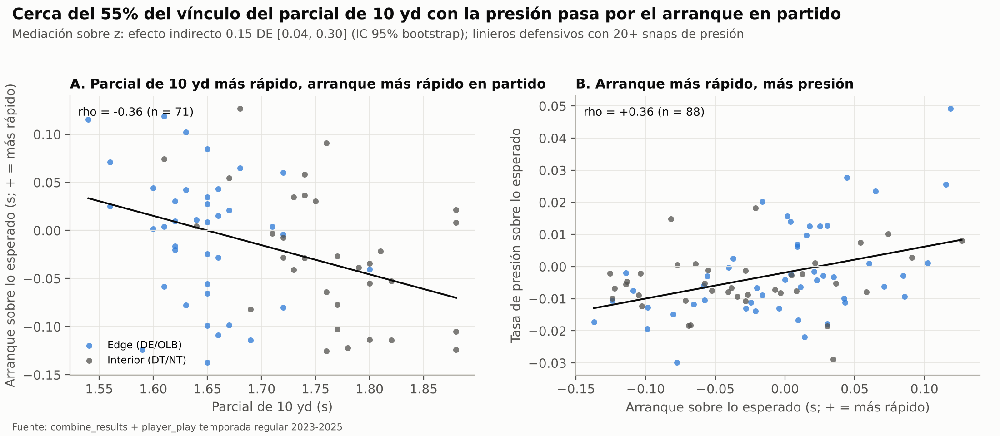

A faster 10-yard split goes with a quicker get-off, and a quicker get-off with more pressure; once get-off is
known, the drill adds nothing directly.

The models compare logistic regression, random forest and XGBoost for starters, and ridge, random forest and
XGBoost against a position baseline for each movement and performance target. All use 5×3 nested
cross-validation with grid search and seed 42, and they are compared with corrected resampled t-tests,
Wilcoxon, Friedman and DeLong. Version 2.0 reproduces every version 1 number exactly, 2.1 validates every
delivery against the provider's data spec and 2.2 adds Combine drill tracking. Version 3.0 adds full-season
tracking for 2023 and 2024, which changes every number built on the SBI; everything else reproduces exactly.
Version 3.1 reorganises the repository into the GitHub structure and moved the documentation to Spanish,
without changing any result. Version 3.2 reads the raw tables as Parquet as well as CSV, receives four of them
as Parquet and brings the whole project back to English; the clean data and every metric are identical.
Everything is logged in MLflow with 17 registered models.

## 1. Problem statement and data inventory

The data include the Combine drill results (and, since v2.2, the tracking of those drills), so the study
measures **drill translation**: how well each Combine drill predicts the way a player moves and performs in
NFL regular-season games, and whether that carries signal about who becomes a starter. Version 2.0 adds a
seventh file, `player_play_3.csv`, which turns "how he moves" into season-long on-field performance: get-off,
pressure, pass protection and separation.

Movement is observed from two sides. Before the draft there are stopwatch and tape-measure results. After the
draft there are 10 Hz tracking frames (position, speed, acceleration, orientation, direction) from plays of the
2023 and 2024 regular seasons and playoffs, and from week 18 and the playoffs of 2025 (the full-season files
were added in v3.0).

| File (in `data/raw/`, Parquet or compressed `.csv.gz`) | Rows | Grain | What it provides |
| --- | --- | --- | --- |
| combine_results (Parquet since v3.2) | 510 | prospect | Measurables, drill times (40, 10-yd split, vertical, broad jump, 3-cone, short shuttle, bench), NGS scores |
| players (Parquet since v3.2) | 510 | prospect | NFL position, 2023–2025 draft class, round and pick (127 undrafted) |
| player_career_successes (Parquet since v3.2) | 510 | prospect | Career snaps, games active, games started, All-Pro, Pro Bowl |
| games (Parquet since v3.2) | 1,002 | game | Season, week, season type (816 regular, 147 preseason, 39 postseason) |
| game_tracking_2023_5.csv (v3.0) | 1,048,575 | frame (0.1 s) | 2023 season: 333 games (49 preseason), 14,612 player-plays, 154 players; cut at a spreadsheet's row limit |
| game_tracking_2024_1_5.csv (v3.0) | 951,733 | frame (0.1 s) | 2024 weeks 0–17: 305 games (49 preseason), 13,215 player-plays, 314 players |
| game_tracking_2024_2.csv | 96,842 | frame (0.1 s) | 29 games, 1,358 player-plays, 166 players |
| game_tracking_2025_2.csv | 97,147 | frame (0.1 s) | 29 games, 1,348 player-plays, 225 players |
| player_play_3.csv (v2.0) | 314,197 | player-play | Every 2023–2025 game of 497 prospects: alignment, route, NGS get-off, pressure generated and allowed, separation at the throw, coverage assignment |
| combine_tracking_6.csv (v2.2) | 463,189 | frame (0.1 s) | 6,310 attempts by the 510 prospects: 40-yard dash, short shuttle, 3-cone and position drills (53 drill names) |

The 510 prospects join on `nfl_id` across the three player tables with no duplicates. 343 appear in the
regular-season and playoff tracking, 299 with three or more plays: DL 72, OL 72, DB 71, WR 63, TE 21 (v3.0).
497 appear in `player_play`, and 255 meet the on-field play minimums: DL 89, OL 70, WR 73, TE 23. Tracked plays
join `player_play` 99.1% of the time, which gives every tracked play its route, alignment and assignment.

Version 1 had two gaps. The tracking covers 1 to 4 players per play, with no ball or opponents, so separation
and pass-rush outcomes could not be built. And agility drills are sparse: 35% of prospects ran the 3-cone and
39% the shuttle. `player_play` closes the first gap for three position families: DL pass rush, OL pass
protection and WR/TE separation. Defensive backs remain unmeasured, because the file carries their alignment
and assignment but not the outcome of the coverage. The agility gap remains.

## 2. Data cleaning and standardisation

All 510 prospects survive cleaning. No drill value broke a plausibility rule and every tracking frame passed
the sensor checks. The work is in typing, missing-value handling and the business rules that make careers of
different lengths comparable. Everything lives in `src/data_prep.py`.

**Typing and validation.** Each raw table is read against a declared schema (column names, types, primary
key). Loading fails on a missing column, a failed type conversion, a duplicate key, a player with no Combine row
or a game that is not in `games`; an extra column is logged and ignored. `NA` and empty strings are the null
markers. Draft round and pick are nullable integers, and the birth date becomes a date. Since v3.2 the table may
be Parquet, CSV or compressed CSV: the reader detects the format from the file's first bytes and converts
Parquet columns to the CSV encodings before the schema is applied (see "Parquet ingestion" below).

**Missing values.**

| Field | Missing | Treatment |
| --- | --- | --- |
| 40, 10-yd split, broad jump | 17% | NaN kept + `<drill>_missing` flag; position-group median imputed inside each training fold |
| Vertical jump | 14% | Same |
| 3-cone / short shuttle / bench | 65% / 61% / 62% | Same; treated as informative (prospects choose which drills they run) |
| Draft round and pick | 25% (127 undrafted) | Business rule R3 |
| NGS production and final score | 1 row | Imputed inside the fold with the position median |

Imputation never sees validation rows. The `PositionMedianImputer` learns its medians from the outer training
fold only and falls back to the global median when a position has no observed value.

**Business rules** (thresholds in `configs/config.yaml`):

1. R1: drill values outside physical ranges become NaN, e.g. a 40 outside 4.10–6.00 s. 0 values were changed.
2. R2: missing drills are flagged, not dropped. 27 prospects ran no drill at all.
3. R3: undrafted players get pick 260, just after the last observed one (257), plus an `is_undrafted` flag. Draft capital enters the models as log(pick).
4. R4: seasons available = 2025 − draft year + 1, so the 2023 class has 3 seasons (51 games) and the 2025 class one (17).
5. R5: start rate = games started ÷ (17 × seasons available). Starter = rate ≥ 0.5. That gives 103 starters (20.2%).
6. R6: age at draft is measured on 27 April of the draft year (mean 22.95).
7. R7: 21 conferences are reduced to a power-conference flag (85% of prospects).
8. R8 (tracking): plays need a `ball_snap` (or `snap_direct`) event and 2.0 s of frames after it. Speeds above 12.5 yd/s or accelerations above 15 yd/s² would be interpolated; there were none. 210 of 25,038 regular-season and playoff player-plays were dropped (1 with no snap, 209 too short), leaving 24,828. R8b removes preseason games (390,373 frames). R8c (v3.0) drops the last play of a file cut at a spreadsheet's row limit (one play, in the 2023 file).
9. R9 (tracking): a player needs at least 3 valid plays to get a movement profile. 299 players remain (221 before v3.0).

**Rules for `player_play` (v2.0).** The full 64-column header is validated and 25 columns are loaded. Boolean
flags arrive as `TRUE`/`FALSE`/`NA` text and are converted to 1/0/missing. Of 314,197 player-plays, 239,673
remain after these rules (240,412 in v2.0, before R15):

1. R10: regular season only, because the challenge asks about regular-season performance. 64,928 preseason and playoff rows are set aside; they are kept as play context to join with the tracking.
2. R11: plays nullified by penalty are removed (8,857 rows).
3. R12: NGS get-off outside 0.30–2.00 s is treated as a tracking artefact and blanked (21 plays, 0.08% of pass-rush snaps).
4. R13: a player metric needs a minimum of valid plays: 20 DL pass-rush snaps, 50 OL pass-protection snaps, 30 WR/TE routes with a separation reading. Below that, the metric stays missing; it is not imputed.
5. R14: defensive backs get no on-field metric, because the file records their alignment and assignment but not the outcome of the coverage.
6. R15 (v2.1): downs 1–4 only, as the spec defines them. The 739 regular-season rows with down 0 (two-point tries) are removed; none was a DL, OL or WR/TE play with a metric, so no metric changes.

Missing values in `player_play` are structural, not errors. Separation only exists on routes, get-off only for
pass rushers and pressure allowed only on protection snaps. Each metric is computed on the plays where it is
defined, so an on-field value is never imputed.

**Data contract (v2.1).** The provider's data structure document (`docs/Data_structure_CSV_files.docx`) is now
a machine-readable contract (`configs/data_contract.yaml`) that every run checks before loading data. It covers
the spec's nine files: type, nulls, range, allowed codes and pattern per column, plus keys, foreign keys and the
expected row count. A missing required file or column, a duplicate key or a broken foreign key stops the run.
Any other deviation is a warning handled by a business rule. With the ten delivered files the contract runs 435
checks: 0 errors and 32 warnings. Each warning and its handling are listed in
`reports/metrics/data_contract_report.csv`. Since v3.2 the contract's file patterns are format-agnostic, and
Parquet tables are checked after the same harmonisation, so a table gives the same report as Parquet or CSV.

| The spec says | Files delivered | How the pipeline handles it |
| --- | --- | --- |
| `combine_tracking.csv`: 10 Hz tracking of 6,310 Combine attempts | Delivered in v2.2 as combine_tracking_6.csv: 6,310 attempts, 510 prospects | R16 drops the ball rows, which exceed a player's speed, acceleration and distance ranges. The 40 lane lies outside the 0–53.3 yd frame and is kept, because the metrics use displacement and speed |
| `game_tracking_2023/2024/2025.csv`: full seasons, all 510 prospects | Parts: 2023 (333 games; exactly 1,048,575 rows, a spreadsheet's limit), 2024 weeks 0–17 (305 games), 2024 and 2025 week 18 + playoffs (29 games each); 415 prospects | Files are found by pattern and a full season file supersedes its parts. R8b drops 98 preseason games; R8c drops the last play of the 2023 file, which may be incomplete. The rows follow no order, so the cut removes a random set of plays. The SBI keeps 299 players with 3+ plays |
| `player_play.csv`: 316,338 player-plays | 314,197 (−0.68%) | Results use the rows delivered |
| `games`: REG or POST, weeks 1–18 | Also 147 preseason games (weeks 0–3) and playoffs numbered 19–23 | R10: on-field metrics use REG. R8b: tracking keeps REG + POST |
| `down`: 1–4 | 961 rows with down 0 (two-point tries) | R15 removes them |
| `quick_pressure`, `unblocked_pressure`, `recovered_fumble`, `tackle_for_loss`: float 1.0 / null | `TRUE` / `FALSE` text | The boolean reader accepts both encodings |
| `lined_up_position` codes such as DE, DT | EDGE, INTERIOR_LINE | The alignment codes live in the configuration; DE → EDGE and DT/NT → INTERIOR_LINE were added |
| Tracking x 0–120 yd, y 0–53.3 yd | 8,340 of 2,194,297 frames outside (0.4%), players beyond a sideline or end line | Kept. The metrics use displacement and speed, not field position |

**Two refinements suggested by the spec were tested and dropped.** Removing unblocked pressures from DL pressure
lowered its reliability (ICC 0.25 → 0.22). Adding cushion and team coverage to the WR/TE separation expectation
lowered WR reliability (ICC 0.75 → 0.65). Cushion is the defender's reaction to the receiver, so conditioning on
it removes part of the skill being measured.

**Rule for Combine drill tracking (v2.2).** R16: ball rows and rows with no player are dropped, leaving 431,094
player frames. Frames must be 0.1 s apart within an attempt; none fails. Speed and acceleration above the game
caps would be blanked and interpolated; none exceeds them. Attempts shorter than 1.5 s after the start are
dropped (4 of 6,310). The features built from these attempts are described in section 3.

**Compressed raw data (v3.1).** To respect GitHub's 100 MB per-file limit, the original CSVs are stored as
`.csv.gz` (96 MB in total; the largest, `player_play_3.csv.gz`, weighs 41 MB). pandas reads them directly and
the manifest stores the hash of the decompressed content, so the data version stayed `a75ba51ae4b9` and all the
clean data were byte-identical to v3.0.

**Parquet ingestion (v3.2).** The four small tables (`players`, `combine_results`, `player_career_successes`,
`games`) now arrive as Parquet; the six large ones stay as compressed CSV. The pipeline accepts the three
formats for every table:

- the format is detected from the file's first bytes (`PAR1` for Parquet, the gzip header for compressed CSV),
  not from its extension, and a mismatch is logged;
- Parquet columns are harmonised to the CSV encodings before the contract and the schema see them: booleans
  as `TRUE`/`FALSE`, dates and timestamps as ISO 8601 text, categorical columns as their plain values (the
  delivered `players` file stores `birth_date` as a Parquet date, which becomes the same `YYYY-MM-DD` text as in
  the CSV);
- when a table is present in more than one format, Parquet is used, then plain CSV, then its `.gz` copy; the
  others are logged and ignored.

With the four tables in Parquet, the 12 clean data files are byte-identical to the ones v3.1 built from CSV,
and the 435 contract checks give the same results. The manifest records each file's format; because the
Parquet bytes differ from the CSV bytes, the data version moves from `a75ba51ae4b9` to `261a80510390`.

**Scaling.** Numeric features are standardised with `StandardScaler` inside each pipeline, so linear models see
z-scores fitted on training data only. Tree models receive the same matrix; scaling does not change their
splits.

**Encoding.** The Combine position group (DB, DL, OL, TE, WR) is one-hot encoded, ignoring unknown categories.
The NFL position (17 levels) is kept for reporting only, because it is decided after the draft. The derived
features are the Speed Score (weight × 200 ÷ 40⁴), the share of the 40 in the first 10 yards and the momentum
over the first 10 yards (weight ÷ 10-yd split).

## 3. Feature engineering: the Snap Burst Index

The new metric is the **Snap Burst Index (SBI)**: how far a player travels in the first 2.0 seconds after the
snap, compared with others at his position. Two seconds is the in-game analogue of the 10-yard split, which
prospects run in about 1.5–1.9 s. Every metric is anchored to the snap and built from speeds, distances and
changes of angle, so the direction of play does not matter.

| Metric (per play) | Definition | Unit | Combine analogue |
| --- | --- | --- | --- |
| Snap burst (`burst_2s`) | Straight-line distance from the snap spot at t = 2.0 s | yd | 10-yd split |
| Distance at 1 s (`burst_1s`) | Same at t = 1.0 s | yd | 10-yd split |
| Get-off (`get_off_1s`) | Speed 1.0 s after the snap | yd/s | 10-yd split, broad jump |
| Peak acceleration (`peak_accel_2s`) | Highest acceleration in the first 2.0 s | yd/s² | Broad jump, vertical |
| Top speed (`top_speed`) | Highest speed after the snap | yd/s | 40-yard dash |
| Max braking (`max_decel`) | Largest drop in 3-frame smoothed speed while moving at ≥ 1 yd/s | yd/s² | Short shuttle |
| Sharpest cut (`max_cut_deg`) | Largest change in direction of travel over 0.5 s, at ≥ 2 yd/s at both ends | degrees | 3-cone |

**From plays to players.** Each player's metric is the mean of his plays. It is then shrunk towards his
position-group mean with the empirical-Bayes weight w = n ÷ (n + k), where k = within-player variance ÷
between-player variance. A player seen on 3 plays is ranked with less confidence than one seen on 30. The SBI
puts the shrunk 2-second burst on a scouting scale within each position group:

$$
\mathrm{SBI}_i = 50 + 10\,\frac{\hat{b}_i - \bar{b}_{\mathrm{pos}}}{s_{\mathrm{pos}}}, \qquad \hat{b}_i = \bar{b} + w_i\,(b_i - \bar{b}), \quad w_i = \frac{n_i}{n_i + k_{\mathrm{pos}}}
$$

**A rejected first version.** Version 0.3.0 used each player's 80th-percentile play as his "capacity". A
subsampling test on the 38 players with 20+ plays showed that this estimator reads 0.43 yd low at 3 plays, 0.21
at 5 and 0.09 at 10. The mean is unbiased: within ±0.02 yd at every sample size. Starters log more plays, so the
biased version manufactured a link between movement and playing time: it correlated ρ = 0.22 with plays
observed and ρ = 0.23 with start rate. The unbiased SBI gives ρ = 0.00 and ρ = 0.08. With the v3.0 sample (191
players with 20+ plays) the 80th percentile still reads 0.50 yd low at 3 plays, 0.30 at 5 and 0.15 at 10, and
still correlates 0.13 with plays observed and 0.12 with start rate, against 0.03 and 0.07 for the SBI. Any
tracking metric built from a player's best plays needs this check.

**Reliability check.** Before relating a game metric to the Combine, the study asks whether the metric is a
stable player trait. It does so with an intraclass correlation (ICC: the share of the variance between player
averages that is real difference) and a one-way ANOVA by position. The answer depends on the position, and
full-season tracking (v3.0: a median of 39 plays per player, against 8 before) changes it for receivers. Snap
burst is a stable trait on the defensive line (ICC 0.63) and at wide receiver (0.62), moderate on the offensive
line (0.40), weak for defensive backs (0.26) and absent for tight ends (0.08, 21 players). Distance at 1 s is the
most portable metric (DL 0.66, WR 0.68, OL 0.60, DB 0.49). With 8 plays per player, version 2.2 had found
receiver burst unstable (ICC −0.34): the noise of few plays, not the receivers, decided that verdict. The
reliability figure in section 5 shows the full grid.

**Translation gap.** For each player, the in-game SBI minus the SBI his Combine profile predicts (out-of-fold,
with the champion regressor). Positive means he plays faster off the snap than he tested; negative, the
reverse.

### On-field performance over expected (v2.0)

`player_play` adds five season-long performance metrics, each measured against what an average prospect does in
the same context. That way a player gets no credit for his role or his route tree. Positive is always better.

| Family | Plays used | Metric | Expected = average in the same |
| --- | --- | --- | --- |
| DL (89 players) | 26,980 pass snaps on which the lineman rushed | Get-off over expected (GOE): expected − actual NGS get-off, in seconds | Alignment (EDGE / INTERIOR_LINE) |
| DL | same | Pressure rate over expected (PROE): pressure (0/1) − expected | Alignment |
| OL (70) | 46,492 pass-protection snaps | Pressure probability over expected (PPOE): expected − peak pressure probability allowed | Alignment (T / G / C) × dropback-duration quintile |
| OL | same | Pressures allowed over expected (PAOE): expected − pressure allowed (0/1) | same |
| WR/TE (96) | 37,816 routes with a separation reading | Separation over expected (SOE): separation at the throw − expected, in yards | Route × alignment (route only if a cell has < 30 plays) |

Per-player values use the same machinery as the SBI: mean of the valid plays, shrunk by empirical Bayes towards
the position mean and then z-scored within the family. One index per family enters the starter classifier: PROE
for the DL, PPOE for the OL and SOE for WR/TE.

$$
\mathrm{GOE}_{ij} = \overline{\text{get-off}}_{\,\text{alignment}(j)} - \text{get-off}_{ij}, \qquad \widehat{\mathrm{GOE}}_i = \bar{g} + w_i\,(\overline{\mathrm{GOE}}_i - \bar{g})
$$

**They are stable traits.** Season-long volume makes the difference: a median of 165–558 plays per player,
against 39 tracked plays (8 before v3.0).

| Metric | ICC | Mean reliability weight | Rookie → later seasons (ρ, players) |
| --- | --- | --- | --- |
| DL get-off over expected | 0.89 | 0.90 | 0.61 (41) |
| OL pressure probability over expected | 0.74 | 0.78 | 0.16 (31, n.s.) |
| WR separation over expected | 0.75 | 0.79 | 0.37 (52, WR+TE) |
| OL pressures allowed over expected | 0.59 | 0.67 | 0.20 (31, n.s.) |
| DL pressure rate over expected | 0.25 | 0.39 | 0.50 (41) |
| TE separation over expected | 0.21 | 0.27 | (together with WR) |

The rookie season predicts what follows for get-off, pressure and separation, but not for pass protection.

**The tracking SBI is validated against season get-off.** Among 69 defensive linemen with both, the SBI (built
from a median of 33 tracked plays) correlates ρ = 0.45 with get-off over expected (p < 0.001) and 0.28 with
pressure over expected (p = 0.02). Distance at 1 second correlates 0.54 with GOE.

**Context separates trait from role.** Joining each tracked play with its route (WR/TE), coverage assignment
(DB) or alignment (OL/DL), and measuring snap burst again net of that context, receivers stay at ICC 0.62: their
burst is a player trait, not a product of the route. The defensive line drops from 0.63 to 0.14: most of its
stability is role, because edge and interior linemen line up and move differently. Defensive backs stay low
(0.26 → 0.25) and the offensive line drops from 0.40 to 0.34.

### Combine drill-tracking features (v2.2)

Only the parts of a tracked drill that repeat within a player become features. A tracked 40 starts at a variable
moment (first-frame speed 0.2–3.2 yd/s), so anything timed from the first frame barely repeats between a
player's two attempts: the 0–5 yd split repeats at r = 0.16 and the 10-yd split from the start at 0.23. Splits
between distance marks do not depend on the start and repeat well: 5–10 yd 0.87, 10–20 yd 0.98, top speed 0.99.

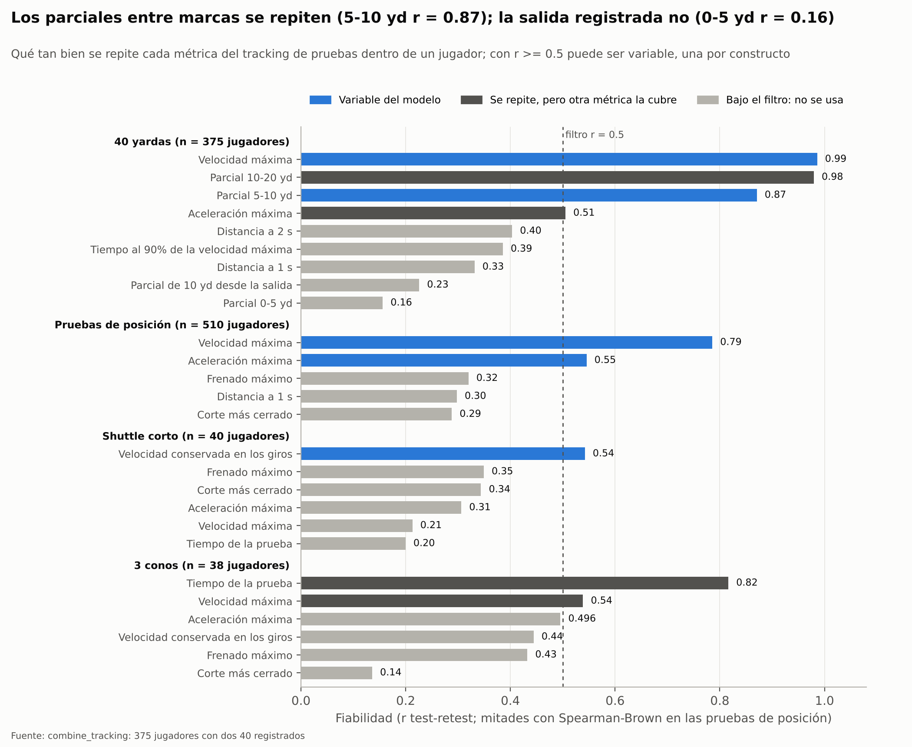

The rule is the same as for the game metrics (reliability before use): a metric may become a feature only if it
repeats at r ≥ 0.5, and each construct gets one feature, its most reliable metric. Shuttle and 3-cone repeats
rest on about 40 players who ran twice, so those estimates are approximate.

| Construct | Feature (best attempt; position drills: player mean) | Reliability | Within-position ρ with the official result |
| --- | --- | --- | --- |
| Sprint acceleration | 40: 5–10 yd split | 0.87 | 0.55 with the 10-yd split |
| Sprint speed | 40: top speed | 0.99 | −0.90 with the 40 |
| Change of direction | Shuttle: speed kept in the turns | 0.54 | −0.14 with the shuttle time |
| Position-drill speed | Top speed z-scored within each drill as a position group runs it | 0.79 | −0.46 with the 40 |
| Position-drill acceleration | Peak acceleration, same scale | 0.55 | −0.34 with the 10-yd split |

Metrics that repeat but duplicate a kept one stay out: the 10–20 yd split (same construct as top speed), the
40's peak acceleration and the 3-cone's time and top speed (the official 3-cone and the 40 already measure
them).

## 4. Versioning and MLOps strategy

Every reported number traces back to three identifiers stamped on its MLflow run: the pipeline version, the
data version and the git commit.

**Code versioning.** Git with semantic-version tags, and this `CHANGELOG.md` in the Keep a Changelog format. A
MAJOR version means a metric or target definition changed, so results are not comparable across them. A MINOR
adds an analysis, a model or a capability. A PATCH changes no number in `reports/metrics/`. Versions
0.1.0–0.3.0 were development steps before the first commit and are recorded to keep the reasoning.

| Version | Change | Why it mattered |
| --- | --- | --- |
| 3.2.0 | Raw tables read as Parquet, CSV or compressed CSV (format detected from the content, Parquet harmonised to the CSV encodings); four tables delivered as Parquet; whole project in English, folders included (`data/raw`, `data/clean`, `src/`, `configs/`, `tests/`, `reports/`, `docs/`) | Providers can deliver Parquet with no code change; the clean data and every metric are identical to v3.1 |
| 3.1.0 | Repository reorganised into the GitHub structure (`datos/datos_ini`, `datos/datos_limp`, `fuentes/entrena.ipynb`, `fuentes/datos_prep.py`, `fuentes/train.py`), documentation in Spanish, Colab notebook, compressed raw data | The project is published and reproduced from GitHub or Colab; no result changes |
| 3.0.0 | Full-season tracking for 2023 and 2024; rule R8c for a file cut at a spreadsheet's row limit; receivers as a third SBI population; figure titles computed from the data (major change: new data version and SBI sample) | Tracked plays go from 2,677 to 24,828: receiver burst becomes a stable trait and the DL model becomes significant |
| 2.2.0 | Combine drill tracking arrives (combine_tracking_6.csv): reliability-gated features, translation, models with and without on the same folds, six challengers | Answers whether drill movement adds to drill results: it reproduces them and adds no predictive power |
| 2.1.0 | Data contract from the provider's spec, checked on every run; rules R8b and R15 | Every delivery is validated before it reaches a model; no number changed |
| 2.0.0 | player_play added: on-field metrics over expected, Combine → on-field regressions, pre-draft stacked projector, starter model with on-field data | Gives the translation question a reliable season-long target |
| 1.0.1 | Portable MLflow store (relocate) | Registered models load from any folder |
| 1.0.0 | Release run from a clean MLflow store; documentation, CI, model card | The reported numbers come from that run |
| 0.9.0 | Metric reliability (ICC), defensive-line analysis, regression target → SBI | The position baseline gave R² 0.94 with the target in yards and hid the within-position question |
| 0.5.0 | Nested CV, three model families per task, statistical tests, MLflow registry | — |
| 0.4.0 | SBI = shrunk mean instead of 80th-percentile capacity (major change) | Removed a spurious SBI–starting correlation (0.23 → 0.08) |
| 0.3.0 | Snap-anchored movement metrics, first SBI | — |
| 0.2.0 | Cleaning and business rules R1–R9 | — |
| 0.1.0 | Schema-validated readers, data manifest | — |

**Release runs.** Every major or minor version was trained from a clean MLflow store. Version 3.2 was retrained
in full from scratch on the Parquet inputs: {{RUNS}} runs tagged `git_commit = {{COMMIT}}`,
`pipeline_version = 3.2.0` and `data_version = 261a80510390`, with 17 registered models. {{RELEASE_CHECK}} The
earlier versions are documented in part II.

**Data versioning.** `data/raw/manifest.json` records each file's SHA-256 (of the decompressed content for a
`.csv.gz`), size, rows and format, plus a combined `data_version` (`261a80510390` for v3.2 with four Parquet
tables; `a75ba51ae4b9` for v3.0–v3.1 with ten CSV files; `d63395440694` for v2.2 with eight; `dfc567c4ffe3` for
v2.0 with seven; `263d3909c68b` for v1 with six). CI recomputes the hashes (`make verify`) and fails on any
difference. The data contract (`configs/data_contract.yaml`) is versioned with the code, so a change in the
provider's spec lands in this log like any other change. It is the same contract DVC gives, without the extra
dependency.

**Experiment tracking.** MLflow with a SQLite store (`mlflow/mlflow.db`) and local artifacts
(`mlflow/mlartifacts/`). Every nested-CV run logs:

- parameters: model, feature set, population, search grid
- tags: pipeline version, data version, git commit, seed, Python version
- metrics: every outer-fold score as a step series, plus the mean and the standard deviation
- artifacts: per-fold score table, out-of-fold predictions, hyperparameters chosen in each fold

**Model registry.** Champion models are refitted on all rows and registered with an inferred signature and an
input example, together with the project code (`data_prep.py` and `train.py`), so they load on any machine. Each
carries an alias:

- `cgmt-starter-classifier@champion`: usable before the draft (Combine + draft capital)
- `cgmt-starter-classifier-movement@challenger`: adds tracking movement; diagnostic only
- `cgmt-starter-classifier-onfield@challenger` (v2.0): adds on-field performance; diagnostic only
- `cgmt-snap-burst-regressor@champion`: SBI, all positions
- `cgmt-snap-burst-regressor-dl@champion`: SBI, defensive line
- `cgmt-snap-burst-regressor-wr@champion` (v3.0): SBI, wide receivers
- `cgmt-onfield-dl-getoff@champion`, `cgmt-onfield-dl-pressure@champion`, `cgmt-onfield-ol-protection@champion`, `cgmt-onfield-wrte-separation@champion` (v2.0): Combine → on-field performance
- `<regressor>-ct@challenger` for the six game tasks and `cgmt-starter-classifier-combine-tracking@challenger` (v2.2–v3.0): with drill tracking, to reload and rescore the with/without comparison

Every version carries the tag `validation_status = nested-cv-passed`. Registry names have stayed the same
across versions.

**Reproducibility.**

- One configuration file (`configs/config.yaml`) holds paths, business rules, the CV scheme and the grids.
- Seed 42 is set for Python, NumPy and `PYTHONHASHSEED`, and passed as `random_state` to every splitter and model. A unit test checks that two fits give identical predictions.
- Dependencies are pinned in `requirements.txt`.
- A smoke configuration (`configs/smoke.yaml`) runs the same code with minimal grids in about 10 minutes; CI uses it.
- 40 pytest tests (`tests/`) cover the cleaning rules, the movement metrics (with synthetic plays of known answer), the statistics, the data contract, reading compressed and Parquet files (format detection, harmonisation, format priority, identical typed tables and contract reports), schema validation and determinism.
- The notebook `src/training.ipynb` runs everything in Google Colab.

## 5. Visualisations: patterns and anomalies

Three patterns drive the design: agility drills are almost always missing, game movement is a stable trait only
where enough plays are seen (since v3.0, the defensive line and receivers) and outlier plays are real football,
not sensor errors. The model-result charts sit next to the metrics in sections 8 and 10.

### Combine coverage and structure


Only 44% of prospects ran the shuttle or the 3-cone, against 79–91% for the 40. Defensive backs ran the 3-cone
least (20%) and offensive linemen most (50%). 27 prospects ran no drill at all, and they range from the first
round to undrafted. Missing is a choice, not noise, which is why every drill keeps a missing flag.

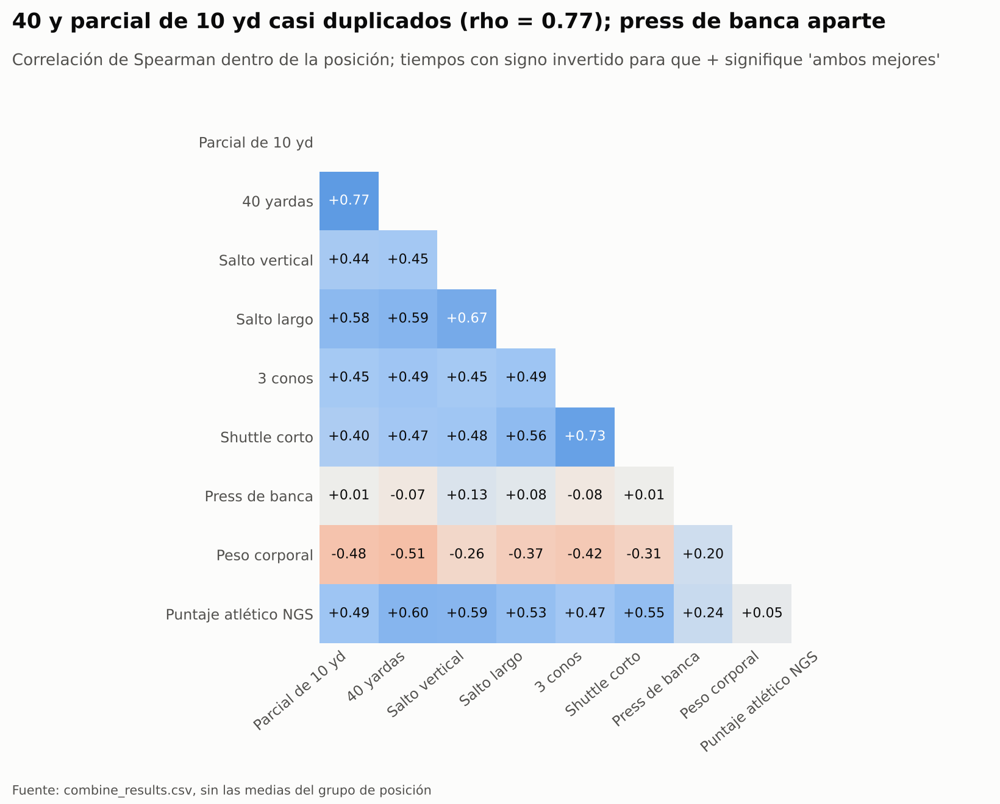

Within position, the 40 and the 10-yd split almost duplicate each other (ρ = 0.77) and the two jumps go together
(0.67). The bench press relates to nothing. For a scout, one sprint and one jump capture almost everything the
testing day measures.

### Game movement and its anomalies

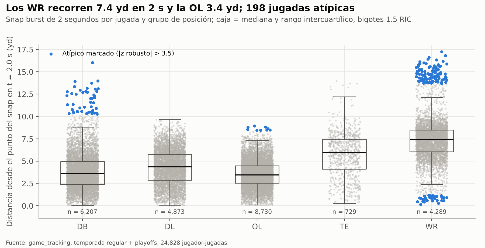

The median 2-second distance goes from 3.4 yd (OL) and 3.6 yd (DB), through 4.3 yd (DL) and 6.0 yd (TE), up to
7.4 yd (WR), over 24,828 plays. The search flags plays more than 3.5 robust deviations from their position's
median: 513 across four metrics, 198 of them on snap burst. 142 of those 198 are receiver plays and 47 defensive
back plays; 163 are long releases and 35 plays with almost no movement. No frame broke the speed or acceleration
caps, so they are kept as real plays.

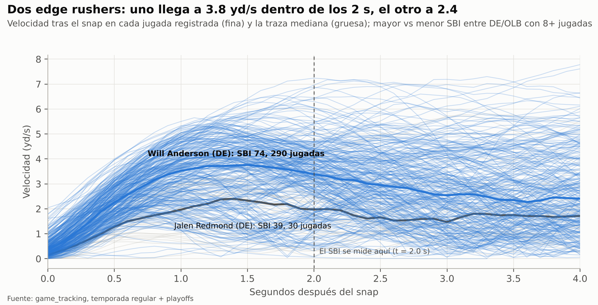

The Snap Burst Index separates players with the same job. Among edge rushers with 8+ plays, Will Anderson's
median trace (SBI 74, 290 plays) reaches 3.8 yd/s inside 2 s; Jalen Redmond's (SBI 39, 30 plays), 2.4 yd/s.
With more plays per player the medians are steadier, so the extremes sit closer than with week 18 alone (4.6 vs
1.8 yd/s in v2.2).

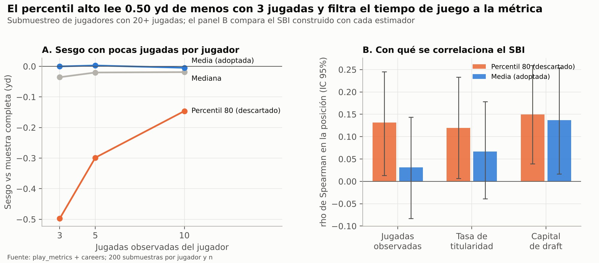

A high-percentile estimator reads 0.50 yd low at 3 plays (191 players with 20+ plays). That bias alone creates a
correlation of 0.13 with plays observed and 0.12 with start rate. The adopted mean gives 0.03 and 0.07.

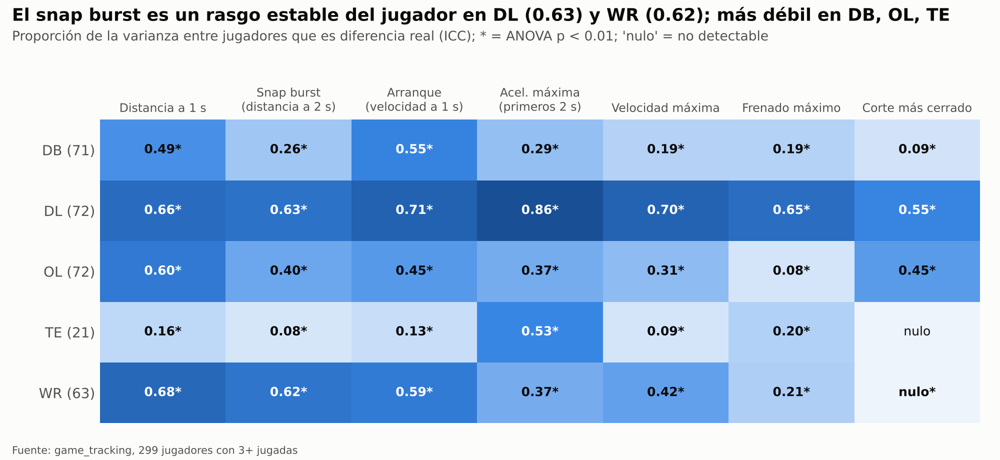

This is the figure that sets the focus. On the defensive line every metric is a stable player trait (ICC
0.55–0.86). Receivers now show stable burst, get-off and distance at 1 s (0.59–0.68), but not braking or cuts
(≤ 0.21). Tight ends, with 21 players, show almost none.

### Drill translation to the game

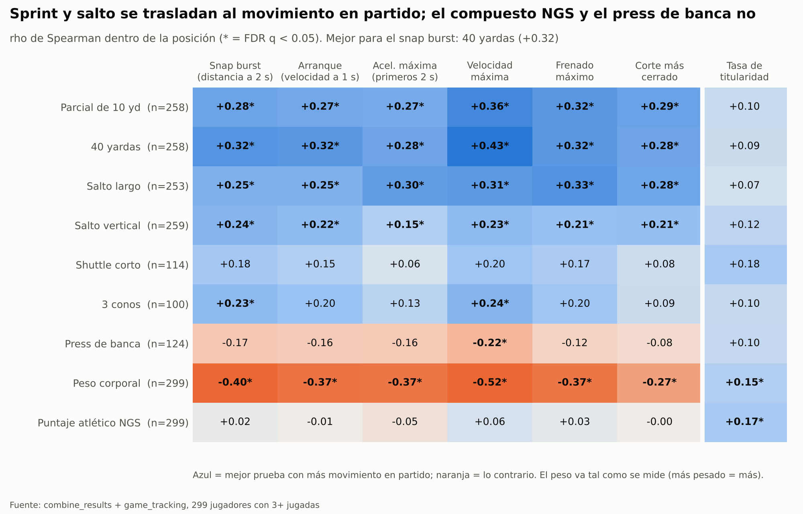

With 299 tracked players (258 with a 40 time) the links sharpen. The 40, the 10-yd split, the broad jump and the
vertical correlate 0.15–0.43 with every game metric (FDR q < 0.05); the 40 with top speed is the strongest pair
(0.43). The NGS athleticism score (−0.05 to 0.06) does not, and the bench press is only significant against top
speed (−0.22). Within a position, heavier players move less, with ρ between −0.27 and −0.52. Start rate relates
to no sprint or jump drill, only to body weight (0.15) and the NGS score (0.17).

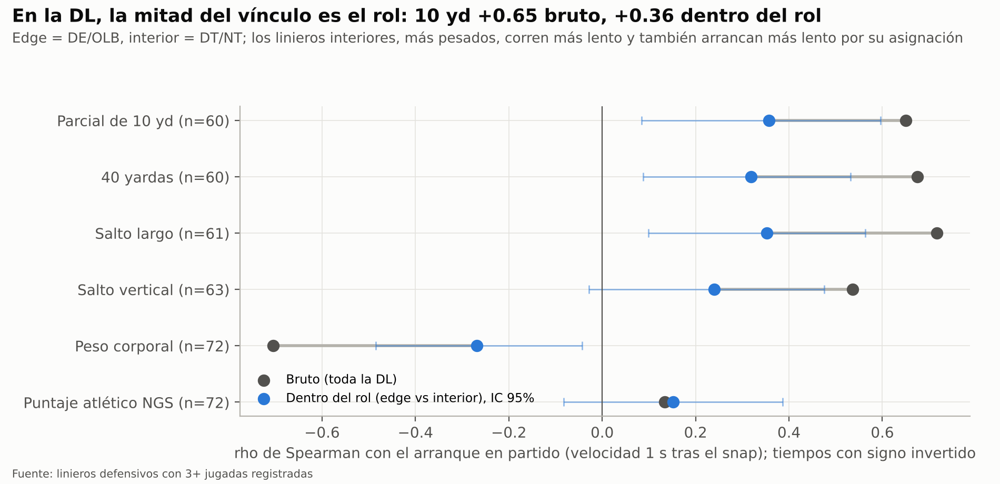

On the defensive line the raw links look strong: 10-yd split vs get-off ρ = 0.65. About half of it is role.
Interior tackles are heavier, run slower and are asked to get off differently. Within the edge or interior
groups the link is 0.36 (95% CI 0.09–0.60, q = 0.07 after FDR).

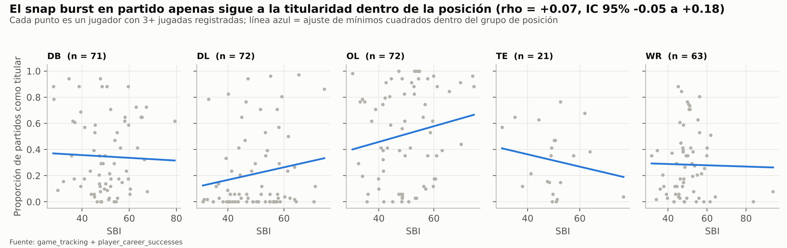

Across the 299 tracked players, in-game snap burst barely tracks starting within position: ρ = 0.07, 95% CI
−0.05 to 0.18. The offensive- and defensive-line panels slope up, the tight-end panel (21 players) slopes down
and the rest are flat.

### On-field performance (v2.0)

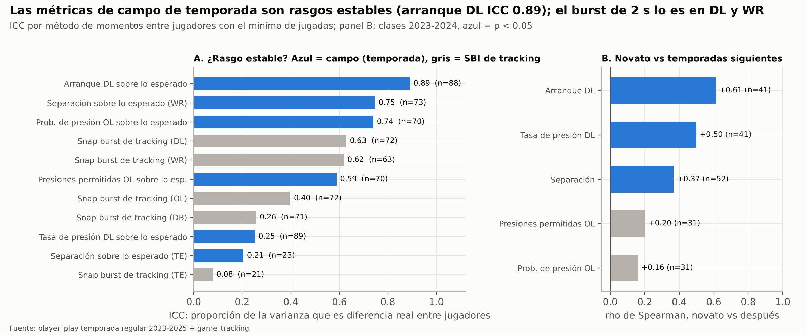

Season-long on-field metrics are far more reliable than the 2-second tracking burst. DL get-off over expected
reaches ICC 0.89, and WR separation and OL pressure probability sit near 0.75. The weak spots are TE separation
(23 players, 0.21) and DL pressure rate (0.25), which is a rare 0/1 event. The rookie season predicts the
following ones for get-off (ρ = 0.61), pressure (0.50) and separation (0.37), but not for pass protection
(0.16, not significant).

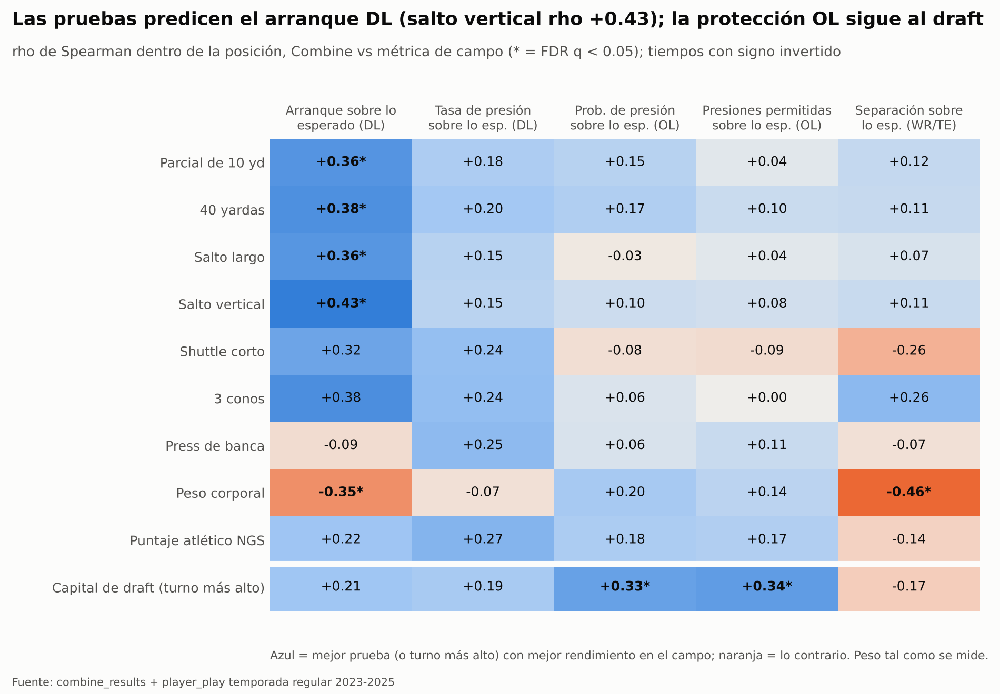

The drills carry over in one place only: DL get-off. The vertical (ρ = 0.43), the 40 (0.38), the 10-yd split
(0.36) and the broad jump (0.36) pass FDR q < 0.05, and heavier linemen get off slower (−0.35). Within the edge
or interior role the links hold at 0.37–0.40, so, unlike the version 1 tracking result, it is not a role
artefact. No drill passes FDR for DL pressure, OL protection or WR/TE separation. OL protection tracks draft
capital (ρ = 0.33–0.34, q < 0.05). Separation tracks weight within position (−0.46): lighter receivers and tight
ends separate more.


The chain from drills to production runs through get-off. A faster 10-yd split goes with a quicker get-off (0.37
SD per SD), and a quicker get-off with more pressure (0.41 SD, with the drill fixed). The indirect path carries
0.15 SD, 95% CI 0.04–0.30, about 55% of the drill's total link with pressure. The share is 52% for the 40, 44%
for the broad jump and 77% for the vertical. Weight's small negative link with pressure runs entirely through a
slower get-off.

### Drill tracking vs the game (v2.2)

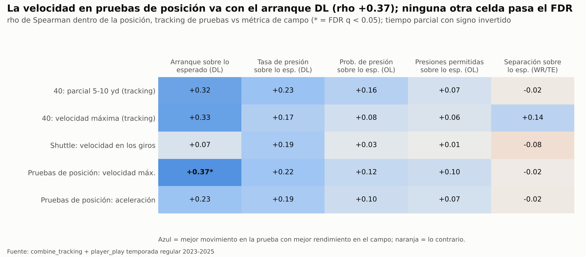

Position-drill top speed is the only drill-tracking feature linked to season-long DL get-off after FDR
correction (ρ +0.37, q = 0.009, 88 linemen). Within the defensive line it closely follows the 40 (ρ −0.76). Once
weight, role and the official 40 are fixed, the partial ρ falls to +0.13 (p = 0.31). Against game movement, 24
of 35 drill-tracking cells pass FDR with ρ 0.14–0.44 (16 in v2.2), the same size as the official drills; none
passes against start rate.

## 6. Models trained

Three supervised tasks answer the translation question: Combine → tracking movement (A), who becomes a starter
(B) and Combine → season-long on-field performance (C, added in version 2.0). Each compares a linear model with
two tree ensembles under the same preprocessing and the same CV folds.

**Task A — Regression: Combine → game movement.** Target: Snap Burst Index. Features: the athletic profile
only, with no draft or production information.

- Measurables: height, weight, hand, arm, wingspan.
- Seven drills, each with its missing flag, plus the number of drills run.
- Derived: Speed Score, share of the 40 in the first 10 yd, 10-yd momentum.
- NGS athleticism score, age at draft, position group.

Three populations (receivers were added in v3.0):

- All positions (n = 299): do the drills predict game burst anywhere?
- Defensive line only (n = 72): where burst is a measurable trait (ICC 0.63).
- Wide receivers only (n = 63): burst became a stable trait (ICC 0.62) once full seasons were tracked, and stays one without the route context.

| Model | Role | Why it is in the comparison |
| --- | --- | --- |
| Position mean | Baseline | Predicts each position group's average; anything useful must beat it |
| Ridge regression | Linear (least squares with an L2 penalty) | Interpretable and stable with ~30 correlated features and n ≤ 299 |
| Random forest | Bagged trees | Captures thresholds and interactions (drill effects that change with size) |
| XGBoost | Gradient-boosted trees | Strong on small tabular data with shallow trees and regularisation |

**Task B — Classification: who becomes a starter.** Target: started 50%+ of the available regular-season games
(103 of 510, 20.2%). The feature sets are nested, so each step answers a single question:

1. Combine: the athletic profile plus the NGS production score and the power-conference flag. It is what a scout has before the draft.
2. Combine + draft: adds the log of the draft pick and an undrafted flag. It is what the league decided.
3. Combine + draft + game movement: adds SBI, get-off, peak acceleration, top speed, braking and cut, normalised by position. It is measured after the draft, so it is diagnostic only.

Sets 1 and 2 run on the 510 prospects. Sets 2 and 3 run on the 299 tracked players (93 starters), so the
movement comparison uses the same players and folds.

| Model | Role | Class imbalance |
| --- | --- | --- |
| Logistic regression | Linear; L1 or L2 penalty chosen by the grid | `class_weight = balanced` |
| Random forest | Bagged trees | `class_weight = balanced` |
| XGBoost | Gradient-boosted trees | `scale_pos_weight` = negatives ÷ positives in the training fold |

**Task C (v2.0) — Regression: Combine → on-field performance.** Same features as task A (athletic profile only),
same four models, same nested CV. One task per family with a measurable outcome:

| Task | Players | Target (shrunk, over expected) | CV strata |
| --- | --- | --- | --- |
| dl_getoff | 88 DL | Get-off over expected (s) | Edge / interior role |
| dl_pressure | 89 DL | Pressure rate over expected | Edge / interior role |
| ol_protection | 70 OL | Pressure probability over expected | T / G / C |
| wrte_separation | 96 WR + TE | Separation over expected (yd) | WR / TE |

Role and NFL position only balance the CV folds; they never enter the model, because they are decided after the
draft.

**Additions to task B (v2.0).** Two sets join the starter comparison:

- **Combine + draft + projected on-field** (all 510 prospects, usable before the draft). A stacked `OnFieldProjector` lives inside the pipeline. In each training fold it learns Combine → GOE, PROE, PPOE and SOE with a ridge regression (α = 10) on the players who have that metric, and passes the classifier the projection instead of the observed value. Training rows receive 5-fold out-of-fold projections, so the classifier sees the same kind of noisy projection it will see for a new prospect. The observed on-field values are labels only: a unit test checks that blanking them changes no prediction.
- **Combine + draft + on-field performance** (255 players with an on-field index, diagnostic). The four within-family z-scores are added directly; a metric outside the player's family is 0, the family average. They are measured after the draft, so this model is registered as a challenger, like the movement one.

The pre-draft champion switches to the projector set only if it beats Combine + draft on mean AUC and its DeLong
test gives p < 0.05.

**Drill-tracking variants (v2.2).** Each game task (the snap-burst populations of the defensive line and, since
v3.0, of the receivers, and the four on-field tasks) runs twice on the same players and folds: once with the
athletic features and once with those plus the five drill-tracking features. Task B adds the pre-draft set
Combine + draft + drill tracking. The pipelines with drill tracking are registered as challengers (suffix `-ct`
and `cgmt-starter-classifier-combine-tracking`). The starter champion would switch only if that set won on mean
AUC with DeLong p < 0.05, the same rule the projector followed.

**Common pipeline.** Every model is a single scikit-learn `Pipeline`: `PositionMedianImputer` →
`ColumnTransformer` (`StandardScaler` on numerics, `OneHotEncoder` on the position group) → estimator, with the
`OnFieldProjector` between imputation and encoding when the projected set is used. Because imputation,
projection and scaling live inside the pipeline, CV refits them in every training fold.

**Evaluation design.** Nested cross-validation:

- Outer loop: `RepeatedStratifiedKFold`, 5 folds × 3 repeats = 15 test folds, which estimate performance. Classification stratifies on the target; regression on position group (all positions), edge/interior role (defensive line) or NFL position (receivers).
- Inner loop: `GridSearchCV` with 3-fold CV chooses the hyperparameters using the outer training part only.
- Selection: ROC-AUC for classification, RMSE for regression.

Each task's champion is re-tuned with 5-fold CV on all rows, refitted and registered in MLflow.

## 7. Hyperparameter configuration

The inner search almost always chose the most conservative configuration. That fits a small, noisy problem:
the models needed more regularisation than flexibility.

**Search design.** `GridSearchCV` runs inside each of the 15 outer training folds, with 3-fold inner CV.
Selection uses ROC-AUC for classification and RMSE for regression. The grids live in `configs/config.yaml`;
XGBoost also fixes subsample 0.8, colsample 0.8 and λ = 1. Seed 42 throughout.

| Model | Grid searched | Most chosen (outer folds) |
| --- | --- | --- |
| Ridge | α ∈ {1, 10, 100, 300, 1000} | All positions: α = 1000 (10/15). DL: α = 100 (13/15). WR: α = 100 (11/15) |
| Logistic regression | C ∈ {0.01, 0.1, 1, 10}; L1 or L2 | L1 in 56 of 60 per-fold fits. C = 0.1 in three scenarios; C = 0.01 for Combine + draft on all prospects (12/15) |
| Random forest (both tasks) | 200 trees; depth ∈ {3, 6, unlimited}; min leaf ∈ {3, 10}; feature fraction ∈ {0.33, 0.66} | Depth 3 in 59 of 105 fits (4 starter scenarios and 3 SBI populations), leaf 10 in 51 of 105; the feature fraction is split (0.66 in 53) |
| XGBoost (both tasks) | trees ∈ {200, 400}; depth ∈ {2, 3}; learning rate ∈ {0.03, 0.1}; min child weight ∈ {3, 8} | 200 trees, rate 0.03 and depth 2 in 73 of 105 fits; rate 0.03 in 99 of 105. The WR regression splits depth 2 and 3 (8/7) |

Two choices read as findings:

- **The all-positions ridge sits at the largest penalty in the grid.** It is the model saying the drills carry almost no linear signal for the all-positions SBI beyond position: shrinking the coefficients towards zero beats using them.
- **Logistic regression picks L1 almost always.** It keeps a sparse set of features; with draft capital present, the draft pick carries the model.

**Version 2.0 configuration.** The on-field regressions reuse the same grids, and the searches are again
conservative:

- Ridge chose α = 300 for both DL targets, 1,000 for OL protection and 100 for WR/TE separation.
- The random forests chose depth 3 in most outer folds of every on-field task (the final refit for DL pressure chose depth 6).
- XGBoost kept 200 trees with learning rate 0.03.

The `OnFieldProjector` uses a fixed configuration: ridge α = 10 with 5 inner folds for the out-of-fold
projections. It is not tuned, because doing so would add a third level of nesting to buy a feature that showed
no signal (section 8).

**Registered champions** (re-tuned with 5-fold CV on all rows and refitted):

| Registry name @ alias | Model | Final hyperparameters | Inner CV score |
| --- | --- | --- | --- |
| cgmt-starter-classifier @ champion | XGBoost, Combine + draft, 510 prospects | 200 trees, depth 2, rate 0.03, min child weight 3 | AUC 0.914 |
| cgmt-starter-classifier-movement @ challenger | XGBoost, + game movement, 299 players | 200 trees, depth 2, rate 0.1, min child weight 3 | AUC 0.892 |
| cgmt-snap-burst-regressor @ champion | Random forest, all positions (299) | 200 trees, depth 6, feature fraction 0.33, min leaf 3 | RMSE 9.74 |
| cgmt-snap-burst-regressor-dl @ champion | Random forest, defensive line (72) | 200 trees, depth 3, feature fraction 0.66, min leaf 10 | RMSE 8.20 |
| cgmt-snap-burst-regressor-wr @ champion (v3.0) | Ridge, wide receivers (63) | α = 300 | RMSE 8.35 |
| cgmt-onfield-dl-getoff @ champion | Random forest, 88 DL | 200 trees, depth 3, feature fraction 0.66, min leaf 3 | RMSE 0.060 s |
| cgmt-onfield-dl-pressure @ champion | Random forest, 89 DL | 200 trees, depth 6, feature fraction 0.33, min leaf 3 | RMSE 0.0115 (no better than the baseline) |
| cgmt-onfield-ol-protection @ champion | Random forest, 70 OL | 200 trees, depth 3, feature fraction 0.33, min leaf 10 | RMSE 0.0178 (no better than the baseline) |
| cgmt-onfield-wrte-separation @ champion | Ridge, 96 WR/TE | α = 100 | RMSE 0.178 yd |
| cgmt-starter-classifier-onfield @ challenger | Random forest, + on-field performance, 255 players | 200 trees, depth 3, feature fraction 0.33, min leaf 10 | AUC 0.876 |

The drill-tracking challengers use the same grids; their chosen hyperparameters are in
`regression_final_models.json` and `classification_final_models.json`. The drill-tracking starter challenger
picks the same XGBoost configuration as the champion. With full-season tracking, the all-positions champion
moves from ridge to random forest, and the DL one from XGBoost to random forest.

## 8. Metrics obtained

Combine results predict snap burst best on the defensive line: RMSE 7.85 against 9.99 for the baseline, 21%
less (v2.2: 8.54 against 10.05, 15%). Receivers, new in v3.0, gain 10%, and all positions together, 5%. For
starters, draft capital lifts ROC-AUC from 0.84 to 0.91 and game movement adds nothing.

Version 2.0 adds two predictable on-field targets, DL get-off (pooled R² 0.13) and WR/TE separation (0.19), and
two the drills do not predict, DL pressure and OL protection. Observed on-field performance adds +0.004 to
+0.009 AUC to the starter model; performance projected from the Combine adds nothing.

Every number is out-of-sample: mean ± SD over the 15 outer folds of the nested CV. "Pooled R²" averages each
player's out-of-fold predictions over the 3 repeats and scores them once, with a 2,000-resample bootstrap 95%
CI. It is the most stable number for the 72 defensive linemen and 63 receivers, where each test fold has 12–15
players.

### Regression: Combine → Snap Burst Index (SBI points)

| Population | Model | MAE | RMSE | R² (fold mean) | Pooled R² [95% CI] |
| --- | --- | --- | --- | --- | --- |
| All positions (n = 299) | Position mean (baseline) | 7.78 ± 0.84 | 10.06 ± 1.02 | −0.05 ± 0.04 | −0.04 [−0.06, −0.03] |
| All positions | Ridge | 7.59 ± 0.81 | 9.83 ± 1.04 | −0.00 ± 0.03 | 0.02 [−0.02, 0.05] |
| All positions | Random forest (champion) | 7.39 ± 0.87 | 9.57 ± 1.03 | 0.05 ± 0.07 | 0.07 [0.00, 0.12] |
| All positions | XGBoost | 7.52 ± 0.81 | 9.70 ± 1.06 | 0.02 ± 0.09 | 0.05 [−0.03, 0.13] |
| Defensive line (n = 72) | Position mean (baseline) | 8.43 ± 0.98 | 9.99 ± 1.20 | −0.07 ± 0.09 | −0.02 [−0.10, −0.01] |
| Defensive line | Ridge | 6.50 ± 1.19 | 8.08 ± 1.27 | 0.29 ± 0.17 | 0.34 [0.16, 0.47] |
| Defensive line | Random forest (champion) | 6.53 ± 1.16 | 7.85 ± 1.27 | 0.33 ± 0.17 | 0.37 [0.17, 0.50] |
| Defensive line | XGBoost | 6.68 ± 1.29 | 8.01 ± 1.55 | 0.30 ± 0.24 | 0.37 [0.11, 0.53] |
| Wide receivers (n = 63, v3.0) | Position mean (baseline) | 6.86 ± 2.34 | 9.38 ± 4.02 | −0.16 ± 0.20 | −0.03 [−0.13, −0.02] |
| Wide receivers | Ridge (champion) | 6.39 ± 1.90 | 8.45 ± 2.97 | −0.08 ± 0.56 | 0.22 [−0.01, 0.31] |
| Wide receivers | Random forest | 6.24 ± 1.98 | 8.65 ± 3.16 | −0.11 ± 0.53 | 0.17 [−0.05, 0.27] |
| Wide receivers | XGBoost | 7.28 ± 2.06 | 9.57 ± 2.69 | −0.47 ± 0.77 | 0.06 [−0.43, 0.21] |

The baseline's R² is negative, not zero, because the position means learned on the training folds do not match
the test fold's mean. Each model is read against the baseline row, not against zero. The receivers' per-fold R²
swings widely (ridge −0.08 ± 0.56). Two receivers sit far above the rest, Derius Davis (SBI 94) and Jacob Cowing
(84), and the test folds that contain them concentrate most of the error; the folds without them have so little
spread that small errors turn R² negative. The pooled R² is the most stable reading.

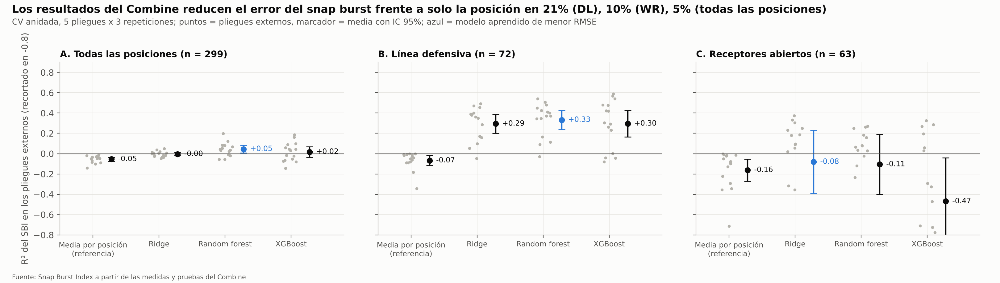

### Regression (v2.0): Combine → on-field performance

The drills modestly predict DL get-off and WR/TE separation; they do not predict DL pressure or OL protection.
Units are each target's own: seconds for get-off, rate points for pressure, probability points for protection
and yards for separation.

| Task (n) | Model | MAE | RMSE | R² (fold mean) | Pooled R² [95% CI] |
| --- | --- | --- | --- | --- | --- |
| DL get-off, s (88) | Position mean | 0.053 | 0.064 ± 0.006 | −0.03 ± 0.04 | −0.01 [−0.08, −0.01] |
| DL get-off | Ridge | 0.051 | 0.062 ± 0.006 | 0.03 ± 0.09 | 0.06 [−0.07, 0.16] |
| DL get-off | Random forest (champion) | 0.049 | 0.060 ± 0.005 | 0.10 ± 0.10 | 0.13 [−0.02, 0.25] |
| DL get-off | XGBoost | 0.052 | 0.063 ± 0.007 | 0.00 ± 0.18 | 0.08 [−0.15, 0.25] |
| DL pressure (89) | Position mean | 0.0091 | 0.0124 ± 0.0026 | −0.09 ± 0.09 | −0.03 [−0.09, −0.02] |
| DL pressure | Ridge | 0.0096 | 0.0122 ± 0.0026 | −0.07 ± 0.18 | 0.01 [−0.12, 0.08] |
| DL pressure | Random forest | 0.0093 | 0.0120 ± 0.0024 | −0.12 ± 0.63 | 0.05 [−0.13, 0.17] |
| DL pressure | XGBoost | 0.0101 | 0.0129 ± 0.0029 | −0.33 ± 0.84 | −0.08 [−0.42, 0.13] |
| OL protection (70) | Position mean | 0.0150 | 0.0186 ± 0.0028 | −0.30 ± 0.61 | −0.05 [−0.14, −0.04] |
| OL protection | Ridge | 0.0151 | 0.0187 ± 0.0027 | −0.31 ± 0.59 | −0.06 [−0.15, −0.03] |
| OL protection | Random forest | 0.0145 | 0.0182 ± 0.0028 | −0.24 ± 0.54 | −0.01 [−0.14, 0.07] |
| OL protection | XGBoost | 0.0155 | 0.0196 ± 0.0023 | −0.45 ± 0.60 | −0.12 [−0.44, 0.08] |
| WR/TE separation, yd (96) | Position mean | 0.138 | 0.186 ± 0.055 | −0.01 ± 0.07 | 0.01 [−0.08, 0.03] |
| WR/TE separation | Ridge (champion) | 0.128 | 0.169 ± 0.048 | 0.16 ± 0.13 | 0.19 [−0.01, 0.30] |
| WR/TE separation | Random forest | 0.124 | 0.169 ± 0.040 | 0.13 ± 0.15 | 0.21 [0.00, 0.32] |
| WR/TE separation | XGBoost | 0.133 | 0.180 ± 0.040 | −0.04 ± 0.46 | 0.13 [−0.22, 0.31] |

The per-fold R² for OL protection is negative even for the baseline: test folds hold about 14 linemen with
little spread, so a small shift in the fold mean moves R² a lot. The pooled R² is the most stable reading, and it
leaves every OL model at zero or below.

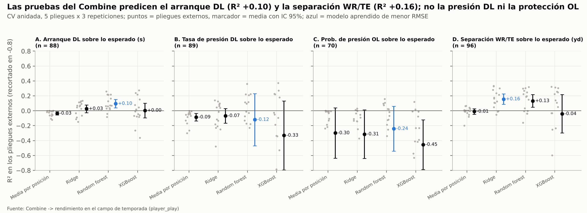

### Classification: starter (started 50%+ of available games)

Threshold metrics use a 0.5 cut on class-weighted models, which favours recall: missing a future starter is
treated as costlier than a false alarm.

| Population | Features | Model | Accuracy | Precision | Recall | F1 | ROC-AUC | PR-AUC |
| --- | --- | --- | --- | --- | --- | --- | --- | --- |
| All prospects (510; 103 starters) | Combine | Logistic | 0.759 | 0.441 | 0.723 | 0.545 | 0.835 ± 0.032 | 0.617 |
| All prospects | Combine | Random forest | 0.774 | 0.464 | 0.697 | 0.553 | 0.830 ± 0.031 | 0.629 |
| All prospects | Combine | XGBoost | 0.796 | 0.507 | 0.674 | 0.572 | 0.840 ± 0.036 | 0.652 |
| All prospects | Combine + draft | Logistic | 0.839 | 0.585 | 0.738 | 0.649 | 0.911 ± 0.022 | 0.745 |
| All prospects | Combine + draft | Random forest | 0.800 | 0.506 | 0.877 | 0.640 | 0.912 ± 0.022 | 0.755 |
| All prospects | Combine + draft | XGBoost (champion) | 0.824 | 0.549 | 0.800 | 0.646 | 0.915 ± 0.025 | 0.758 |
| Tracked (299; 93 starters) | Combine + draft | Logistic | 0.783 | 0.636 | 0.724 | 0.672 | 0.884 ± 0.029 | 0.785 |
| Tracked | Combine + draft | Random forest | 0.767 | 0.596 | 0.824 | 0.688 | 0.881 ± 0.039 | 0.777 |
| Tracked | Combine + draft | XGBoost | 0.776 | 0.618 | 0.757 | 0.676 | 0.884 ± 0.040 | 0.789 |
| Tracked | + game movement | Logistic | 0.783 | 0.634 | 0.727 | 0.673 | 0.882 ± 0.032 | 0.782 |
| Tracked | + game movement | Random forest | 0.763 | 0.594 | 0.785 | 0.672 | 0.879 ± 0.038 | 0.777 |
| Tracked | + game movement | XGBoost (challenger) | 0.776 | 0.622 | 0.752 | 0.676 | 0.884 ± 0.038 | 0.786 |
| All prospects (v2.0) | + projected on-field | Logistic | 0.839 | 0.585 | 0.728 | 0.646 | 0.910 ± 0.025 | 0.745 |
| All prospects (v2.0) | + projected on-field | Random forest | 0.801 | 0.509 | 0.878 | 0.642 | 0.910 ± 0.020 | 0.748 |
| All prospects (v2.0) | + projected on-field | XGBoost | 0.833 | 0.567 | 0.803 | 0.658 | 0.916 ± 0.024 | 0.756 |
| With on-field metrics (255; 79 starters) | Combine + draft | Logistic | 0.792 | 0.643 | 0.768 | 0.697 | 0.865 ± 0.053 | 0.789 |
| With on-field metrics | Combine + draft | Random forest | 0.792 | 0.640 | 0.794 | 0.706 | 0.867 ± 0.056 | 0.783 |
| With on-field metrics | Combine + draft | XGBoost | 0.788 | 0.643 | 0.747 | 0.689 | 0.851 ± 0.070 | 0.761 |
| With on-field metrics | + on-field performance | Logistic | 0.803 | 0.666 | 0.755 | 0.705 | 0.869 ± 0.050 | 0.801 |
| With on-field metrics | + on-field performance | Random forest (challenger) | 0.800 | 0.658 | 0.781 | 0.711 | 0.874 ± 0.057 | 0.801 |
| With on-field metrics | + on-field performance | XGBoost | 0.795 | 0.650 | 0.768 | 0.701 | 0.861 ± 0.073 | 0.780 |

Precision and PR-AUC are higher in the tracked group because its starter base rate is 31%, against 20% overall;
only rows within the same population are compared.

Version 2.0 moves the starter numbers in one place only. The pre-draft projector changes AUC by −0.002 to
+0.0004, so the registered champion stays Combine + draft (XGBoost, 0.915). Observed on-field performance lifts
every model by +0.004 to +0.009 AUC and improves accuracy, precision and F1 in all three, while recall drops
about 0.01 for the logistic and random forest. It is a measurable but small gain, and the evidence is mixed
(section 9).

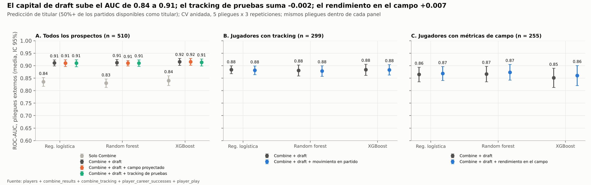

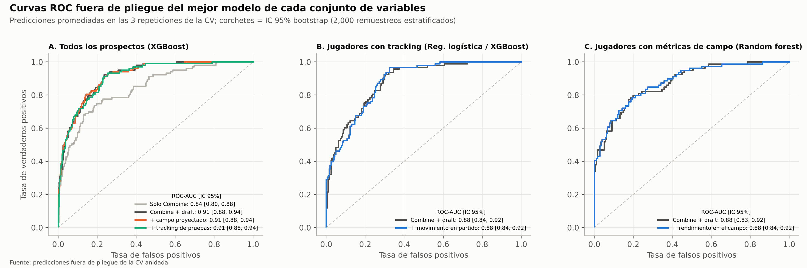

### Drill tracking: with vs without (v2.2)

Adding drill tracking improves no model. Each row compares the best learned model of each arm on the same 15
outer folds.

| Target | Best model, without → with | Without | With | Change (95% CI) | p, corrected t | Folds better |
| --- | --- | --- | --- | --- | --- | --- |
| DL snap burst (SBI), R² | Random forest → random forest | 0.332 | 0.336 | +0.004 (−0.04, 0.04) | 0.83 | 8 of 15 |
| WR snap burst (SBI), R² (v3.0) | Ridge → random forest | −0.081 | −0.088 | −0.007 (−0.70, 0.68) | 0.98 | 6 of 15 |
| DL get-off over expected, R² | Random forest → random forest | 0.096 | 0.091 | −0.004 (−0.10, 0.09) | 0.92 | 8 of 15 |
| DL pressure over expected, R² | Random forest → random forest | −0.119 | −0.156 | −0.037 (−0.19, 0.12) | 0.62 | 9 of 15 |
| OL protection over expected, R² | Random forest → random forest | −0.241 | −0.291 | −0.051 (−0.16, 0.06) | 0.35 | 6 of 15 |
| WR/TE separation over expected, R² | Ridge → random forest | 0.157 | 0.123 | −0.034 (−0.24, 0.17) | 0.73 | 9 of 15 |
| Starter, all prospects, ROC-AUC | XGBoost → XGBoost | 0.915 | 0.913 | −0.002 (−0.012, 0.008) | 0.68 (DeLong 0.30) | 5 of 15 |

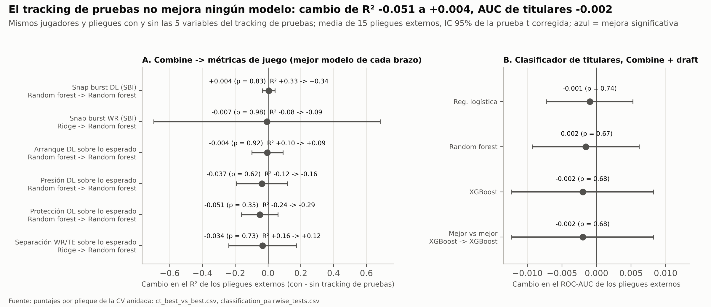

R² values are outer-fold means; the pooled out-of-fold values are in `regression_summary.csv`. Threshold metrics
barely change in the starter model: F1 0.646 → 0.647 with XGBoost.

## 9. Statistical comparison of results

Three conclusions hold across every test:

- Draft capital improves the starter prediction (every test p < 0.003).
- Game movement does not improve it (p ≥ 0.47).
- The model family matters little.

With full-season tracking, the defensive-line regression beats its baseline on every test, including the
corrected t-test, the strictest (Holm p = 0.001). The receiver gain is consistent fold by fold, but it is not
significant under that test, so its evidence is moderate.

**Why these tests.** The 15 outer folds share training players, so a simple paired t-test on the per-fold scores
overstates confidence. The study uses:

- **Corrected resampled t-test** (Nadeau and Bengio, 2003). It inflates the variance by 1/J + n_test/n_train, with J = 15 folds.
- **Wilcoxon signed ranks** on the same folds, as a check that does not assume normal differences.
- **Holm correction** within each family of pairwise comparisons.
- **Friedman test** as an omnibus check that the models share the same rank.
- **DeLong test** on the pooled out-of-fold predictions, to compare two correlated ROC-AUCs on the same players.

$$
t = \frac{\bar{d}}{\sqrt{\left(\frac{1}{J} + \frac{n_{\text{test}}}{n_{\text{train}}}\right)\hat{\sigma}_d^{2}}}, \qquad df = J - 1
$$

### Regression (RMSE, SBI points)

| Population | Comparison | ΔRMSE | Corrected t (p, Holm p) | Wilcoxon p (Holm) |
| --- | --- | --- | --- | --- |
| All positions | Random forest vs baseline | −0.49 | 2.64 (0.019, 0.12) | 0.0003 (0.002) |
| All positions | Ridge vs baseline | −0.24 | 2.28 (0.039, 0.19) | 0.0006 (0.003) |
| All positions | Random forest vs ridge | −0.25 | 1.43 (0.17, 0.66) | 0.008 (0.033) |
| Defensive line | Random forest vs baseline | −2.15 | 4.97 (0.0002, 0.001) | 0.0001 (0.0004) |
| Defensive line | Ridge vs baseline | −1.91 | 4.42 (0.0006, 0.003) | 0.0001 (0.0004) |
| Defensive line | XGBoost vs baseline | −1.99 | 2.91 (0.012, 0.046) | 0.0003 (0.001) |
| Defensive line | Learned models against each other | 0.07–0.23 | p ≥ 0.47 | p ≥ 0.21 |
| Wide receivers | Ridge vs baseline | −0.93 | 1.08 (0.30, 1.0) | 0.030 (0.15) |
| Wide receivers | Random forest vs baseline | −0.73 | 0.91 (0.38, 1.0) | 0.064 (0.19) |
| Wide receivers | XGBoost vs ridge | +1.11 | 1.20 (0.25, 1.0) | 0.030 (0.15) |

Friedman, all positions: χ² = 18.4, p < 0.001; random forest has the best rank (mean 1.60) and the baseline the
worst (3.60). Friedman, defensive line: χ² = 22.6, p < 0.001; random forest has the best rank (1.93) and the
baseline the worst (3.87). Friedman, receivers: χ² = 12.7, p = 0.005; ridge has the best rank (1.60) and
XGBoost (3.07) ranks below the baseline (3.00): the boosted trees overfit 63 receivers.

### Classification (ROC-AUC)

| Question | Result | Corrected t | DeLong |
| --- | --- | --- | --- |
| Does draft capital add to the Combine? (all prospects) | +0.075 to +0.082 AUC across the 3 models | p = 0.0005–0.0019 | z = 3.0–4.9, p ≤ 0.0023 |
| Does game movement add to Combine + draft? (tracked) | −0.003 to −0.0002 AUC | p = 0.52–0.99 | p = 0.47–0.81 |
| Do the model families differ? (12 pairwise tests) | Largest difference 0.010 AUC | Holm p ≥ 0.76 | — |

Friedman across the three families is only significant with the Combine features alone (χ² = 10.1, p = 0.006;
XGBoost ranks first). It is not in the other three scenarios (p = 0.15–0.59).

### Likelihood-ratio test for the Snap Burst Index

A logistic GLM on the 299 tracked players asks the business question directly:
starter ~ position + log draft pick + NGS athleticism + SBI. Adding the SBI leaves the fit unchanged:

- Odds ratio per +10 SBI points: 0.87, 95% CI 0.61–1.24, Wald p = 0.45.
- Likelihood-ratio χ² = 0.58, p = 0.45. AIC rises from 226.7 to 228.1.
- Pseudo-R² stays at 0.43, almost all of it from the draft pick.

The NGS athleticism score adds nothing either (OR 1.02 per 10 points, p = 0.92).

An exploratory, not pre-specified, look at day-3 and undrafted players asks whether the SBI matters where draft
capital says less. Version 2.2 found ρ = 0.14 (95% CI −0.04 to 0.30, 11 starters among 107) and flagged it as a
hypothesis, not a finding. With full seasons it is ρ = −0.03 (−0.16 to 0.11, 12 starters among 164): the hint
was noise.

### Version 2.0 tests

Three conclusions hold: Combine drills beat position alone for DL get-off and WR/TE separation; the projector
adds nothing; observed on-field performance adds little, and only the less conservative tests confirm it.

**On-field regressions (RMSE).**

| Task | Best vs baseline | ΔRMSE | Corrected t (p, Holm p) | Wilcoxon p (Holm) | Friedman χ² (p) |
| --- | --- | --- | --- | --- | --- |
| DL get-off | Random forest | −0.0043 s | 2.86 (0.013, 0.075) | 0.0001 (0.0004) | 21.5 (0.0001); RF first (1.27) |
| WR/TE separation | Ridge | −0.017 yd | 2.26 (0.040, 0.24) | 0.0003 (0.002) | 6.8 (0.080) |
| DL pressure | Random forest | −0.0004 | 0.40 (0.69, 1.0) | 0.055 (0.25) | 7.6 (0.056) |
| OL protection | Random forest | −0.0003 | 0.64 (0.53, 1.0) | 0.15 (0.38) | 6.6 (0.086) |

The gains for DL get-off and WR/TE separation are consistent fold by fold (Wilcoxon, Holm p ≤ 0.002). They do
not survive the corrected t-test after Holm correction, so they are treated as moderate evidence, like the
receiver snap-burst result in v3.0.

**Starter classifiers (ROC-AUC).**

| Question | ΔAUC (3 models) | Corrected t p | Wilcoxon p | DeLong p |
| --- | --- | --- | --- | --- |
| Projected on-field vs Combine + draft (510) | −0.002 to +0.0004 | 0.64–0.87 | 0.29–0.84 | 0.054–0.77 (LR and RF slightly worse) |
| Observed on-field vs Combine + draft (255) | +0.004 to +0.009 | 0.21–0.79 | 0.44 (LR), 0.035 (RF), 0.021 (XGB) | 0.46 (LR), 0.37 (RF), 0.037 (XGB) |

**Likelihood-ratio test for on-field performance.** A logistic GLM on the 255 players asks: starter ~ position +
log draft pick + on-field index, with the index z-scored within family. Adding the index improves the fit: odds
ratio 1.47 per SD, 95% CI 1.02–2.12, χ² = 4.22, p = 0.040, AIC 198.8 → 196.5. On-field performance carries
signal about starting that draft position does not. The SBI, tested the same way, does not (p = 0.45 in v3.0).

**Mediation.** The bootstrap 95% CI of the indirect path (drill → get-off → pressure) excludes zero for the
10-yd split (0.04–0.30 SD), the 40 (0.04–0.30), the broad jump (0.03–0.24), the vertical (0.05–0.30) and body
weight (−0.28 to −0.05). Once get-off is in the model, no direct path from drill to pressure stands out from
zero: point estimates of 0.00–0.16 SD and every 95% CI includes zero.

### Version 2.2: drill tracking

No drill-tracking comparison passes any test. The paired corrected t-test gives p ≥ 0.35 for every game target
(v3.0: DL snap burst 0.83, WR snap burst 0.98) and p = 0.68 for the starter model. Wilcoxon on the same folds
agrees (p ≥ 0.06), and DeLong on the starter out-of-fold predictions gives p = 0.30 (AUC 0.913 vs 0.910). A
partial rank correlation explains the single univariate link: position-drill speed vs DL get-off goes from
ρ +0.37 (p < 0.001) to +0.23 with weight and role fixed (p = 0.03), and to +0.13 when the official 40 is added
(p = 0.31).

A first release run pooled the position drills of several groups before computing the z. It showed a DL get-off
gain of R² +0.07, better in 12 of 15 folds but not significant under the corrected t (p = 0.19). Computing each
drill's z within the position group that ran it removed the gain. A gain that a small, correct change in a
feature's scaling erases is exactly the kind the corrected test is there to reject, and the corrected run is the
release.

## 10. Actionable conclusions

The Combine says something real about how a prospect will move at the snap, above all through four drills, most
clearly on the defensive line and, now that full seasons are tracked, at receiver. It says little about who will
start once it is known where he was drafted.

### For scouts

1. **Weight the 40, the 10-yd split and the broad jump; discount the composite.** Within a position, each correlates 0.25–0.43 with game burst, acceleration, top speed, braking and cuts (v3.0, 299 players); the vertical follows at 0.15–0.24. The NGS athleticism score correlates −0.05 to 0.06 with the same metrics, and the bench press runs from null to negative. When comparing two prospects at the same position, the information is in the individual sprint and jump numbers, not in the composite.
2. **Ask for one sprint and one jump, not all of them.** The 40 and the 10-yd split almost duplicate each other (ρ = 0.77), as do the vertical and the broad jump (0.67). The 40, the 10-yd split, the broad jump and the vertical are significant against all six game metrics.
3. **On the defensive line, read the 10-yd split together with weight.** The v3.0 model leans first on weight, then on 10-yd momentum (weight ÷ split) and the 40. About half of the drills' raw link with get-off is the edge vs interior role, so compare edge with edge.
4. **Get the agility drills run.** Only 44% of prospects ran the shuttle or the 3-cone, which leaves their translation as the most uncertain (100–114 tracked players). Teams that collect them at pro days fill a real gap.

### For general managers and analytics teams

5. **Check reliability before trusting a tracking metric.** Reliability depends on how many plays are seen. With 8 plays per player (v2.2) receiver burst looked like noise (ICC −0.34); with 39 it is a stable trait (0.62) and stays one without the route context. Defensive-line burst is stable too (0.63), but it is almost all role: net of alignment it drops to 0.14. Defensive backs stay weak (0.26); for them use get-off at 1 second (0.55) or distance at 1 s (0.49).
6. **Avoid the exposure trap.** A metric built from a player's best plays penalises whoever is seen on few plays: 0.50 yd low at 3 plays in the v3.0 sample. Because starters are seen more, it manufactures a link with playing time (ρ 0.23 → 0.08 once corrected in v1; 0.12 vs 0.07 with full seasons). Use empirical-Bayes shrunk means, or adjust for the number of plays.
7. **Use game movement to describe players, not to forecast careers.** Draft capital takes the starter AUC from 0.84 to 0.91. Game movement adds −0.003 to 0 on top, and the SBI odds ratio is 0.87 per 10 points (p = 0.45). The registered pre-draft model is `cgmt-starter-classifier@champion`; the movement model stays a challenger.

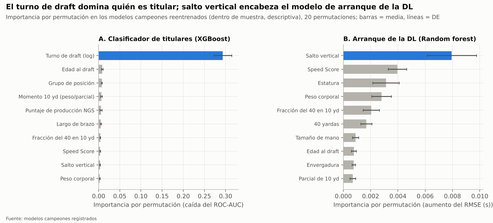

### For defensive-line coaches: the translation gap

The translation gap compares each lineman's in-game SBI with what his Combine profile predicted. A positive gap
flags a player who plays faster off the snap than he tested. A negative one flags a player whose athletic profile
says he can get off faster than he does, which points to technique: stance, snap anticipation, first step.

| Player | Position, class | Plays | Game SBI | Predicted | Gap |
| --- | --- | --- | --- | --- | --- |
| Will Anderson | DE, 2023 (round 1) | 290 | 74 | 56 | +18 |
| Chop Robinson | OLB, 2024 (round 1) | 64 | 71 | 56 | +15 |
| Cedric Johnson | DE, 2024 (round 6) | 14 | 71 | 57 | +14 |
| Brenton Cox | DE, 2023 (undrafted) | 24 | 64 | 51 | +12 |
| Austin Booker | DE, 2024 (round 5) | 52 | 64 | 54 | +9 |
| Tyrus Wheat | DE, 2023 (undrafted) | 28 | 41 | 55 | −14 |
| Nick Hampton | OLB, 2023 (round 5) | 25 | 44 | 59 | −15 |
| Adetomiwa Adebawore | DT, 2023 (round 4) | 75 | 37 | 54 | −17 |

The table keeps players with 10+ plays (54 of 72 linemen, reliability ≥ 0.57); gaps are computed before rounding.
Players with few plays and large gaps, such as Nazir Stackhouse (+13 on 3 plays), are in
`reports/metrics/translation_gap.csv` and are leads for film review, not conclusions. Two first-rounders top the
list, but a sixth-rounder and an undrafted edge follow them: that is where a movement metric earns its place, on
players the draft did not value highly. Among receivers (v3.0), Derius Davis (round 4, +36 on 29 plays) and
Rakim Jarrett (undrafted, +15) beat their testing the most, and Rashee Rice (round 2, −15 on 133 plays) falls
below it, a reminder that a receiver's 2-second distance also reflects how he is used.

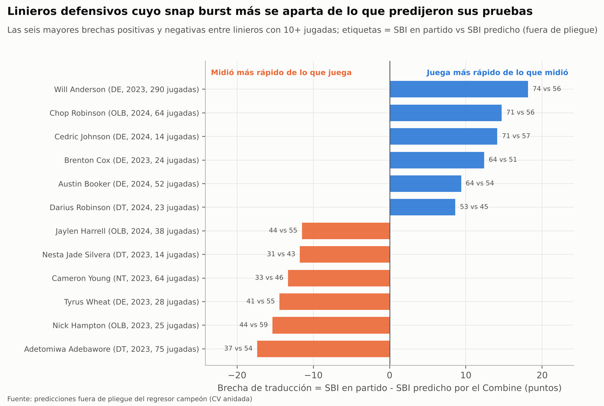

### Version 2.0: what season-long performance adds

The season-long data confirm the defensive-line story, extend it from movement to production and show where the
drills stop helping: pass protection and separation.

**For scouts**

1. **With pass rushers, trust the sprint and jump drills: they forecast get-off.** Within the DL, the vertical, the 40, the 10-yd split and the broad jump correlate 0.36–0.43 with season-long get-off over expected, and the link holds within the edge or interior role. Each 0.1 s on the 10-yd split is worth about 0.03 s of in-game get-off, roughly half the distance between a typical lineman and a top-decile one. The vertical is the most important feature of the champion model.
2. **Get-off is how drills become pressure.** About half of each drill's link with pressure rate runs through get-off (44–77%). When a prospect's testing outruns his get-off on film, the gap marks the step between athleticism and production that coaching can work on.
3. **At receiver, size, not the drills, forecasts separation.** Within WR and within TE, lighter players separate more (ρ = −0.46); no drill passes the false-discovery control. The Combine-only model explains about 19% of separation over expected (pooled R²); height leads its features, followed by which jumps the receiver skipped and the shuttle.
4. **Do not evaluate pass protection with the Combine.** No drill relates to OL pressure allowed (|ρ| ≤ 0.18), and no model beats position alone. Linemen drafted earlier protect better (ρ = 0.33), so the information is in the film that set their draft slot.

**For general managers**

5. **On-field performance carries signal about starting that draft position does not see.** Each SD of the family on-field index raises the odds of starting by 47% after controlling for pick and position (p = 0.04), and adds about 0.007 AUC to the starter model. The SBI showed no such signal.
6. **Read rookie seasons by position.** A rookie's get-off (ρ = 0.61 with later seasons), pressure (0.50) and separation (0.37) carry over. A rookie lineman's pass-protection numbers do not (0.16), so do not overreact to them.
7. **There is no cheap pre-draft gain in projecting on-field performance.** A stacked model that projects each prospect's on-field metrics from his drills adds −0.002 to +0.0004 AUC: the Combine information is already in the starter model. The champion stays Combine + draft.

**For defensive-line coaches: season-long translation gap**

This complements the SBI table above for linemen with 50+ pass-rush snaps. Gap = observed get-off over expected
minus what his Combine profile predicts (out-of-fold), in seconds; positive = he gets off earlier than his drills
suggest.

| Player | Position, class | Pass-rush snaps | Get-off over exp. | Predicted | Gap |
| --- | --- | --- | --- | --- | --- |
| Brandon Dorlus | DT, 2024 (round 4) | 277 | +0.127 s | −0.011 s | +0.14 s |
| Will Anderson | DE, 2023 (round 1) | 1,118 | +0.119 s | −0.002 s | +0.12 s |
| Warren Brinson | DT, 2025 (round 6) | 133 | +0.091 s | −0.027 s | +0.12 s |
| Chop Robinson | OLB, 2024 (round 1) | 521 | +0.115 s | +0.018 s | +0.10 s |
| Austin Booker | DE, 2024 (round 5) | 394 | −0.098 s | +0.012 s | −0.11 s |
| Myles Cole | DE, 2024 (round 7) | 52 | −0.137 s | −0.018 s | −0.12 s |
| Tyrus Wheat | DE, 2023 (undrafted) | 110 | −0.124 s | +0.014 s | −0.14 s |

Will Anderson and Chop Robinson sit near the top of both tables and Tyrus Wheat near the bottom of both, so the
two gap measures agree at the extremes. Austin Booker is the exception: on 52 tracked plays he moves faster than
he tested (+9 SBI), but over 394 regular-season pass-rush snaps he gets off 0.11 s slower than his drills
predict. Two late-round interior linemen, Dorlus and Brinson, beat their testing by the widest margin. The full
list is in `reports/metrics/onfield_translation_gap.csv`.

**Drill tracking (v2.2).** Use the tracking as an audit of the stopwatch, not as a new grade. The tracked 5–10 yd
split and top speed reproduce the official times, so a large gap between them flags a timing problem worth
checking. Position-drill speed needs no weight of its own in a defensive lineman's evaluation: what it says about
get-off, the 40 already says.

## 11. Limitations, leakage control and next steps

Since v3.0 the tracking findings rest on 299 players observed on a median of 39 plays each, across the 2023
season, 2024 weeks 0–17 and week 18 and playoffs of 2024–2025 (221 players and 8 plays before). The version 2.0
on-field findings rest on 255 players with a median of 165–558 regular-season plays each, which is why their
reliability remains higher.

**Information-leakage controls.**

- Imputation medians and scaling are learned inside each outer training fold.
- Hyperparameters are chosen by an inner CV that never sees the outer test fold.
- Game-movement features are per-play averages, never play counts. Counts follow playing time and would leak the target; the 80th-percentile episode in section 3 shows how easily that happens.
- The NFL position only labels roles in the defensive-line analysis and balances the folds; it is never a model feature, because it is decided after the draft.
- The movement classifier is a diagnostic. Its features are measured after the draft, so it is registered as a challenger and must not be used for draft decisions.

**Limitations.**

1. Drill mechanics are only partly measured. Up to v2.2, drill movement was known only through times and distances. Version 2.2 adds 10 Hz drill tracking. Only distance splits, top speeds and speed through the turns repeat within a player, and none adds predictive power to the official results. Braking and cuts, the mechanics inside the 3-cone and shuttle turns, do not repeat between attempts (r 0.14–0.43), so they cannot yet be compared with game mechanics.
2. Incomplete game sample. The 2023 season and 2024 weeks 0–17 are now tracked, but 2025 weeks 1–17 are missing, and the 2023 file stops at exactly 1,048,575 rows, a spreadsheet's limit, so a random part of 2023 is missing. 343 of 510 prospects appear, so those who barely played are under-represented.
3. No opponents or ball. With 1–4 tracked players per play, separation, pass-rush win rate and blocking outcomes cannot be measured, so movement is judged from the player's own kinematics.
4. Partial play context. Without the play call, a receiver's 2-second distance mixes routes, blocks and pre-snap motion. Route and alignment taken from `player_play` remove part of that: receiver burst stays a trait net of the route (ICC 0.62), while DL burst is mostly role (0.14 net of alignment).
5. Small samples per position. 72 defensive linemen and 63 receivers feed the snap-burst models; the role-adjusted correlation on the DL has a 95% interval of about ±0.25 (0.09–0.60).
6. Agility drills are sparse: 35% of prospects ran the 3-cone and 39% the shuttle, so their translation estimates are the most uncertain.
7. The starter target is coarse. A 50% starting threshold ignores rotation value, which weighs more for defensive linemen.

**What version 2.0 resolves.** Limitation 3 closes for three families: `player_play` provides pressure generated,
pressure allowed and separation at the throw over full regular seasons. Limitation 4 is tested directly: every
tracked play carries its route, assignment and alignment. With the week-18 sample, receiver and defensive-back
snap burst showed no player signal once that context was removed; with the full seasons of v3.0, receiver burst
does (ICC 0.62) and defensive-back burst stays weak (0.25). Limitation 2 weighs less, because the on-field metrics
cover every 2023–2025 regular-season game.

**New caveats in version 2.0.**

1. Expected values come from the prospects' own plays (497 players), not from the whole league. "Over expected" means "against the 2023–2025 draft classes in the same context".
2. Defensive backs still have no outcome metric: the file carries their alignment and assignment, not the outcome of the coverage.
3. The starter model with on-field data is circular by design. Performance and starts are measured in the same seasons, and starters log more snaps. Per-play rates, shrinkage and play minimums limit the exposure effect, but the model stays a registered challenger, never a draft tool.
4. DL pressure rate is a rare event (about 10% of pass-rush snaps) with ICC 0.25, which limits how much any pre-draft model can explain.
5. OL protection depends on the scheme, the quarterback and the play design. The expectation by alignment × dropback duration removes part of that, not all of it.
6. The delivered `player_play` file has 2,141 fewer rows than the spec states (−0.68%). It is not known which plays are missing, so a small bias in the on-field metrics cannot be ruled out.

**Next steps.**

- Add coverage outcomes for defensive backs (separation allowed, passes per coverage snap), the only family `player_play` leaves unmeasured.
- Compute "expected" from league-wide plays instead of the prospects' own, to compare a rookie with every NFL player in the same context.
- Deliver the uncut 2023 tracking file and the 2025 regular season (weeks 1–17). Version 3.0 showed the benefit: full seasons made receiver burst measurable and the DL model significant. The pipeline finds new files by pattern, in Parquet or CSV, and validates them with no code change.
- Re-run every spring with the newest class as a monitored job; the smoke configuration and the manifest hashes are already wired into CI.

## 12. Reproducibility

The whole study re-runs from the ten raw files with one command and gives the same numbers, whether the tables
arrive as Parquet, CSV or compressed CSV. Python 3.13, dependencies pinned in `requirements.txt`. The
step-by-step guide (Colab and local) is in the [README](README.md).

```
python -m pip install -r requirements.txt
make relocate     # once after cloning: points the MLflow store at this folder
make validate     # data contract only: raw files vs the spec, about 10 s
make verify       # raw-data hashes vs the manifest
make test         # 40 unit tests, about 15 s
make smoke        # the whole pipeline with minimal CV and grids, about 10 min (own folders)
make all          # release run, about 60 min on 2 cores
make ui           # MLflow interface: runs, metrics, registered models
```

1. `src/data_prep.py` (stage `data`): validates the ten raw files against the data contract (detecting and harmonising each file's format), writes `data/raw/manifest.json`, cleans the prospects, builds the tracking metrics and player profiles, the on-field plays over expected, the on-field profiles and the drill-tracking features, and saves everything in `data/clean/`.
2. `src/train.py`, stage `translation`: drill-to-game and drill-to-field correlations, reliability, rookie stability, DL mediation, SBI validity and the two starter GLMs.
3. Stage `models`: nested-CV regression (3 SBI populations and 4 on-field targets, each with and without drill tracking) and classification (3 populations, 8 feature sets), statistical tests, final refits and the registration of 17 models.
4. Stage `stats`: recomputes the omnibus tests from the saved per-fold scores, without retraining.
5. Stage `figures`: the 21 figures in `reports/figures/`.

Every table behind this report is in `reports/metrics/` as CSV or JSON, so any figure can be redrawn without
retraining. A registered model loads with `mlflow.sklearn.load_model("models:/cgmt-starter-classifier@champion")`
against `sqlite:///mlflow/mlflow.db`.

---

# Part II. Version history

All notable changes to the project are documented here. The format follows
[Keep a Changelog](https://keepachangelog.com/en/1.1.0/) and the project uses
[semantic versioning](https://semver.org/):

- **MAJOR**: a change that alters a published metric or a target definition (results are not comparable across versions).
- **MINOR**: a new analysis, model, feature set, stage or capability; existing results stay comparable.
- **PATCH**: fixes and refactors that change no number in `reports/metrics/`.

Every MLflow run carries the tags `pipeline_version` (this file), `data_version` (hash of the raw files,
`data/raw/manifest.json`) and `git_commit`, so every number in the report traces back to the exact code and data
that produced it. Versions 0.1.0–0.3.0 were development steps before the repository was created (first commit =
0.4.0); they are recorded so the reasoning behind each decision is not lost.

The entries keep the paths, modules and commands of their time: up to 3.0.0 `src/cgmt/`, `configs/`,
`reports/metrics/`, `--stage`; in 3.1.0 the Spanish names (`fuentes/`, `configuracion/`, `reportes/metricas/`,
`--etapa`). The 3.2.0 entry maps both onto the current structure.

## [3.2.0] - 2026-10-20

MINOR: the raw tables can be delivered as Parquet as well as CSV or compressed CSV, four of them now arrive as
Parquet, and the whole project is back in English, folder names included. No metric or target definition
changes: the clean data are byte-identical to v3.1.0 and every metric matches. The data version changes
(`a75ba51ae4b9` → `261a80510390`) because the four Parquet files have different bytes from the CSVs they
replace. Published on the `english` branch; `main` keeps the Spanish v3.1.0.

### Added
- **Parquet ingestion** in `src/data_prep.py`, with no change to the cleaning rules:
  - `detect_format`: the format comes from the file's first bytes (`PAR1` = Parquet, gzip header = compressed CSV, otherwise CSV), so a file with the wrong extension is still read correctly and the mismatch is logged.
  - `harmonize` and `read_raw_table`: one reader for the three formats. Parquet columns are converted to the CSV encodings before the contract and the schema see them (booleans → `TRUE`/`FALSE`, timestamps → ISO 8601 text, dates → `YYYY-MM-DD`, categorical → plain values). `read_header` reads a Parquet schema without loading rows.
  - `resolve_files` groups a table's files by stem and, when the same table is present in several formats, uses Parquet, then plain CSV, then its `.gz` copy (`FORMAT_PRIORITY`); the others are logged and ignored. A split part is still superseded by the full file whatever the formats.
  - The manifest records each file's `format`; Parquet rows come from the file metadata and its size is the stored size. The contract summary lists the formats read per table, and the data-stage log prints them.
- **Raw data**: `players.parquet`, `combine_results.parquet`, `player_career_successes.parquet` and `games.parquet` replace their `.csv.gz` files in `data/raw/`; the six large tables stay as compressed CSV. Verified before use: the four Parquet tables hold the same rows and values as the CSVs (the delivered `players` file stores `birth_date` as a Parquet date, which harmonises to the same text).
- **Five tests** (40 in total): format detection by content (including a Parquet file saved as `.csv`), format priority and part superseding across formats, harmonisation of booleans, timestamps, dates and categoricals, identical typed tables from Parquet and CSV, and identical contract reports from Parquet and CSV.
- CI also runs on pushes to the `english` branch.

### Changed
- **Everything in English**: README, this report, the model card (`docs/model_card.md`), configuration and contract comments, contract handling texts, docstrings, comments, log messages, test names, the notebook and the 21 figures (titles, axes, legends and source notes). Figure wording follows the v3.0.0 originals, with the automatic font fitting added in v3.1.0.
- **Folders and files in English**, keeping the structure of `Estructura_Gitub_NFL.docx`. The command line is `--stage all|contract|data|translation|models|stats|figures|relocate` for `src/train.py` and `--stage data|contract|verify` for `src/data_prep.py`; the `make` targets are `install`, `test`, `smoke`, `validate`, `verify`, `data`, `translation`, `models`, `stats`, `figures`, `all`, `relocate`, `ui` and `clean`.
- Raw-file patterns in `configs/config.yaml`, `configs/smoke.yaml` and `configs/data_contract.yaml` are format-agnostic (`players.*`, `game_tracking_*`, …).
- Registered models are logged with `code_paths = [data_prep.py, train.py]`.
- The Colab notebook clones the `english` branch (`BRANCH` setting) and its modes are `smoke`, `full` and `load_only`.

**Mapping from the v3.1.0 structure.**

| v3.1.0 (Spanish) | v3.2.0 (English) |
| --- | --- |
| `datos/datos_ini/*.csv.gz` | `data/raw/*.parquet` (4 tables), `data/raw/*.csv.gz` (6 tables) |
| `datos/datos_ini/manifiesto.json` | `data/raw/manifest.json` |
| `datos/datos_limp/`, `datos/datos_limp/intermedios/` | `data/clean/`, `data/clean/interim/` |
| `fuentes/datos_prep.py`, `fuentes/train.py`, `fuentes/entrena.ipynb` | `src/data_prep.py`, `src/train.py`, `src/training.ipynb` |
| `configuracion/config.yaml`, `rapida.yaml`, `contrato_datos.yaml` | `configs/config.yaml`, `smoke.yaml`, `data_contract.yaml` |
| `pruebas/` | `tests/` |
| `reportes/figuras/`, `reportes/metricas/` | `reports/figures/`, `reports/metrics/` |
| `documentos/Data_structure_CSV_files.docx`, `documentos/tarjeta_modelo.md` | `docs/Data_structure_CSV_files.docx`, `docs/model_card.md` |
| `datos/rapida/`, `reportes/rapida/`, `mlflow/rapida.db` | `data/smoke/`, `reports/smoke/`, `mlflow/smoke.db` |
| `python fuentes/train.py --etapa todo` | `python src/train.py --stage all` |
| `make pruebas`, `rapida`, `validar`, `verificar`, `todo`, `reubicar` | `make test`, `smoke`, `validate`, `verify`, `all`, `relocate` |

### Release notes
- Trained from a clean MLflow store: {{RUNS}} runs tagged `git_commit = {{COMMIT}}`, `pipeline_version = 3.2.0`
  and `data_version = 261a80510390`, with 17 registered models (the same names and aliases as in v3.1.0).
- Verified: with the four tables read from Parquet, the data stage reproduces every file in `data/clean/` byte for
  byte against v3.1.0 (12 files); the contract gives 435 checks, 0 errors and 32 warnings with the same result for
  every check; {{METRICS_CHECK}} All 40 tests pass and the notebook runs end to end in smoke mode. {{DURATION}}

## [3.1.0] - 2026-10-17

MINOR: the repository is reorganised into the GitHub structure of the `Estructura_Gitub_NFL.docx` document, all
the documentation moves to Spanish and a Google Colab notebook is added. No metric or target definition changes:
the clean data are byte-identical to v3.0.0, `data_version` stays `a75ba51ae4b9` and the models were retrained
from a clean MLflow store with the reorganised code (see the release notes).

### Added
- **Repository structure** following the attached document, plus add-ons marked in the README:
  - `datos/datos_ini/`: the ten original CSVs and the manifest (`manifiesto.json`).
  - `datos/datos_limp/`: the clean, model-ready data (parquet) and `intermedios/` (cleaned tracking frames and play context).
  - `fuentes/entrena.ipynb`: Colab notebook to train and evaluate end to end.
  - `fuentes/datos_prep.py`: every cleaning and preparation function.
  - `fuentes/train.py`: training, evaluation, statistical tests, figures and MLflow registration.
  - `README.md` (reproduction guide and decisions) and `CHANGELOG.md` (final report plus this history).
  - Add-ons: `configuracion/`, `pruebas/`, `reportes/` (figures and metrics), `documentos/` (data spec and model card), `mlflow/` (experiment store and registry), `.github/workflows/`, `requirements.txt`, `pyproject.toml` and `Makefile`.
- **Notebook `fuentes/entrena.ipynb`**: clones the repository in Colab, installs the dependencies, validates the data contract, prepares the data, trains in quick mode (about 10 min) or full mode (60–90 min), shows the evaluation tables and figures and loads the registered models from MLflow.
- **Compressed raw data** (`.csv.gz`, `gzip -n -9`): `player_play_3.csv` weighs 147 MB uncompressed and GitHub rejects files over 100 MB. The ten files go from 427 MB to 100 MB. pandas reads them without decompressing to disk, and the manifest stores the SHA-256 and the lines of the decompressed content, so `data_version` does not change (`a75ba51ae4b9`). The reader treats `.csv` and `.csv.gz` as the same logical file, so a new uncompressed delivery works the same.
- `--etapa verificar` (`make verificar`): recomputes the hashes of `datos/datos_ini` against the manifest; CI fails on any difference.
- A new test (`test_csv_comprimido_equivale_al_original`): a compressed CSV gives the same table, the same hash and the same row count as the original. 35 tests in total.

### Changed
- Documentation in Spanish: README, final report, model card (`documentos/tarjeta_modelo.md`), configuration and data-contract comments, docstrings, log messages and test names and docstrings.
- The 21 figures are drawn with Spanish titles, axes, legends and source notes. An automatic fit shrinks the font of a title or note that does not fit the figure's width.
- Command line in Spanish: `--etapa todo|contrato|datos|traduccion|modelos|estadistica|figuras|reubicar` and Spanish `make` targets (`instalar`, `pruebas`, `rapida`, `validar`, `verificar`, `datos`, `traduccion`, `modelos`, `estadistica`, `figuras`, `todo`, `reubicar`, `ui`, `limpiar`).
- The MLflow store moves to `mlflow/mlflow.db` and `mlflow/mlartifacts/`. Models are registered with `code_paths = [datos_prep.py, train.py]`, so they load on any machine without installing the package.
- Identifiers (functions, columns, metrics, experiment and registered-model names) stay in English, because the code, the metric files and the MLflow registry share them across versions.

**Mapping from the earlier structure.**

| Before (≤ 3.0.0) | Now (3.1.0) |
| --- | --- |
| `data/raw/*.csv` | `datos/datos_ini/*.csv.gz` |
| `data/manifest.json` | `datos/datos_ini/manifiesto.json` |
| `data/processed/`, `data/interim/` | `datos/datos_limp/`, `datos/datos_limp/intermedios/` |
| `src/cgmt/config.py`, `data.py`, `contract.py`, `cleaning.py`, `movement.py`, `performance.py`, `combine_tracking.py`, `features.py` | `fuentes/datos_prep.py` |
| `src/cgmt/models.py`, `stats.py`, `mlops.py`, `viz.py`, `pipeline.py` | `fuentes/train.py` |
| `configs/config.yaml`, `smoke.yaml`, `data_contract.yaml` | `configuracion/config.yaml`, `rapida.yaml`, `contrato_datos.yaml` |
| `tests/` | `pruebas/` |
| `reports/figures/`, `reports/metrics/` | `reportes/figuras/`, `reportes/metricas/` |
| `docs/Data_structure_CSV_files.docx`, `MODEL_CARD.md` | `documentos/Data_structure_CSV_files.docx`, `documentos/tarjeta_modelo.md` |
| `mlflow.db`, `mlartifacts/` | `mlflow/mlflow.db`, `mlflow/mlartifacts/` |
| `python -m cgmt.pipeline --stage all` | `python fuentes/train.py --etapa todo` |
| `make test`, `smoke`, `validate`, `all`, `relocate` | `make pruebas`, `rapida`, `validar`, `todo`, `reubicar` |

### Release notes
- Trained from a clean MLflow store: 93 runs tagged `git_commit = 71749c7`, `pipeline_version = 3.1.0` and
  `data_version = a75ba51ae4b9`, with 17 registered models (the same names and aliases as in v3.0.0).
- Verified: the data stage reproduces every file in `datos/datos_limp/` byte for byte against v3.0.0; the contract
  gives 435 checks, 0 errors and 32 warnings, as before; the 90 tables in `reportes/metricas/` match v3.0.0
  number for number (only translated texts, the `.csv.gz` names in the contract report and the date of the GLM
  summary change); the 35 tests pass, and the notebook runs end to end in quick mode in about 10 minutes. The
  full run took 59 minutes on 2 cores.

## [3.0.0] - 2026-10-17

MAJOR: full-season game tracking for 2023 and 2024 changes the Snap Burst Index sample. The SBI definition is
unchanged, but every SBI-based number moves, so results are not comparable with v2.x. Everything that does not
use game tracking reproduces v2.2.0 exactly: the on-field metrics and regressions, the all-prospect and on-field
starter models, and the drill-tracking analyses. `data_version` is `a75ba51ae4b9` (ten raw files).

### Added
- **`game_tracking_2023_5.csv`** (333 games, 154 players) and **`game_tracking_2024_1_5.csv`** (305 games,
  2024 weeks 0-17, 314 players). With the 2024/2025 Week 18 + playoff parts, the tracking has 24,828
  regular-season and playoff player-plays and 299 players with 3+ plays. Before, it had 2,677 plays and 221
  players, and the median per player rises from 8 plays to 39.
- **R8c, a cut-file check.** `game_tracking_2023_5.csv` has exactly 1,048,575 data rows, the row limit of a
  spreadsheet, so it was almost certainly cut when saved. Its rows are in no particular order, so the cut removes
  a random set of plays (2023 still covers 154 of the 160 prospects in that class). The contract warns about
  any file at that limit, and the pipeline drops the file's last player-play, which may be incomplete. R8b
  removes the 98 preseason games (390,373 frames). Contract: 435 checks, 0 errors, 32 warnings.
- **Wide receivers become an SBI population** (`regression.populations`, `cgmt-snap-burst-regressor-wr`), with a
  drill-tracking challenger. SBI populations are a configured map (`SBI_POPULATIONS`).

### Changed results (v2.2.0 -> v3.0.0)
- Reliability of snap burst (ICC): DL 0.62 -> 0.63, **WR -0.34 -> 0.62**, OL 0.10 -> 0.40, DB 0.00 -> 0.26,
  TE 0.24 -> 0.08 (21 players). With play context removed, WRs stay at 0.62 and the DL falls to 0.14. Most of
  the DL's stability is role (edge vs interior); a receiver's burst is his own.
- Drill vs game movement: 35 of 63 within-position cells pass FDR (25 before); 40 vs top speed rho 0.43.
- **The defensive-line SBI model improves:** random forest RMSE 7.85 vs 9.99 for position alone (-21%; v2.2:
  8.54 vs 10.05). Pooled R^2 is 0.37 [0.17, 0.50] (was 0.29 [-0.02, 0.45]), and the gain now passes the corrected
  resampled t-test (p = 0.0002, Holm 0.001; v2.2 Holm p = 0.45).
- Wide receivers (new): ridge RMSE 8.45 vs 9.38 (-10%), pooled R^2 0.22 [-0.01, 0.31]. The gain is consistent
  fold by fold (Wilcoxon p = 0.03) but not significant under the corrected t-test (p = 0.30).
- All positions: random forest RMSE 9.57 vs 10.06 (-5%), pooled R^2 0.07 [0.00, 0.12] (was -0.02).
- The SBI is validated against season-long DL get-off at rho 0.45 (was 0.39, 69 DL vs 52) and against
  pressure at 0.28 (was 0.49).
- Starters: game movement still adds nothing beyond Combine + draft (299 players, AUC change -0.003 to 0.000,
  DeLong p >= 0.47). The GLM odds ratio per 10 SBI points is 0.87 [0.61, 1.24], p = 0.45. The exploratory
  Day-3 signal (rho 0.14 in v2.2) is gone (-0.03).
- The 80th-percentile trap persists: it reads 0.50 yd low at 3 plays and correlates 0.12 with start rate, against
  0.07 for the mean.
- Drill tracking adds nothing to the SBI models (DL +0.004, WR -0.007 R^2; p >= 0.83).

### Fixed
- Figure titles that stated v2.2 conclusions as fixed text (figures 6, 10, 15) and source notes with typed counts
  (figures 3, 4, 6, 7) are now computed from the data. Figure 14 lists linemen with 10+ tracked plays only.

### Release notes
- Trained from a clean MLflow store: 93 runs tagged `git_commit = aad6177`, `pipeline_version = 3.0.0` and
  `data_version = a75ba51ae4b9`, with 17 registered models (two new: `cgmt-snap-burst-regressor-wr@champion`,
  `-wr-ct@challenger`). Figure fixes were applied afterwards with `--stage figures`.
- A first v3 run was interrupted by a workspace restart; it was discarded and the release was rerun from a clean store.

## [2.2.0] - 2026-10-16

MINOR: the spec's Combine drill tracking arrives as `combine_tracking_6.csv` and enters the pipeline.
`data_version` changes to `d63395440694` (eight raw files). No metric or target definition changes. Every
v2.0.0 number in `reports/metrics/` reproduces exactly: the same rows of the summary, fold, test, DeLong and
importance tables, and the same registered champions. Drill tracking adds new rows and files only.

**Result: drill tracking does not improve any model.** It reproduces the stopwatch, and its strongest
link to the game (position-drill top speed with DL get-off) is explained by weight, role and the official 40.

### Added
- **`combine_tracking_6.csv`** (spec File 3): 463,189 frames, 6,310 drill attempts and all 510 prospects, as
  the spec states. The contract now runs 370 checks with 0 errors and 26 warnings. The missing-file warning is
  gone, and four range warnings are new. The 40-yard lane lies outside the field's 0-53.3 yd frame, and thrown
  balls exceed the player speed, acceleration and distance ranges. Ball rows are dropped by R16.
- **Calibration of the drill features on real attempts** (`attempt_reliability`, `ct_reliability.csv`,
  figure 19). The start of a tracked attempt does not repeat between a player's two 40s (0-5 yd r = 0.16, 10-yd
  split timed from the first frame 0.23), so start-timed metrics were dropped. A metric becomes a feature only
  if it repeats at r >= 0.5 (`combine_tracking_rules.min_reliability`), with one feature per construct. That
  gives five features: 40 5-10 yd split (0.87), 40 top speed (0.99), speed kept through the shuttle turns (0.54),
  and position-drill top speed (0.79) and acceleration (0.55). Both position-drill features are z-scored
  within each drill as run by one position group.
- Validity and translation (`ct_official_validity.csv`, `ct_translation_matrix.csv`,
  `ct_onfield_translation_matrix.csv`, `ct_partial_dl_getoff.csv`, figure 21):
  - The tracked 40 reproduces the stopwatch: top speed vs official 40 rho -0.97 (-0.90 within position).
  - Position-drill top speed is the only drill-tracking feature linked to season-long DL get-off after FDR
    correction (rho +0.37, q = 0.009, 88 DL). Within the DL it tracks the 40 closely (rho -0.76). Once weight,
    role and the official 40 are held fixed, the partial rho falls to +0.13 (p = 0.31).
- **Does drill tracking improve the models?** (`ct_best_vs_best.csv`, figure 20; best model in each arm, same
  players and folds; corrected resampled t-test):
  - DL get-off over expected: R² 0.096 -> 0.091 (-0.004, 95% CI -0.10 to +0.09, p = 0.92, 8 of 15 folds better).
  - DL snap burst -0.093, DL pressure -0.037, OL protection -0.051, WR/TE separation -0.034 (all p >= 0.35).
  - Starter classifier: AUC 0.915 -> 0.913 (XGBoost; p = 0.68; DeLong p = 0.30). The champion stays Combine + draft.
- Registry: `<regressor>-ct@challenger` for the five game targets, and
  `cgmt-starter-classifier-combine-tracking@challenger`. No champion changes.
- `ct_best_vs_best()` runs after the models and in `--stage stats`. `stats.partial_spearman`. Figures 19-21.
  Two new tests (34 in total).

### Release notes
- Trained from a clean MLflow store: 83 runs tagged `git_commit = 22b147e`, `pipeline_version = 2.2.0` and
  `data_version = d63395440694`, with 15 registered models. Afterwards, the within-position validity column,
  the DL get-off partial correlations and figure-title fixes were added. They were applied with
  `--stage translation`, `--stage stats` and `--stage figures`, without retraining.
- A first release run z-scored the position drills pooled across position groups. Five drill names, such as
  the gauntlet, are run by several groups (19% of position-drill attempts). That run showed a DL get-off gain
  of R² +0.07 (12 of 15 folds), already not significant under the corrected t-test (p = 0.19). Correcting the
  grouping removed the gain. Such sensitivity to a small feature change is what the conservative test
  guards against; the corrected run is the release.

## [2.1.0] - 2026-10-16

MINOR: the provider's data structure spec (`docs/Data_structure_CSV_files.docx`) becomes a
machine-readable data contract that every run checks, and the pipeline is made conformant
with the spec. **No number in `reports/metrics/` changes:** `data_version` stays
`dfc567c4ffe3`, and the data and translation stages were re-run and diffed against the v2.0.0
outputs: all 67 processed, interim and metric files are identical. The models were not retrained
because their inputs and code path are unchanged, so the v2.0.0 MLflow runs and registry stand.
`data_audit.json` gains keys, and `pp_rows_regular_season` goes from 240,412 to 239,673: R15 removes
739 down-0 rows, none of which was a DL, OL or WR/TE family play.

### Added
- **Data contract** `configs/data_contract.yaml`: the spec's nine files. Per column it records type,
  nullability, range, allowed values and pattern, plus keys, foreign keys, expected rows and
  tracking coverage. It also documents how the pipeline handles each known deviation.
- `cgmt.contract`: runs first in the data stage, also as `--stage contract` / `make validate`.
  Writes `reports/metrics/data_contract_report.csv` (one row per check, with severity and handling)
  and `data_contract_summary.json`. Errors (missing required file or column, duplicate key, broken
  foreign key) stop the run. Deviations are warnings, handled by the business rules.
- Result on the delivered files: 332 checks, **0 errors, 23 warnings**. `combine_tracking.csv` (spec File 3)
  is missing. Tracking covers 2024-2025 Week 18 + playoffs only (no 2023; 279 of 510 prospects).
  `player_play` has 2,141 fewer rows than the spec (-0.68%). Preseason games and playoff weeks
  19-23 sit outside the spec's REG/POST and 1-18. There are 961 down-0 rows (two-point tries).
  Four flags are stored as TRUE/FALSE where the spec documents 1.0/null. A few out-of-field
  tracking positions and minor nulls in unused columns complete the list.
- **`cgmt.combine_tracking`** (spec File 3, optional): business rule R16. Per-attempt metrics use the
  same definitions as in-game tracking: 1 s / 2 s burst, top speed, time to 90% of top speed, peak
  acceleration and braking, sharpest cut, tracking 10/20-yd splits, and plants and speed kept
  through the turns of the 3-cone and shuttle. Player features (`ct_*`) take the best attempt, and
  skill drills are z-scored within each drill name. When the file is present the pipeline adds:
  tracking-vs-official validity (`ct_official_validity.csv`); drill tracking vs game movement and
  on-field performance (`ct_translation_matrix.csv` and `ct_onfield_translation_matrix.csv`, kept
  as separate files so the v2.0.0 FDR q-values do not move); athletic vs athletic + tracking
  regressions on the same folds (`regression_ct_comparison.csv`, registered `<name>-ct@challenger`);
  and the pre-draft classifier set `combine_draft_ct`. The champion rule extends to that set:
  it replaces Combine + draft only with a higher mean AUC and DeLong p < 0.05. Tested end to end on
  a simulated file. It is inactive on the delivered data.
- 7 tests (`tests/test_contract.py`, 32 in total): contract severities, boolean encodings, file
  resolution for spec names and split parts, R15 and spec alignment codes, and the 40-yd split
  against kinematics, shuttle plants and best-attempt aggregation.

### Changed
- `raw_files` are names or glob patterns, so both the spec names (`game_tracking_2024.csv`,
  `player_play.csv`, `combine_tracking.csv`) and the delivered split parts (`game_tracking_2024_2.csv`,
  `player_play_3.csv`) are found. A part `<stem>_<n>.csv` is ignored when the full `<stem>.csv` is
  present. File order in the manifest is unchanged, so `data_version` is unchanged.
- Loader: an extra column is logged and ignored instead of stopping the run (the contract report
  lists it), while a missing column is still an error. Tracking is streamed one file at a time:
  rule R8b keeps `tracking_rules.season_types` (REG, POST; the spec's season files also hold
  preseason). A play split across file parts is processed once, after all parts are read. Frames
  are appended to `tracking_frames.parquet` and the figures read only the defensive-line frames
  they plot. Together these keep spec-scale seasons within memory.
- `performance.py`: the boolean parser accepts TRUE/FALSE, True/False, 1/0 and 1.0/0.0. Alignment
  cells come from `performance_rules.alignment_codes`, which adds the spec's DE -> EDGE and
  DT/NT -> INTERIOR_LINE (0 plays affected; OLB stays OTHER). New rule R15 (`valid_downs`) keeps
  downs 1-4. OL pressures allowed over expected are computed only where `pressure_allowed` is
  recorded (it was previously read as "no pressure"; 0 rows affected).
- `within_group_spearman`: Benjamini-Hochberg runs over finite p-values only (a constant column
  yields NaN instead of an error). The results are identical when every p-value is finite.

### Considered and not adopted
- Removing unblocked pressures from the DL pressure metric (spec: `unblocked_pressure`): the
  reliability of pressure over expected fell from ICC 0.25 to 0.22, so the metric stays as it was.
- Adding `cushion` and team coverage to the WR/TE separation expectation: WR ICC fell from 0.75 to
  0.65. Cushion is the defender's response to the receiver (a post-treatment variable), so
  conditioning on it removes part of the skill being measured.

## [2.0.0] - 2026-10-16

MAJOR: a seventh raw file and new on-field targets. `data_version` changes, and the
regression and classification tables gain rows. Every v1 number is reproduced unchanged
(same SBI, same folds, same seed). The v1 rows are a subset of the v2 outputs.

### Added
- **`player_play_3.csv`** (314,197 player-plays, 497 prospects, 2023-2025 incl. preseason and
  playoffs): schema-validated on the full 64-column header, loaded on 25 used columns,
  hashed in the manifest, referential integrity checked against `combine_results` and `games`.
- Business rules R10-R14 (`performance_rules` in the config): regular season only; plays
  nullified by penalty removed; NGS get-off outside [0.30, 2.00) s blanked (21 plays);
  minimum plays per family (DL 20 rush snaps, OL 50 pass-block snaps, WR/TE 30 routes);
  DBs get no on-field metric (the file holds no coverage outcome).
- `performance.py`: on-field metrics measured over expected for the play's context:
  DL get-off and pressure rate (vs alignment), OL peak pressure probability and pressures
  allowed (vs alignment x dropback quintile), WR/TE separation at the throw (vs route x alignment).
  Empirical-Bayes shrinkage, reliability weights, within-family z-scores, a per-family index.
- Translation analyses: on-field reliability (ICC), rookie-to-later stability, drill vs on-field
  matrix with draft capital as reference, DL role check, mediation drill -> get-off -> pressure,
  convergent validity of the tracking SBI against season-long get-off, context-adjusted tracking
  reliability (closes v1 limitation 4), starter GLM with the on-field index.
- Regression: four Combine -> on-field tasks (`regression.onfield_tasks`), each with the same
  four models, nested CV, tests and a registered champion (`cgmt-onfield-<task>@champion`).
- Classification: `combine_draft_proj` (pre-draft safe: a stacked `OnFieldProjector` learns
  Combine -> on-field inside each training fold, out-of-fold for training rows, labels never
  read at prediction time) and `combine_draft_perf` (observed on-field performance, diagnostic),
  registered as `cgmt-starter-classifier-onfield@challenger`. The champion switches to the
  projector set only if it beats Combine + draft on mean AUC with DeLong p < 0.05.
- Figures 15-18; figures 11-13 generalized to any set of experiments.
- 7 tests (`tests/test_onfield.py`): R10-R13, over-expected centering, projector never reading
  labels at prediction time, out-of-fold training projections, imputer exclusion, pipeline fit.

### Release notes
- Trained from a clean MLflow store: 54 runs tagged `git_commit = 5f30906`, `pipeline_version = 2.0.0`,
  `data_version = dfc567c4ffe3`; 9 registered models (4 new on-field regressors, 1 new challenger).
- After training: `mediation_bootstrap` also reports a bootstrap CI for the direct path (same
  resamples, so the indirect CIs are unchanged) and the translation stage was re-run; figure
  titles/legends were fixed (fig12 legend, fig13 wording, fig18 title now data-driven) and re-rendered.
- Verified: DL get-off random forest, projector logistic and on-field logistic re-runs reproduce
  their saved outer-fold scores exactly; every v1 number reproduces unchanged.
- Results: drills forecast DL get-off (rho 0.36-0.43) and get-off mediates ~half of the drill ->
  pressure link; Combine models reach pooled R^2 0.13 (DL get-off) and 0.19 (WR/TE separation),
  none for DL pressure or OL protection; the projector does not improve the starter champion
  (DeLong p >= 0.05) so it is not promoted; observed on-field performance adds +0.004 to +0.009 AUC.

### Changed
- Smoke config writes to `data/smoke/` and `reports/smoke/`, so it can never overwrite release outputs.
- `Config.path` creates the parent folder of file paths (manifest).
- Regression stage refactored into one `_regress` routine shared by SBI and on-field tasks;
  `regression_summary.csv` gains a `target` column; the SBI translation gap keeps `predicted_sbi`.

## [1.0.1] - 2026-10-15

### Added
- `make relocate` (`--stage relocate`): rewrites the absolute artifact paths MLflow stores in
  `mlflow.db` so the registry works after the archive is extracted anywhere. Idempotent.
  No number in `reports/metrics/` changes.

## [1.0.0] - 2026-10-15

Note: the release run's MLflow runs carry `git_commit = e8e0b91` (tag v0.9.0), the code that
trained every model. Changes in 1.0.0 after that run (below) touch only the GLM, the Friedman
rank labels and the figures, which were regenerated with `--stage translation`, `--stage stats`
and `--stage figures`.

### Added
- Technical report, README, model card, CI workflow (pytest + smoke pipeline).
- Release run from a clean MLflow store (`mlflow.db`), models registered with aliases:
  `cgmt-starter-classifier@champion`, `cgmt-starter-classifier-movement@challenger`,
  `cgmt-snap-burst-regressor@champion`, `cgmt-snap-burst-regressor-dl@champion`.

- `--stage stats` (`make` target via the CLI): recomputes the Friedman omnibus tests from the
  saved outer-fold scores, so a statistics fix can be applied to a release run without retraining.
- `MODEL_CARD.md`.

### Fixed
- Friedman mean ranks were computed "higher is better" for every metric, which inverted the
  ranks for RMSE (chi-square and p-values were unaffected). Ranks now use 1 = best per metric.
- Starter GLM did not converge: no undrafted tracked player started (quasi-complete separation
  on `is_undrafted`). The flag is dropped from the GLM (log pick already places undrafted
  players at pick 260); SBI result unchanged (OR 0.91 per 10 points, p = 0.62).

### Changed
- Figures: layout fixes (labels no longer overlap, titles fit the frame); speed-trace
  example restricted to edge rushers (DE/OLB) so the comparison is like-for-like; readable
  feature names in the importance chart; shorter ROC legends.

### Verified
- Two release experiments re-run from the committed config reproduce the saved outer-fold
  scores exactly (DL XGBoost RMSE, all-prospect logistic regression AUC).

## [0.9.0] - 2026-10-15

### Added
- `metric_reliability()`: ICC (method of moments) and one-way ANOVA per metric x position.
  Finding: 2-second snap burst is a player trait only on the defensive line (ICC 0.62).
- Defensive-line deep dive: drill-to-game correlations raw vs adjusted for edge/interior role.
- Regression now runs for two populations (`all_positions`, `defensive_line`).
- `sbi_reliability` per player (empirical-Bayes weight) and a reliability summary by position.
- Smoke configuration (`configs/smoke.yaml`) for CI: same code path, tiny CV and grids.
- 14 figures (`reports/figures/`), pytest suite (18 tests).

### Changed
- Regression target changed from shrunk burst in yards (`burst_2s_eb`) to the
  position-normalised SBI. With the yard target the position-mean baseline scored
  R^2 = 0.94 because shrinkage pulls values to group means, hiding the within-position question.
- Random-forest grid trimmed (200 trees, `max_features` 0.33/0.66) to fit a 2-core budget.
- Ridge alpha grid widened to [1, 1000] (alpha 0.1 overfit at n = 221).
- MLflow model serialisation set to cloudpickle (skops cannot serialise the project transformer).

## [0.5.0] - 2026-10-15

### Added
- Nested cross-validation (outer RepeatedStratifiedKFold 5x3, inner GridSearchCV 3-fold).
- Regression: position-mean baseline vs Ridge vs Random Forest vs XGBoost.
- Classification: Logistic Regression (L1/L2) vs Random Forest vs XGBoost over nested
  feature sets (combine, combine + draft, combine + draft + game movement).
- Statistics: corrected resampled t-test (Nadeau-Bengio), Wilcoxon + Holm, Friedman,
  DeLong, bootstrap CIs; logistic GLM likelihood-ratio test for SBI.
- MLflow tracking (SQLite backend) and model registry.

## [0.4.0] - 2026-10-15 - first commit

### Changed
- **SBI redefined (breaking):** player level = mean over plays with empirical-Bayes
  shrinkage, replacing the 80th-percentile "capacity". Subsampling showed the 80th
  percentile reads 0.43 yd low at 3 plays and 0.21 yd low at 5; because starters log
  more plays, the bias created a spurious SBI-start-rate correlation (0.23 -> 0.08 after the fix).
  The 80th percentile is kept as `<metric>_q80` for the sensitivity analysis only.

## [0.3.0] - 2026-10-15 (pre-repository)

### Added
- Snap-anchored movement metrics: burst at 1 s / 2 s, get-off, peak acceleration, top speed,
  max braking, sharpest cut. Player capacity = 80th percentile across plays (superseded in 0.4.0).
- Snap Burst Index on a 50 +/- 10 scale within position group.
- Within-position drill-vs-game translation matrix with bootstrap CIs and BH-FDR.

## [0.2.0] - 2026-10-15 (pre-repository)

### Added
- Prospect cleaning and business rules R1-R7 (ranges, missing flags, undrafted pick 260,
  seasons available, start rate and starter >= 0.5, age at draft, power conference).
- Tracking rules R8-R9 (snap anchoring, 2.0 s minimum, physical caps, 3+ plays per player).

## [0.1.0] - 2026-10-15 (pre-repository)

### Added
- Schema-validated loaders for the six CSVs, referential-integrity checks.
- `data/manifest.json` with SHA-256 per raw file and a combined `data_version`.
