# Reporte final y registro de cambios — Proyecto NFL (v3.1.0)

Este archivo contiene el **reporte técnico final** del proyecto (parte I) y el **historial de versiones**
(parte II). Las cifras salen de `reportes/metricas/` y las figuras de `reportes/figuras/`; ambas las genera
`fuentes/train.py` y se pueden rastrear en MLflow hasta el código y los datos exactos que las produjeron.
La guía para reproducir el proyecto y las decisiones de diseño están en el [README](README.md).

**Contenido**

- Parte I. Reporte técnico final
  - [Resumen ejecutivo](#resumen-ejecutivo)
  - [1. Planteamiento del problema e inventario de datos](#1-planteamiento-del-problema-e-inventario-de-datos)
  - [2. Limpieza y estandarización de datos](#2-limpieza-y-estandarización-de-datos)
  - [3. Ingeniería de variables: el Snap Burst Index](#3-ingeniería-de-variables-el-snap-burst-index)
  - [4. Estrategia de versionado y MLOps](#4-estrategia-de-versionado-y-mlops)
  - [5. Visualizaciones: patrones y anomalías](#5-visualizaciones-patrones-y-anomalías)
  - [6. Modelos entrenados](#6-modelos-entrenados)
  - [7. Configuración de hiperparámetros](#7-configuración-de-hiperparámetros)
  - [8. Métricas obtenidas](#8-métricas-obtenidas)
  - [9. Comparación estadística de resultados](#9-comparación-estadística-de-resultados)
  - [10. Conclusiones accionables](#10-conclusiones-accionables)
  - [11. Limitaciones, control de fugas y siguientes pasos](#11-limitaciones-control-de-fugas-y-siguientes-pasos)
  - [12. Reproducibilidad](#12-reproducibilidad)
- [Parte II. Historial de versiones](#parte-ii-historial-de-versiones)

---

# Parte I. Reporte técnico final

## Resumen ejecutivo

Las pruebas de sprint y salto del NFL Combine sí se trasladan al juego de temporada regular, y el caso más
claro es la línea defensiva. Las pruebas pronostican qué tan rápido arranca un liniero en los partidos, y ese
arranque es el camino por el que el atletismo se convierte en presión al pasador. Con el tracking de
temporada completa (v3.0), los resultados del Combine también pronostican el *snap burst* de un liniero en
partido, con 21% menos error que la posición sola. El tracking de las pruebas del Combine (v2.2) confirma el
cronómetro en lugar de sumarle información: su vínculo más fuerte con el juego, la velocidad máxima de un
liniero en sus pruebas de posición, es la misma velocidad que mide el 40, y agregarlo no mejora ningún
modelo. Fuera de eso, el Combine dice poco sobre la producción en el campo, y los datos de campo apenas
mueven la predicción de titulares una vez que se conoce el turno de draft.

El estudio mide el movimiento de dos formas:

- **Snap Burst Index (SBI):** distancia recorrida 2.0 s después del snap según el tracking a 10 Hz, el análogo
  en partido del parcial de 10 yardas. Cubre 299 prospectos de las clases 2023–2025 en 24,828 jugadas
  registradas de temporada regular y playoffs (v3.0; antes 2,677 jugadas y 221 prospectos).
- **Métricas de campo de temporada completa (v2.0):** 239,673 jugadas de temporada regular de `player_play`,
  cada una comparada con el promedio de su contexto. Cubren arranque y presión de la DL, presión permitida
  por la OL y separación de WR/TE para 255 prospectos.
- **Tracking de las pruebas del Combine (v2.2):** tracking a 10 Hz de 6,310 intentos de los 510 prospectos
  (40 yardas, shuttle, 3 conos y pruebas de posición), reducido a cinco variables que se repiten dentro de
  un jugador.

| Hallazgo | Evidencia |
| --- | --- |
| Las métricas de campo de temporada son rasgos estables del jugador; con tracking de temporada completa, el burst de 2 segundos lo es en DL y WR | ICC: arranque DL 0.89, separación WR 0.75, protección OL 0.74; snap burst DL 0.63, WR 0.62, OL 0.40, DB 0.26, TE 0.08 |
| El 40, el parcial de 10 yd, el salto vertical y el salto largo pronostican el arranque de la DL, más allá del rol | ρ dentro de la posición 0.36–0.43 (FDR q < 0.05); 0.37–0.40 dentro del rol edge o interior |
| El arranque es el camino de las pruebas a la presión | Cerca de la mitad del vínculo de cada prueba con la presión pasa por el arranque; efecto indirecto del parcial de 10 yd 0.15 DE [0.04, 0.30] |
| Los modelos del Combine predicen el arranque de la DL y la separación de WR/TE, no la presión de la DL ni la protección de la OL | R² agrupado 0.13 (arranque, random forest) y 0.19 (separación, ridge); ≤ 0.05 y sin ganancia sobre la posición en los otros dos |
| El tracking de las pruebas reproduce el cronómetro y no mejora ningún modelo | Velocidad máxima registrada en el 40 vs 40 oficial ρ −0.97; velocidad en pruebas de posición ρ 0.37 con el arranque DL, 0.13 al fijar peso, rol y el 40; R² del arranque DL 0.096 → 0.091, AUC de titulares 0.915 → 0.913 (DeLong p = 0.30) |
| Solo sirven las partes de una prueba registrada que se repiten | Entre los dos 40 de un jugador: parcial 0–5 yd r = 0.16, 5–10 yd 0.87, velocidad máxima 0.99; las métricas cronometradas desde la salida se descartan |
| El SBI de tracking es un indicador válido del arranque | ρ = 0.45 con el arranque de temporada y 0.28 con la presión (69 DL) |
| Los resultados del Combine predicen el snap burst en partido de los linieros defensivos, ahora de forma significativa, y de los receptores de forma moderada (v3.0) | RMSE −21% frente a la posición sola en DL (R² agrupado 0.37 [0.17, 0.50], t corregida Holm p = 0.001); −10% en WR (R² agrupado 0.22, p = 0.30) |
| El capital de draft separa a los titulares; el rendimiento en el campo suma poco, el movimiento y las proyecciones nada | AUC 0.84 → 0.91 con el turno de draft (p < 0.003); campo +0.004 a +0.009 (GLM OR 1.47 por DE, p = 0.04); el SBI y el campo proyectado suman ≤ 0.001 |
| Las métricas de "capacidad" basadas en las mejores jugadas fabrican un vínculo con el tiempo de juego | El percentil 80 lee 0.50 yd de menos con 3 jugadas y se correlaciona 0.12 con la tasa de titularidad; la media insesgada, 0.07 |


Un parcial de 10 yardas más rápido va con un arranque más rápido, y un arranque más rápido con más presión;
una vez conocido el arranque, la prueba no suma nada directo.

Los modelos comparan regresión logística, random forest y XGBoost para titulares, y ridge, random forest y
XGBoost contra una referencia por posición para cada objetivo de movimiento y rendimiento. Todos usan
validación cruzada anidada 5×3 con búsqueda en rejilla y semilla 42, y se comparan con pruebas t
corregidas para remuestreo, Wilcoxon, Friedman y DeLong. La versión 2.0 reproduce exactamente cada número
de la versión 1, la 2.1 valida cada entrega contra la especificación de datos del proveedor y la 2.2 agrega
el tracking de las pruebas del Combine. La versión 3.0 agrega el tracking de temporada completa de 2023 y
2024, que cambia cada número construido sobre el SBI; todo lo demás se reproduce exactamente. La versión
3.1 reorganiza el repositorio con la estructura para GitHub y pasa toda la documentación al español, sin
cambiar ningún resultado. Todo queda registrado en MLflow con 17 modelos registrados.

## 1. Planteamiento del problema e inventario de datos

Los datos incluyen los resultados de las pruebas del Combine (y, desde v2.2, el tracking de esas pruebas),
así que el estudio mide la **traducción de las pruebas**: qué tan bien predice cada prueba del Combine la
forma en que un jugador se mueve y rinde en partidos de temporada regular de la NFL, y si eso aporta señal
sobre quién llega a titular. La versión 2.0 agrega un séptimo archivo, `player_play_3.csv`, que convierte
"cómo se mueve" en rendimiento de campo de temporada completa: arranque, presión, protección de pase y
separación.

El movimiento se observa de dos lados. Antes del draft hay resultados de cronómetro y cinta métrica. Después
del draft hay cuadros de tracking a 10 Hz (posición, velocidad, aceleración, orientación, dirección) de
jugadas de las temporadas regulares y playoffs de 2023 y 2024, y de la semana 18 y los playoffs de 2025
(los archivos de temporada completa se agregaron en v3.0).

| Archivo (en `datos/datos_ini/`, comprimido `.csv.gz`) | Filas | Granularidad | Qué aporta |
| --- | --- | --- | --- |
| combine_results.csv | 510 | prospecto | Medidas, tiempos de pruebas (40, parcial de 10 yd, vertical, salto largo, 3 conos, shuttle corto, banca), puntajes NGS |
| players.csv | 510 | prospecto | Posición NFL, clase de draft 2023–2025, ronda y turno (127 no seleccionados) |
| player_career_successes.csv | 510 | prospecto | Snaps de carrera, partidos activos, partidos como titular, All-Pro, Pro Bowl |
| games.csv | 1,002 | partido | Temporada, semana, tipo de temporada (816 regular, 147 pretemporada, 39 postemporada) |
| game_tracking_2023_5.csv (v3.0) | 1,048,575 | cuadro (0.1 s) | Temporada 2023: 333 partidos (49 de pretemporada), 14,612 jugador-jugadas, 154 jugadores; cortado en el límite de filas de una hoja de cálculo |
| game_tracking_2024_1_5.csv (v3.0) | 951,733 | cuadro (0.1 s) | 2024 semanas 0–17: 305 partidos (49 de pretemporada), 13,215 jugador-jugadas, 314 jugadores |
| game_tracking_2024_2.csv | 96,842 | cuadro (0.1 s) | 29 partidos, 1,358 jugador-jugadas, 166 jugadores |
| game_tracking_2025_2.csv | 97,147 | cuadro (0.1 s) | 29 partidos, 1,348 jugador-jugadas, 225 jugadores |
| player_play_3.csv (v2.0) | 314,197 | jugador-jugada | Todos los partidos 2023–2025 de 497 prospectos: alineación, ruta, arranque NGS, presión generada y permitida, separación al lanzamiento, asignación de cobertura |
| combine_tracking_6.csv (v2.2) | 463,189 | cuadro (0.1 s) | 6,310 intentos de los 510 prospectos: 40 yardas, shuttle corto, 3 conos y pruebas de posición (53 nombres de prueba) |

Los 510 prospectos se unen por `nfl_id` en las tres tablas de jugadores sin duplicados. 343 aparecen en el
tracking de temporada regular y playoffs, 299 con tres o más jugadas: DL 72, OL 72, DB 71, WR 63, TE 21 (v3.0).
497 aparecen en `player_play`, y 255 cumplen los mínimos de jugadas de campo: DL 89, OL 70, WR 73, TE 23.
Las jugadas con tracking se unen a `player_play` el 99.1% de las veces, lo que da a cada jugada registrada su
ruta, alineación y asignación.

La versión 1 tenía dos huecos. El tracking cubre de 1 a 4 jugadores por jugada, sin balón ni rivales, así que
no se podían construir separación ni resultados de presión al pasador. Y las pruebas de agilidad son
escasas: 35% de los prospectos corrió el 3 conos y 39% el shuttle. `player_play` cierra el primer hueco para
tres familias de posiciones: presión al pasador de la DL, protección de pase de la OL y separación de WR/TE.
Los backs defensivos siguen sin medirse, porque el archivo trae su alineación y asignación pero no el
resultado de la cobertura. El hueco de agilidad sigue.

## 2. Limpieza y estandarización de datos

Los 510 prospectos sobreviven a la limpieza. Ningún valor de prueba rompió una regla de plausibilidad y cada
cuadro de tracking pasó los controles del sensor. El trabajo está en el tipado, el manejo de faltantes y las
reglas de negocio que hacen comparables carreras de distinta duración. Todo vive en `fuentes/datos_prep.py`.

**Tipado y validación.** Cada CSV se lee contra un esquema declarado (nombres de columna, tipos, clave
primaria). La carga falla ante una columna faltante, una conversión de tipo fallida, una clave duplicada, un
jugador sin fila en el Combine o un partido que no está en `games.csv`; una columna extra se registra y se
ignora. `NA` y las cadenas vacías son los marcadores de nulo. La ronda y el turno de draft son enteros con
nulos, y la fecha de nacimiento pasa a fecha.

**Valores nulos.**

| Campo | Faltante | Tratamiento |
| --- | --- | --- |
| 40, parcial de 10 yd, salto largo | 17% | Se conserva NaN + bandera `<prueba>_missing`; se imputa la mediana del grupo de posición dentro de cada pliegue de entrenamiento |
| Salto vertical | 14% | Igual |
| 3 conos / shuttle corto / banca | 65% / 61% / 62% | Igual; se trata como informativo (los prospectos eligen qué pruebas hacen) |
| Ronda y turno de draft | 25% (127 no seleccionados) | Regla de negocio R3 |
| Puntaje NGS de producción y final | 1 fila | Se imputa dentro del pliegue con la mediana de la posición |

La imputación nunca ve filas de validación. El `PositionMedianImputer` aprende sus medianas solo del pliegue
externo de entrenamiento y usa la mediana global cuando una posición no tiene ningún valor observado.

**Reglas de negocio** (umbrales en `configuracion/config.yaml`):

1. R1: los valores de pruebas fuera de rangos físicos se vuelven NaN, p. ej. un 40 fuera de 4.10–6.00 s. Se cambiaron 0 valores.
2. R2: las pruebas faltantes se marcan, no se descartan. 27 prospectos no hicieron ninguna prueba.
3. R3: los no seleccionados reciben el turno 260, justo después del último observado (257), más una bandera `is_undrafted`. El capital de draft entra a los modelos como log(turno).
4. R4: temporadas disponibles = 2025 − año de draft + 1, así la clase 2023 tiene 3 temporadas (51 partidos) y la 2025 una (17).
5. R5: tasa de titularidad = partidos como titular ÷ (17 × temporadas disponibles). Titular = tasa ≥ 0.5. Eso da 103 titulares (20.2%).
6. R6: la edad al draft se mide al 27 de abril del año de draft (media 22.95).
7. R7: 21 conferencias se reducen a una bandera de conferencia fuerte (85% de los prospectos).
8. R8 (tracking): las jugadas necesitan un evento `ball_snap` (o `snap_direct`) y 2.0 s de cuadros después. Velocidades por encima de 12.5 yd/s o aceleraciones por encima de 15 yd/s² se interpolarían; no hubo ninguna. Se descartaron 210 de 25,038 jugador-jugadas de temporada regular y playoffs (1 sin snap, 209 demasiado cortas), quedan 24,828. R8b quita los partidos de pretemporada (390,373 cuadros). R8c (v3.0) descarta la última jugada de un archivo cortado en el límite de filas de una hoja de cálculo (una jugada, en el archivo de 2023).
9. R9 (tracking): un jugador necesita al menos 3 jugadas válidas para recibir un perfil de movimiento. Quedan 299 jugadores (221 antes de v3.0).

**Reglas para `player_play` (v2.0).** Se valida el encabezado completo de 64 columnas y se cargan 25. Las
banderas booleanas llegan como texto `TRUE`/`FALSE`/`NA` y se convierten a 1/0/faltante. De 314,197
jugador-jugadas quedan 239,673 tras estas reglas (240,412 en v2.0, antes de R15):

1. R10: solo temporada regular, porque el reto pregunta por el rendimiento en temporada regular. Se apartan 64,928 filas de pretemporada y playoffs; se conservan como contexto de jugada para unir con el tracking.
2. R11: se quitan las jugadas anuladas por castigo (8,857 filas).
3. R12: el arranque NGS fuera de 0.30–2.00 s se trata como artefacto del tracking y se borra (21 jugadas, 0.08% de los snaps de presión).
4. R13: una métrica de jugador necesita un mínimo de jugadas válidas: 20 snaps de presión de la DL, 50 de protección de la OL, 30 rutas de WR/TE con lectura de separación. Por debajo, la métrica queda faltante, no se imputa.
5. R14: los backs defensivos no reciben métrica de campo, porque el archivo registra su alineación y asignación pero no el resultado de la cobertura.
6. R15 (v2.1): solo downs 1–4, como los define la especificación. Se quitan las 739 filas de temporada regular con down 0 (conversiones de dos puntos); ninguna era una jugada de DL, OL o WR/TE con métrica, así que ninguna métrica cambia.

Los faltantes en `player_play` son estructurales, no errores. La separación solo existe en rutas, el arranque
solo en quienes van al pasador y la presión permitida solo en snaps de protección. Cada métrica se calcula
en las jugadas donde está definida, así que nunca se imputa un valor de campo.

**Contrato de datos (v2.1).** El documento de estructura de datos del proveedor
(`documentos/Data_structure_CSV_files.docx`) es ahora un contrato legible por máquina
(`configuracion/contrato_datos.yaml`) que cada ejecución revisa antes de cargar datos. Cubre los nueve
archivos de la especificación: tipo, nulos, rango, códigos permitidos y patrón por columna, más claves,
claves foráneas y número de filas esperado. Un archivo o columna obligatoria faltante, una clave duplicada o
una clave foránea rota detiene la ejecución. Cualquier otra desviación es una advertencia que trata una regla
de negocio. Con los diez archivos entregados el contrato corre 435 comprobaciones: 0 errores y 32
advertencias. Cada advertencia y su tratamiento se listan en `reportes/metricas/data_contract_report.csv`.

| La especificación dice | Archivos entregados | Cómo lo trata el flujo |
| --- | --- | --- |
| `combine_tracking.csv`: tracking a 10 Hz de 6,310 intentos del Combine | Entregado en v2.2 como combine_tracking_6.csv: 6,310 intentos, 510 prospectos | R16 descarta las filas del balón, que exceden los rangos de velocidad, aceleración y distancia de un jugador. El carril del 40 queda fuera del marco de 0–53.3 yd y se conserva, porque las métricas usan desplazamiento y velocidad |
| `game_tracking_2023/2024/2025.csv`: temporadas completas, los 510 prospectos | Partes: 2023 (333 partidos; exactamente 1,048,575 filas, el límite de una hoja de cálculo), 2024 semanas 0–17 (305 partidos), 2024 y 2025 semana 18 + playoffs (29 partidos cada una); 415 prospectos | Los archivos se buscan por patrón y un archivo completo de temporada reemplaza a sus partes. R8b descarta 98 partidos de pretemporada; R8c descarta la última jugada del archivo de 2023, que puede estar incompleta. Las filas no siguen ningún orden, así que el corte quita un conjunto aleatorio de jugadas. El SBI conserva 299 jugadores con 3+ jugadas |
| `player_play.csv`: 316,338 jugador-jugadas | 314,197 (−0.68%) | Los resultados usan las filas entregadas |
| `games`: REG o POST, semanas 1–18 | También 147 partidos de pretemporada (semanas 0–3) y playoffs numerados 19–23 | R10: las métricas de campo usan REG. R8b: el tracking conserva REG + POST |
| `down`: 1–4 | 961 filas con down 0 (conversiones de dos puntos) | R15 las quita |
| `quick_pressure`, `unblocked_pressure`, `recovered_fumble`, `tackle_for_loss`: float 1.0 / nulo | Texto `TRUE` / `FALSE` | El lector booleano acepta ambas codificaciones |
| Códigos de `lined_up_position` como DE, DT | EDGE, INTERIOR_LINE | Los códigos de alineación están en la configuración; se agregaron DE → EDGE y DT/NT → INTERIOR_LINE |
| Tracking x 0–120 yd, y 0–53.3 yd | 8,340 de 2,194,297 cuadros fuera (0.4%), jugadores más allá de una banda o línea de fondo | Se conservan. Las métricas usan desplazamiento y velocidad, no la posición en el campo |

**Dos refinamientos sugeridos por la especificación se probaron y se descartaron.** Quitar las presiones sin
bloqueo de la presión de la DL bajó su fiabilidad (ICC 0.25 → 0.22). Agregar el colchón (*cushion*) y la
cobertura del equipo al valor esperado de separación de WR/TE bajó la fiabilidad de los WR (ICC 0.75 → 0.65).
El colchón es la reacción del defensor al receptor, así que condicionar en él quita parte de la habilidad que
se quiere medir.

**Regla para el tracking de las pruebas del Combine (v2.2).** R16: se descartan las filas del balón y las filas
sin jugador, quedan 431,094 cuadros de jugador. Los cuadros deben estar a 0.1 s dentro de un intento; ninguno
falla. Velocidad y aceleración por encima de los topes de partido se borrarían e interpolarían; ninguna los
supera. Se descartan los intentos de menos de 1.5 s tras la salida (4 de 6,310). Las variables construidas a
partir de estos intentos se describen en la sección 3.

**Datos originales comprimidos (v3.1).** Para respetar el límite de 100 MB por archivo de GitHub, los CSV
originales se guardan como `.csv.gz` (96 MB en total; el mayor, `player_play_3.csv.gz`, pesa 41 MB). pandas
los lee directamente y el manifiesto guarda el hash del contenido descomprimido, así que la versión de datos
sigue siendo `a75ba51ae4b9` y todos los datos limpios son idénticos byte por byte a los de v3.0.

**Escalado.** Las variables numéricas se estandarizan con `StandardScaler` dentro de cada pipeline, así los
modelos lineales ven puntajes z ajustados solo con datos de entrenamiento. Los modelos de árboles reciben la
misma matriz; el escalado no cambia sus cortes.

**Codificación.** El grupo de posición del Combine (DB, DL, OL, TE, WR) se codifica one-hot ignorando
categorías desconocidas. La posición NFL (17 niveles) se conserva solo para reportar, porque se decide después
del draft. Las variables derivadas son el Speed Score (peso × 200 ÷ 40⁴), la fracción del 40 en las primeras
10 yardas y el momento en las primeras 10 yardas (peso ÷ parcial de 10 yd).

## 3. Ingeniería de variables: el Snap Burst Index

La métrica nueva es el **Snap Burst Index (SBI)**: qué distancia recorre un jugador en los primeros 2.0
segundos después del snap, comparado con otros de su posición. Dos segundos es el análogo en partido del
parcial de 10 yardas, que los prospectos recorren en unos 1.5–1.9 s. Todas las métricas se anclan al snap y se
construyen con velocidades, distancias y cambios de ángulo, así que la dirección de la jugada no importa.

| Métrica (por jugada) | Definición | Unidad | Análogo en el Combine |
| --- | --- | --- | --- |
| Snap burst (`burst_2s`) | Distancia en línea recta desde el punto del snap en t = 2.0 s | yd | Parcial de 10 yd |
| Distancia a 1 s (`burst_1s`) | Igual en t = 1.0 s | yd | Parcial de 10 yd |
| Arranque (`get_off_1s`) | Velocidad 1.0 s después del snap | yd/s | Parcial de 10 yd, salto largo |
| Aceleración máxima (`peak_accel_2s`) | Mayor aceleración en los primeros 2.0 s | yd/s² | Salto largo, vertical |
| Velocidad máxima (`top_speed`) | Mayor velocidad después del snap | yd/s | 40 yardas |
| Frenado máximo (`max_decel`) | Mayor caída de la velocidad suavizada en 3 cuadros moviéndose a ≥ 1 yd/s | yd/s² | Shuttle corto |
| Corte más cerrado (`max_cut_deg`) | Mayor cambio de dirección de desplazamiento en 0.5 s, a ≥ 2 yd/s en ambos extremos | grados | 3 conos |

**De jugadas a jugadores.** La métrica de cada jugador es la media de sus jugadas. Después se contrae hacia
la media de su grupo de posición con el peso de Bayes empírico w = n ÷ (n + k), donde k = varianza dentro
del jugador ÷ varianza entre jugadores. Un jugador visto en 3 jugadas se ordena con menos confianza que uno
visto en 30. El SBI pone el burst de 2 segundos contraído en una escala de scouting dentro de cada grupo de
posición:

$$
\mathrm{SBI}_i = 50 + 10\,\frac{\hat{b}_i - \bar{b}_{\mathrm{pos}}}{s_{\mathrm{pos}}}, \qquad \hat{b}_i = \bar{b} + w_i\,(b_i - \bar{b}), \quad w_i = \frac{n_i}{n_i + k_{\mathrm{pos}}}
$$

**Una primera versión descartada.** La versión 0.3.0 usaba la jugada en el percentil 80 de cada jugador como
su "capacidad". Una prueba de submuestreo sobre los 38 jugadores con 20+ jugadas mostró que ese estimador lee
0.43 yd de menos con 3 jugadas, 0.21 con 5 y 0.09 con 10. La media es insesgada: dentro de ±0.02 yd en todos
los tamaños de muestra. Los titulares suman más jugadas, así que la versión sesgada fabricaba un vínculo entre
movimiento y tiempo de juego: se correlacionaba ρ = 0.22 con las jugadas observadas y ρ = 0.23 con la tasa de
titularidad. El SBI insesgado da ρ = 0.00 y ρ = 0.08. Con la muestra de v3.0 (191 jugadores con 20+ jugadas)
el percentil 80 sigue leyendo 0.50 yd de menos con 3 jugadas, 0.30 con 5 y 0.15 con 10, y sigue
correlacionándose 0.13 con las jugadas observadas y 0.12 con la tasa de titularidad, contra 0.03 y 0.07 del
SBI. Cualquier métrica de tracking construida con las mejores jugadas de un jugador necesita esta revisión.

**Revisión de fiabilidad.** Antes de relacionar una métrica de partido con el Combine, el estudio pregunta si
la métrica es un rasgo estable del jugador. Lo hace con una correlación intraclase (ICC: la proporción de la
varianza entre promedios de jugadores que es diferencia real) y un ANOVA de una vía por posición. La respuesta
depende de la posición, y el tracking de temporada completa (v3.0: mediana de 39 jugadas por jugador, contra 8
antes) la cambia para los receptores. El snap burst es un rasgo estable en la línea defensiva (ICC 0.63) y en
los receptores abiertos (0.62), moderado en la línea ofensiva (0.40), débil en los backs defensivos (0.26) e
inexistente en las alas cerradas (0.08, 21 jugadores). La distancia a 1 s es la métrica más portátil (DL 0.66,
WR 0.68, OL 0.60, DB 0.49). Con 8 jugadas por jugador, la versión 2.2 había encontrado inestable el burst de
los receptores (ICC −0.34): el ruido de pocas jugadas, no los receptores, decidió aquel veredicto. La figura de
fiabilidad de la sección 5 muestra la cuadrícula completa.

**Brecha de traducción.** Para cada jugador, el SBI en partido menos el SBI que predice su perfil del Combine
(fuera de pliegue, con el regresor campeón). Positiva significa que juega más rápido al snap de lo que midió;
negativa, lo contrario.

### Rendimiento en el campo sobre lo esperado (v2.0)

`player_play` agrega cinco métricas de rendimiento de temporada completa, cada una medida contra lo que hace
un prospecto promedio en el mismo contexto. Así un jugador no recibe crédito por su rol o su árbol de rutas.
Positivo siempre es mejor.

| Familia | Jugadas usadas | Métrica | Esperado = promedio en el mismo |
| --- | --- | --- | --- |
| DL (89 jugadores) | 26,980 snaps de pase en que el liniero fue al pasador | Arranque sobre lo esperado (GOE): arranque NGS esperado − real, en segundos | Alineación (EDGE / INTERIOR_LINE) |
| DL | igual | Tasa de presión sobre lo esperado (PROE): presión (0/1) − esperada | Alineación |
| OL (70) | 46,492 snaps de protección de pase | Probabilidad de presión sobre lo esperado (PPOE): esperada − probabilidad máxima de presión permitida | Alineación (T / G / C) × quintil de duración del dropback |
| OL | igual | Presiones permitidas sobre lo esperado (PAOE): esperado − presión permitida (0/1) | igual |
| WR/TE (96) | 37,816 rutas con lectura de separación | Separación sobre lo esperado (SOE): separación al lanzamiento − esperada, en yardas | Ruta × alineación (solo ruta si una celda tiene < 30 jugadas) |

Los valores por jugador usan la misma maquinaria que el SBI: media de las jugadas válidas, contraída por Bayes
empírico hacia la media de la posición y luego en z dentro de la familia. Un índice por familia entra al
clasificador de titulares: PROE para la DL, PPOE para la OL y SOE para WR/TE.

$$
\mathrm{GOE}_{ij} = \overline{\text{arranque}}_{\,\text{alineación}(j)} - \text{arranque}_{ij}, \qquad \widehat{\mathrm{GOE}}_i = \bar{g} + w_i\,(\overline{\mathrm{GOE}}_i - \bar{g})
$$

**Son rasgos estables.** El volumen de temporada completa marca la diferencia: una mediana de 165–558 jugadas
por jugador, contra 39 jugadas con tracking (8 antes de v3.0).

| Métrica | ICC | Peso medio de fiabilidad | Novato → temporadas siguientes (ρ, jugadores) |
| --- | --- | --- | --- |
| Arranque DL sobre lo esperado | 0.89 | 0.90 | 0.61 (41) |
| Probabilidad de presión OL sobre lo esperado | 0.74 | 0.78 | 0.16 (31, n.s.) |
| Separación WR sobre lo esperado | 0.75 | 0.79 | 0.37 (52, WR+TE) |
| Presiones permitidas OL sobre lo esperado | 0.59 | 0.67 | 0.20 (31, n.s.) |
| Tasa de presión DL sobre lo esperado | 0.25 | 0.39 | 0.50 (41) |
| Separación TE sobre lo esperado | 0.21 | 0.27 | (junto con WR) |

La temporada de novato predice lo que sigue para arranque, presión y separación, pero no para la protección
de pase.

**El SBI de tracking se valida contra el arranque de temporada.** Entre 69 linieros defensivos con ambos datos,
el SBI (construido con una mediana de 33 jugadas registradas) se correlaciona ρ = 0.45 con el arranque sobre
lo esperado (p < 0.001) y 0.28 con la presión sobre lo esperado (p = 0.02). La distancia a 1 segundo se
correlaciona 0.54 con el GOE.

**El contexto separa el rasgo del rol.** Al unir cada jugada registrada con su ruta (WR/TE), su asignación de
cobertura (DB) o su alineación (OL/DL), y medir de nuevo el snap burst neto de ese contexto, los receptores
quedan en ICC 0.62: su burst es un rasgo del jugador, no un producto de la ruta. La línea defensiva baja de
0.63 a 0.14: la mayor parte de su estabilidad es el rol, porque los linieros edge e interiores se alinean y
se mueven distinto. Los backs defensivos siguen bajos (0.26 → 0.25) y la línea ofensiva baja de 0.40 a 0.34.

### Variables del tracking de las pruebas del Combine (v2.2)

Solo las partes de una prueba registrada que se repiten dentro de un jugador se vuelven variables. Un 40
registrado empieza en un momento variable (velocidad del primer cuadro 0.2–3.2 yd/s), así que todo lo
cronometrado desde el primer cuadro apenas se repite entre los dos intentos de un jugador: el parcial 0–5 yd
se repite con r = 0.16 y el parcial de 10 yd desde la salida con 0.23. Los parciales entre marcas de distancia
no dependen de la salida y se repiten bien: 5–10 yd 0.87, 10–20 yd 0.98, velocidad máxima 0.99.


La regla es la misma que para las métricas de partido (fiabilidad antes de usar): una métrica solo puede ser
variable si se repite con r ≥ 0.5, y cada constructo recibe una variable, su métrica más fiable. Las
repeticiones del shuttle y del 3 conos se apoyan en unos 40 jugadores que corrieron dos veces, así que esas
estimaciones son aproximadas.

| Constructo | Variable (mejor intento; pruebas de posición: media del jugador) | Fiabilidad | ρ dentro de la posición con el resultado oficial |
| --- | --- | --- | --- |
| Aceleración de sprint | 40: parcial 5–10 yd | 0.87 | 0.55 con el parcial de 10 yd |
| Velocidad de sprint | 40: velocidad máxima | 0.99 | −0.90 con el 40 |
| Cambio de dirección | Shuttle: velocidad conservada en los giros | 0.54 | −0.14 con el tiempo del shuttle |
| Velocidad en pruebas de posición | Velocidad máxima en z dentro de cada prueba tal como la corre un grupo de posición | 0.79 | −0.46 con el 40 |
| Aceleración en pruebas de posición | Aceleración máxima, misma escala | 0.55 | −0.34 con el parcial de 10 yd |

Las métricas que se repiten pero duplican a una conservada quedan fuera: el parcial 10–20 yd (mismo
constructo que la velocidad máxima), la aceleración máxima del 40 y el tiempo y la velocidad máxima del 3 conos
(el 3 conos oficial y el 40 ya los miden).

## 4. Estrategia de versionado y MLOps

Cada número reportado se rastrea hasta tres identificadores grabados en su corrida de MLflow: la versión del
flujo, la versión de los datos y el commit de git.

**Versionado del código.** Git con etiquetas de versión semántica, y este `CHANGELOG.md` con el formato de
Keep a Changelog. Una versión MAYOR significa que cambió la definición de una métrica u objetivo, así que los
resultados no son comparables entre ellas. Una MENOR agrega un análisis o modelo. Un PARCHE no cambia ningún
número de `reportes/metricas/`. Las versiones 0.1.0–0.3.0 fueron pasos de desarrollo antes del primer commit y
se registran para conservar el razonamiento.

| Versión | Cambio | Por qué importó |
| --- | --- | --- |
| 3.1.0 | Repositorio reorganizado con la estructura para GitHub (`datos/datos_ini`, `datos/datos_limp`, `fuentes/entrena.ipynb`, `fuentes/datos_prep.py`, `fuentes/train.py`), documentación en español, notebook de Colab, datos originales comprimidos | El proyecto se publica y se reproduce desde GitHub o Colab; ningún resultado cambia |
| 3.0.0 | Tracking de temporada completa de 2023 y 2024; regla R8c para un archivo cortado en el límite de filas de una hoja de cálculo; los receptores como tercera población del SBI; títulos de figuras calculados con los datos (cambio mayor: nueva versión de datos y muestra del SBI) | Las jugadas registradas pasan de 2,677 a 24,828: el burst de los receptores se vuelve un rasgo estable y el modelo de la DL se vuelve significativo |
| 2.2.0 | Llega el tracking de las pruebas del Combine (combine_tracking_6.csv): variables filtradas por fiabilidad, traducción, modelos con y sin en los mismos pliegues, seis retadores | Responde si el movimiento en las pruebas suma a sus resultados: los reproduce y no agrega poder predictivo |
| 2.1.0 | Contrato de datos a partir de la especificación del proveedor, revisado en cada ejecución; reglas R8b y R15 | Cada entrega se valida antes de llegar a un modelo; ningún número cambió |
| 2.0.0 | Se agrega player_play: métricas de campo sobre lo esperado, regresiones Combine → campo, proyector apilado pre-draft, modelo de titulares con datos de campo | Da a la pregunta de traducción un objetivo fiable de temporada completa |
| 1.0.1 | Almacén MLflow portátil (reubicar) | Los modelos registrados cargan en cualquier carpeta |
| 1.0.0 | Corrida de entrega desde un almacén MLflow limpio; documentación, CI, tarjeta del modelo | Los números reportados salen de esa corrida |
| 0.9.0 | Fiabilidad de métricas (ICC), análisis de la línea defensiva, objetivo de regresión → SBI | La referencia por posición daba R² 0.94 con el objetivo en yardas y ocultaba la pregunta dentro de la posición |
| 0.5.0 | CV anidada, tres familias de modelos por tarea, pruebas estadísticas, registro MLflow | — |
| 0.4.0 | SBI = media contraída en lugar de la capacidad de percentil 80 (cambio mayor) | Eliminó una correlación espuria SBI–titularidad (0.23 → 0.08) |
| 0.3.0 | Métricas de movimiento ancladas al snap, primer SBI | — |
| 0.2.0 | Limpieza y reglas de negocio R1–R9 | — |
| 0.1.0 | Lectores validados por esquema, manifiesto de datos | — |

**Corridas de entrega.** Cada versión mayor o menor se entrenó desde un almacén MLflow limpio. La versión 3.1
se volvió a entrenar completa desde cero con el código reorganizado: {{N_RUNS}} corridas etiquetadas
`git_commit = {{COMMIT}}`, `pipeline_version = 3.1.0` y `data_version = a75ba51ae4b9`, con 17 modelos
registrados. Todas las métricas coinciden con las de v3.0.0 (93 corridas en el commit `aad6177`); las únicas
diferencias son los textos de las figuras, ahora en español. Las versiones anteriores quedan documentadas en
la parte II.

**Versionado de datos.** `datos/datos_ini/manifiesto.json` registra el SHA-256 (del contenido descomprimido),
el tamaño y el número de líneas de cada archivo, más una versión combinada `data_version` (`a75ba51ae4b9` para
v3.x con diez archivos; `d63395440694` para v2.2 con ocho; `dfc567c4ffe3` para v2.0 con siete; `263d3909c68b`
para v1 con seis). La CI vuelve a calcular los hashes (`make verificar`) y falla ante cualquier diferencia. El
contrato de datos (`configuracion/contrato_datos.yaml`) se versiona con el código, así un cambio en la
especificación del proveedor queda en este registro como cualquier otro cambio. Es el mismo contrato que da
DVC, sin la dependencia extra.

**Seguimiento de experimentos.** MLflow con un almacén SQLite (`mlflow/mlflow.db`) y artefactos locales
(`mlflow/mlartifacts/`). Cada corrida de CV anidada registra:

- parámetros: modelo, conjunto de variables, población, rejilla de búsqueda
- etiquetas: versión del flujo, versión de datos, commit de git, semilla, versión de Python
- métricas: cada puntaje de pliegue externo como serie por paso, más la media y la desviación estándar
- artefactos: tabla de puntajes por pliegue, predicciones fuera de pliegue, hiperparámetros elegidos en cada pliegue

**Registro de modelos.** Los modelos campeones se reentrenan con todas las filas y se registran con firma
inferida y ejemplo de entrada, junto con el código del proyecto (`datos_prep.py` y `train.py`), para que
carguen en cualquier máquina. Cada uno queda con un alias:

- `cgmt-starter-classifier@champion`: utilizable antes del draft (Combine + capital de draft)
- `cgmt-starter-classifier-movement@challenger`: agrega movimiento de tracking; solo diagnóstico
- `cgmt-starter-classifier-onfield@challenger` (v2.0): agrega rendimiento de campo; solo diagnóstico
- `cgmt-snap-burst-regressor@champion`: SBI, todas las posiciones
- `cgmt-snap-burst-regressor-dl@champion`: SBI, línea defensiva
- `cgmt-snap-burst-regressor-wr@champion` (v3.0): SBI, receptores abiertos
- `cgmt-onfield-dl-getoff@champion`, `cgmt-onfield-dl-pressure@champion`, `cgmt-onfield-ol-protection@champion`, `cgmt-onfield-wrte-separation@champion` (v2.0): Combine → rendimiento en el campo
- `<regresor>-ct@challenger` para las seis tareas de juego y `cgmt-starter-classifier-combine-tracking@challenger` (v2.2–v3.0): con tracking de pruebas, para recargar y volver a puntuar la comparación con y sin

Cada versión lleva la etiqueta `validation_status = nested-cv-passed`. Los nombres en el registro se
conservan en inglés para que sigan siendo los mismos entre versiones.

**Reproducibilidad.**

- Un archivo de configuración (`configuracion/config.yaml`) guarda rutas, reglas de negocio, esquema de CV y rejillas.
- La semilla 42 se fija para Python, NumPy y `PYTHONHASHSEED`, y se pasa como `random_state` a cada divisor y modelo. Una prueba unitaria verifica que dos ajustes den predicciones idénticas.
- Las dependencias están fijadas en `requirements.txt`.
- Una configuración rápida (`configuracion/rapida.yaml`) recorre el mismo código con rejillas mínimas en unos 10 minutos; la usa la CI.
- 35 pruebas de pytest (`pruebas/`) cubren las reglas de limpieza, las métricas de movimiento (con jugadas sintéticas de respuesta conocida), la estadística, el contrato de datos, la lectura de archivos comprimidos, la validación de esquema y el determinismo.
- El notebook `fuentes/entrena.ipynb` ejecuta todo en Google Colab.

## 5. Visualizaciones: patrones y anomalías

Tres patrones guían el diseño: las pruebas de agilidad faltan casi siempre, el movimiento en partido es un
rasgo estable solo donde se ven suficientes jugadas (desde v3.0, la línea defensiva y los receptores) y las
jugadas atípicas son fútbol real, no errores del sensor. Las gráficas de resultados de modelos están junto a
las métricas en las secciones 8 y 10.

### Cobertura y estructura del Combine

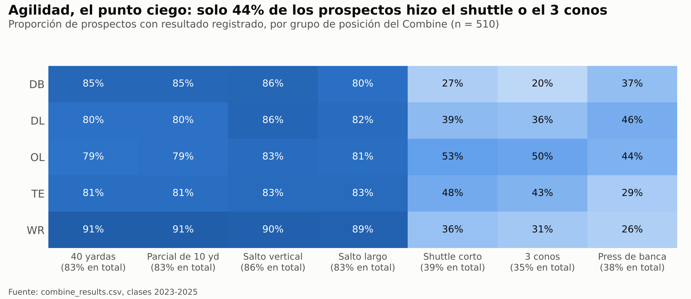

Solo 44% de los prospectos corrió el shuttle o el 3 conos, contra 79–91% en el 40. Los backs defensivos son
los que menos corrieron el 3 conos (20%) y los linieros ofensivos los que más (50%). 27 prospectos no hicieron
ninguna prueba, y van de la primera ronda a los no seleccionados. Faltar es una elección, no ruido, y por eso
cada prueba conserva una bandera de faltante.

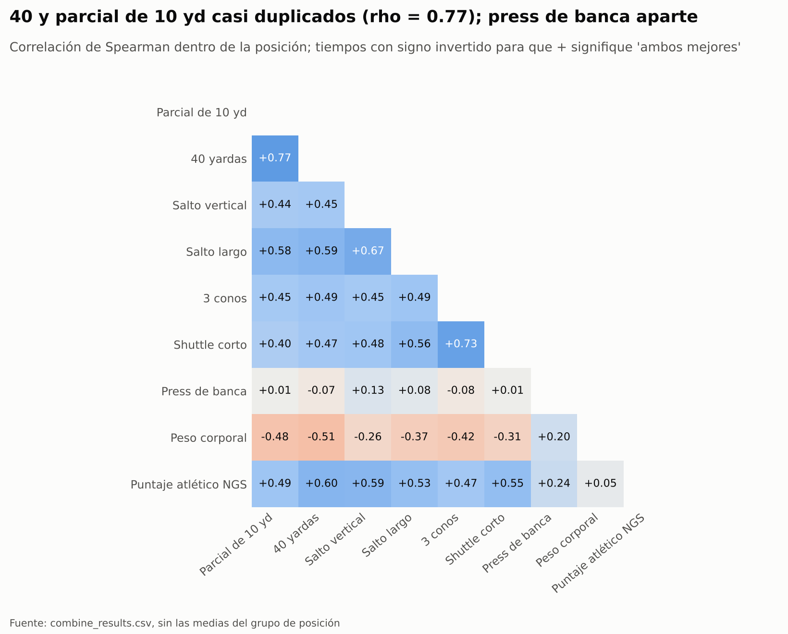

Dentro de la posición, el 40 y el parcial de 10 yd casi se duplican (ρ = 0.77) y los dos saltos van juntos
(0.67). El press de banca no se relaciona con nada. Para un scout, un sprint y un salto capturan casi todo lo
que mide el día de pruebas.

### Movimiento en partido y sus anomalías

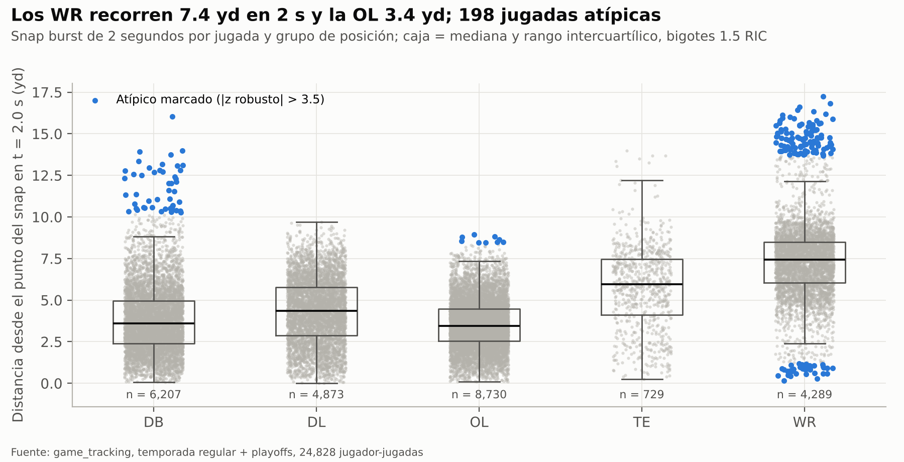

La distancia mediana a 2 segundos va de 3.4 yd (OL) y 3.6 yd (DB), pasando por 4.3 yd (DL) y 6.0 yd (TE),
hasta 7.4 yd (WR), en 24,828 jugadas. La búsqueda marca las jugadas a más de 3.5 desviaciones robustas de la
mediana de su posición: 513 en cuatro métricas, 198 de ellas en snap burst. 142 de esas 198 son jugadas de
receptores y 47 de backs defensivos; 163 son salidas largas y 35 jugadas casi sin movimiento. Ningún cuadro
rompió los topes de velocidad o aceleración, así que se conservan como jugadas reales.


El Snap Burst Index separa a jugadores con el mismo trabajo. Entre los edge rushers con 8+ jugadas, la traza
mediana de Will Anderson (SBI 74, 290 jugadas) llega a 3.8 yd/s dentro de los 2 s; la de Jalen Redmond
(SBI 39, 30 jugadas), a 2.4 yd/s. Con más jugadas por jugador las medianas son más estables, así que los
extremos quedan más cerca que con la semana 18 sola (4.6 vs 1.8 yd/s en v2.2).

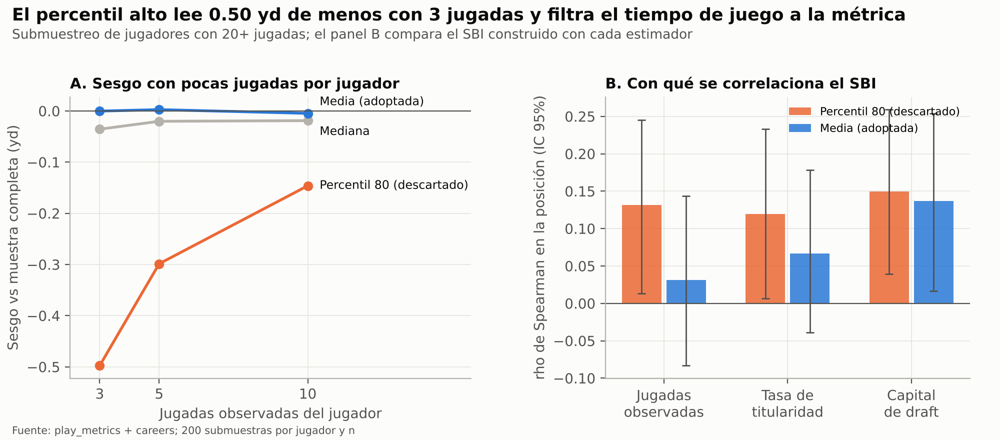

Un estimador de percentil alto lee 0.50 yd de menos con 3 jugadas (191 jugadores con 20+ jugadas). Ese sesgo
por sí solo crea una correlación de 0.13 con las jugadas observadas y de 0.12 con la tasa de titularidad. La
media adoptada da 0.03 y 0.07.

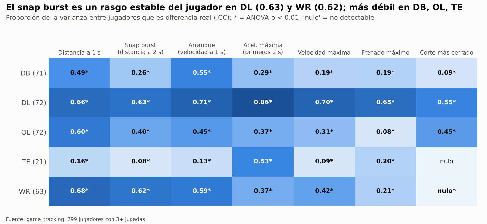

Esta es la figura que fija el enfoque. En la línea defensiva cada métrica es un rasgo estable del jugador
(ICC 0.55–0.86). Los receptores muestran ahora burst, arranque y distancia a 1 s estables (0.59–0.68), pero no
frenado ni cortes (≤ 0.21). Las alas cerradas, con 21 jugadores, casi no muestran ninguno.

### Traducción de las pruebas al partido


Con 299 jugadores con tracking (258 con tiempo de 40) los vínculos se afinan. El 40, el parcial de 10 yd, el
salto largo y el vertical se correlacionan 0.15–0.43 con cada métrica de partido (FDR q < 0.05); el 40 con la
velocidad máxima es el par más fuerte (0.43). El puntaje atlético NGS (−0.05 a 0.06) no, y el press de banca
solo es significativo contra la velocidad máxima (−0.22). Dentro de una posición, los jugadores más pesados se
mueven menos, con ρ entre −0.27 y −0.52. La tasa de titularidad no se relaciona con ninguna prueba de sprint o
salto, solo con el peso corporal (0.15) y el puntaje NGS (0.17).

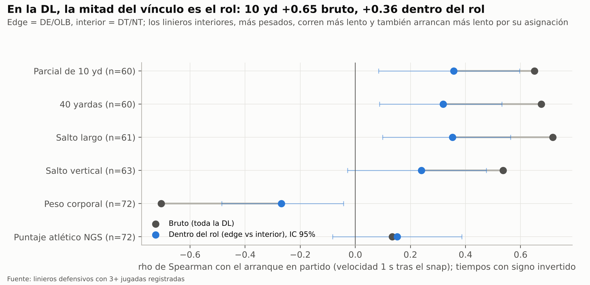

En la línea defensiva los vínculos brutos parecen fuertes: parcial de 10 yd vs arranque ρ = 0.65. Cerca de la
mitad es el rol. Los tackles interiores pesan más, corren más lento y se les pide arrancar distinto. Dentro de
los grupos edge o interior el vínculo es 0.36 (IC 95% 0.09–0.60, q = 0.07 tras FDR).

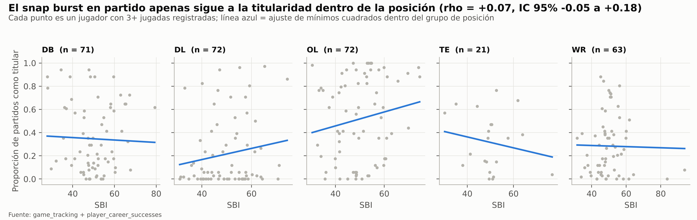

En los 299 jugadores con tracking, el snap burst en partido apenas sigue a la titularidad dentro de la
posición: ρ = 0.07, IC 95% −0.05 a 0.18. Los paneles de la línea ofensiva y defensiva suben, el de las alas
cerradas (21 jugadores) baja y los demás son planos.

### Rendimiento en el campo (v2.0)

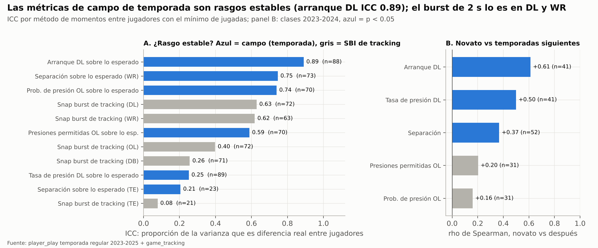

Las métricas de campo de temporada son mucho más fiables que el burst de tracking de 2 segundos. El arranque de
la DL sobre lo esperado llega a ICC 0.89, y la separación de WR y la probabilidad de presión de la OL quedan
cerca de 0.75. Los puntos débiles son la separación de las TE (23 jugadores, 0.21) y la tasa de presión de la
DL (0.25), que es un evento 0/1 poco frecuente. La temporada de novato predice las siguientes para arranque
(ρ = 0.61), presión (0.50) y separación (0.37), pero no para la protección de pase (0.16, no significativa).

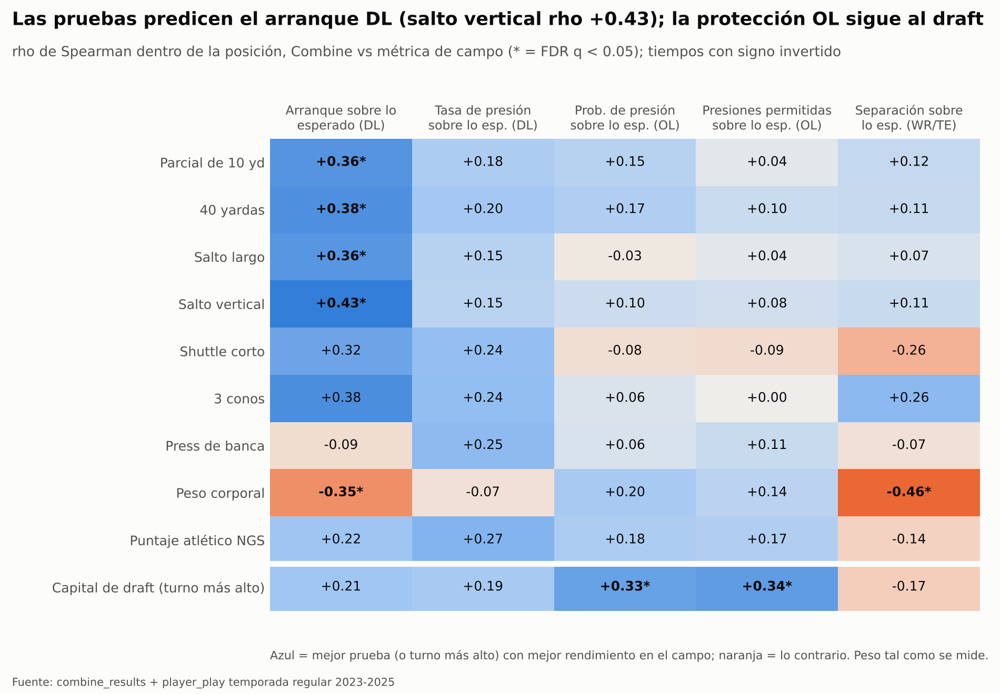

Las pruebas se trasladan en un solo lugar: el arranque de la DL. El vertical (ρ = 0.43), el 40 (0.38), el
parcial de 10 yd (0.36) y el salto largo (0.36) pasan FDR q < 0.05, y los linieros más pesados arrancan más
lento (−0.35). Dentro del rol edge o interior los vínculos se mantienen en 0.37–0.40, así que, a diferencia del
resultado de tracking de la versión 1, no es un artefacto del rol. Ninguna prueba pasa FDR para la presión de
la DL, la protección de la OL o la separación de WR/TE. La protección de la OL sigue al capital de draft
(ρ = 0.33–0.34, q < 0.05). La separación sigue al peso dentro de la posición (−0.46): los receptores y alas
cerradas más ligeros se separan más.


La cadena de las pruebas a la producción pasa por el arranque. Un parcial de 10 yd más rápido va con un
arranque más rápido (0.37 DE por DE), y un arranque más rápido con más presión (0.41 DE, con la prueba fija).
El camino indirecto lleva 0.15 DE, IC 95% 0.04–0.30, cerca del 55% del vínculo total de la prueba con la
presión. La proporción es 52% para el 40, 44% para el salto largo y 77% para el vertical. El pequeño vínculo
negativo del peso con la presión pasa por completo por un arranque más lento.

### Tracking de las pruebas vs el juego (v2.2)

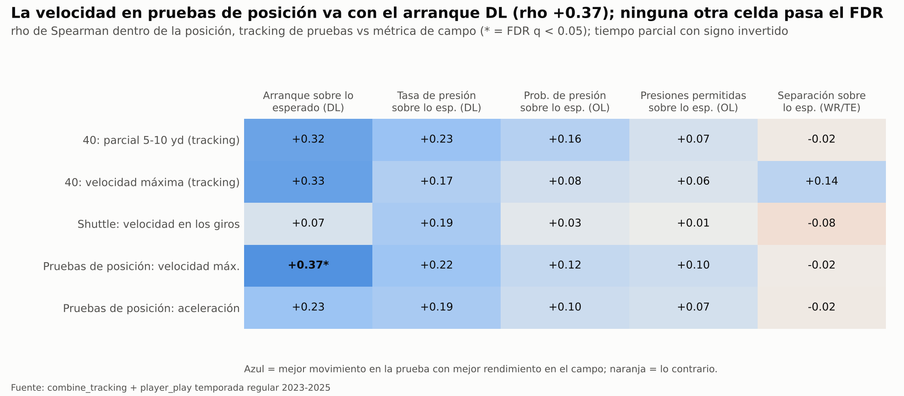

La velocidad máxima en las pruebas de posición es la única variable del tracking de pruebas ligada al arranque
de temporada de la DL tras corregir por FDR (ρ +0.37, q = 0.009, 88 linieros). Dentro de la línea defensiva
sigue de cerca al 40 (ρ −0.76). Al fijar peso, rol y el 40 oficial, la ρ parcial cae a +0.13 (p = 0.31). Contra
el movimiento en partido, 24 de 35 celdas del tracking de pruebas pasan FDR con ρ 0.14–0.44 (16 en v2.2), del
mismo tamaño que las pruebas oficiales; ninguna pasa contra la tasa de titularidad.

## 6. Modelos entrenados

Tres tareas supervisadas responden la pregunta de traducción: Combine → movimiento de tracking (A), quién llega
a titular (B) y Combine → rendimiento de campo de temporada (C, agregada en la versión 2.0). Cada una compara
un modelo lineal con dos ensambles de árboles con el mismo preprocesamiento y los mismos pliegues de CV.

**Tarea A — Regresión: Combine → movimiento en partido.** Objetivo: Snap Burst Index. Variables: solo el
perfil atlético, sin información de draft ni de producción.

- Medidas: estatura, peso, mano, brazo, envergadura.
- Siete pruebas, cada una con su bandera de faltante, más el número de pruebas realizadas.
- Derivadas: Speed Score, fracción del 40 en las primeras 10 yd, momento en 10 yd.
- Puntaje atlético NGS, edad al draft, grupo de posición.

Tres poblaciones (los receptores se agregaron en v3.0):

- Todas las posiciones (n = 299): ¿predicen las pruebas el burst en partido en alguna parte?
- Solo línea defensiva (n = 72): donde el burst es un rasgo medible (ICC 0.63).
- Solo receptores abiertos (n = 63): el burst se volvió un rasgo estable (ICC 0.62) al registrar temporadas completas, y lo sigue siendo sin el contexto de la ruta.

| Modelo | Papel | Por qué está en la comparación |
| --- | --- | --- |
| Media por posición | Referencia | Predice el promedio de cada grupo de posición; cualquier cosa útil debe superarla |
| Regresión ridge | Lineal (mínimos cuadrados con penalización L2) | Interpretable y estable con ~30 variables correlacionadas y n ≤ 299 |
| Random forest | Árboles por bagging | Captura umbrales e interacciones (efectos de pruebas que cambian con el tamaño) |
| XGBoost | Árboles por boosting de gradiente | Fuerte en datos tabulares pequeños con árboles poco profundos y regularización |

**Tarea B — Clasificación: quién llega a titular.** Objetivo: inició el 50%+ de los partidos de temporada
regular disponibles (103 de 510, 20.2%). Los conjuntos de variables están anidados, así cada paso responde una
sola pregunta:

1. Combine: el perfil atlético más el puntaje NGS de producción y la bandera de conferencia fuerte. Es lo que tiene un scout antes del draft.
2. Combine + draft: agrega el log del turno de draft y una bandera de no seleccionado. Es lo que decidió la liga.
3. Combine + draft + movimiento en partido: agrega SBI, arranque, aceleración máxima, velocidad máxima, frenado y corte, normalizados por posición. Se mide después del draft, así que es solo diagnóstico.

Los conjuntos 1 y 2 corren en los 510 prospectos. Los conjuntos 2 y 3 corren en los 299 jugadores con tracking
(93 titulares), así la comparación de movimiento usa los mismos jugadores y pliegues.

| Modelo | Papel | Desbalance de clases |
| --- | --- | --- |
| Regresión logística | Lineal; penalización L1 o L2 elegida por la rejilla | `class_weight = balanced` |
| Random forest | Árboles por bagging | `class_weight = balanced` |
| XGBoost | Árboles por boosting de gradiente | `scale_pos_weight` = negativos ÷ positivos en el pliegue de entrenamiento |

**Tarea C (v2.0) — Regresión: Combine → rendimiento en el campo.** Mismas variables que la tarea A (solo perfil
atlético), mismos cuatro modelos, misma CV anidada. Una tarea por familia con un resultado medible:

| Tarea | Jugadores | Objetivo (contraído, sobre lo esperado) | Estratos de CV |
| --- | --- | --- | --- |
| dl_getoff | 88 DL | Arranque sobre lo esperado (s) | Rol edge / interior |
| dl_pressure | 89 DL | Tasa de presión sobre lo esperado | Rol edge / interior |
| ol_protection | 70 OL | Probabilidad de presión sobre lo esperado | T / G / C |
| wrte_separation | 96 WR + TE | Separación sobre lo esperado (yd) | WR / TE |

El rol y la posición NFL solo equilibran los pliegues de CV; nunca entran al modelo, porque se deciden después
del draft.

**Agregados a la tarea B (v2.0).** Dos conjuntos se suman a la comparación de titulares:

- **Combine + draft + campo proyectado** (los 510 prospectos, utilizable antes del draft). Un `OnFieldProjector` apilado vive dentro del pipeline. En cada pliegue de entrenamiento aprende Combine → GOE, PROE, PPOE y SOE con una regresión ridge (α = 10) en los jugadores que tienen esa métrica, y le pasa al clasificador la proyección en lugar del valor observado. Las filas de entrenamiento reciben proyecciones fuera de pliegue de 5 pliegues, para que el clasificador vea el mismo tipo de proyección ruidosa que verá en un prospecto nuevo. Los valores de campo observados son solo etiquetas: una prueba unitaria verifica que borrarlos no cambia ninguna predicción.
- **Combine + draft + rendimiento en el campo** (255 jugadores con índice de campo, diagnóstico). Se agregan directamente los cuatro puntajes z dentro de la familia; una métrica fuera de la familia del jugador vale 0, el promedio de la familia. Se miden después del draft, así que este modelo queda registrado como retador, igual que el de movimiento.

El campeón pre-draft cambia al conjunto del proyector solo si supera a Combine + draft en AUC medio y su prueba
de DeLong da p < 0.05.

**Variantes con tracking de pruebas (v2.2).** Cada tarea de juego (las poblaciones del snap burst de la línea
defensiva y, desde v3.0, de los receptores, y las cuatro tareas de campo) corre dos veces con los mismos
jugadores y pliegues: una con las variables atléticas y otra con esas más las cinco variables del tracking de
pruebas. La tarea B agrega el conjunto pre-draft Combine + draft + tracking de pruebas. Los pipelines con
tracking de pruebas quedan registrados como retadores (sufijo `-ct` y `cgmt-starter-classifier-combine-tracking`).
El campeón de titulares cambiaría solo si ese conjunto ganara en AUC medio con DeLong p < 0.05, la misma regla
que siguió el proyector.

**Pipeline común.** Cada modelo es un solo `Pipeline` de scikit-learn: `PositionMedianImputer` →
`ColumnTransformer` (`StandardScaler` en numéricas, `OneHotEncoder` en el grupo de posición) → estimador, con el
`OnFieldProjector` entre la imputación y la codificación cuando se usa el conjunto proyectado. Como la
imputación, la proyección y el escalado viven dentro del pipeline, la CV los vuelve a ajustar en cada pliegue
de entrenamiento.

**Diseño de la evaluación.** Validación cruzada anidada:

- Lazo externo: `RepeatedStratifiedKFold`, 5 pliegues × 3 repeticiones = 15 pliegues de prueba, que estiman el rendimiento. La clasificación estratifica por el objetivo; la regresión por grupo de posición (todas las posiciones), rol edge/interior (línea defensiva) o posición NFL (receptores).
- Lazo interno: `GridSearchCV` con CV de 3 pliegues elige los hiperparámetros solo con la parte de entrenamiento externa.
- Selección: ROC-AUC en clasificación, RMSE en regresión.

El campeón de cada tarea se vuelve a ajustar con CV de 5 pliegues en todas las filas, se reentrena y se
registra en MLflow.

## 7. Configuración de hiperparámetros

La búsqueda interna eligió casi siempre la configuración más conservadora. Eso cuadra con un problema pequeño
y ruidoso: los modelos necesitaban más regularización que flexibilidad.

**Diseño de la búsqueda.** `GridSearchCV` corre dentro de cada uno de los 15 pliegues externos de
entrenamiento, con CV interna de 3 pliegues. La selección usa ROC-AUC en clasificación y RMSE en regresión.
Las rejillas viven en `configuracion/config.yaml`; XGBoost además fija subsample 0.8, colsample 0.8 y λ = 1.
Semilla 42 en todo.

| Modelo | Rejilla buscada | Lo más elegido (pliegues externos) |
| --- | --- | --- |
| Ridge | α ∈ {1, 10, 100, 300, 1000} | Todas las posiciones: α = 1000 (10/15). DL: α = 100 (13/15). WR: α = 100 (11/15) |
| Regresión logística | C ∈ {0.01, 0.1, 1, 10}; L1 o L2 | L1 en 56 de 60 ajustes por pliegue. C = 0.1 en tres escenarios; C = 0.01 para Combine + draft en todos los prospectos (12/15) |
| Random forest (ambas tareas) | 200 árboles; profundidad ∈ {3, 6, sin límite}; hoja mínima ∈ {3, 10}; fracción de variables ∈ {0.33, 0.66} | Profundidad 3 en 59 de 105 ajustes (4 escenarios de titulares y 3 poblaciones del SBI), hoja 10 en 51 de 105; la fracción de variables se reparte (0.66 en 53) |
| XGBoost (ambas tareas) | árboles ∈ {200, 400}; profundidad ∈ {2, 3}; tasa de aprendizaje ∈ {0.03, 0.1}; peso mínimo de hijo ∈ {3, 8} | 200 árboles, tasa 0.03 y profundidad 2 en 73 de 105 ajustes; tasa 0.03 en 99 de 105. La regresión de WR reparte profundidad 2 y 3 (8/7) |

Dos elecciones se leen como hallazgos:

- **El ridge de todas las posiciones se queda en la mayor penalización de la rejilla.** Es el modelo diciendo que las pruebas casi no tienen señal lineal para el SBI de todas las posiciones más allá de la posición: encoger los coeficientes hacia cero gana a usarlos.
- **La regresión logística elige L1 casi siempre.** Conserva un conjunto disperso de variables; con el capital de draft presente, el turno de draft carga el modelo.

**Configuración de la versión 2.0.** Las regresiones de campo reutilizan las mismas rejillas, y las búsquedas
vuelven a ser conservadoras:

- Ridge eligió α = 300 para los dos objetivos de la DL, 1,000 para la protección de la OL y 100 para la separación de WR/TE.
- Los random forest eligieron profundidad 3 en la mayoría de los pliegues externos de cada tarea de campo (el reajuste final de la presión de la DL eligió profundidad 6).
- XGBoost mantuvo 200 árboles con tasa de aprendizaje 0.03.

El `OnFieldProjector` usa una configuración fija: ridge α = 10 con 5 pliegues internos para las proyecciones
fuera de pliegue. No se ajusta, porque hacerlo agregaría un tercer nivel de anidación para comprar una variable
que no mostró señal (sección 8).

**Campeones registrados** (reajustados con CV de 5 pliegues en todas las filas y reentrenados):

| Nombre en el registro @ alias | Modelo | Hiperparámetros finales | Puntaje de CV interna |
| --- | --- | --- | --- |
| cgmt-starter-classifier @ champion | XGBoost, Combine + draft, 510 prospectos | 200 árboles, profundidad 2, tasa 0.03, peso mínimo de hijo 3 | AUC 0.914 |
| cgmt-starter-classifier-movement @ challenger | XGBoost, + movimiento en partido, 299 jugadores | 200 árboles, profundidad 2, tasa 0.1, peso mínimo de hijo 3 | AUC 0.892 |
| cgmt-snap-burst-regressor @ champion | Random forest, todas las posiciones (299) | 200 árboles, profundidad 6, fracción de variables 0.33, hoja mínima 3 | RMSE 9.74 |
| cgmt-snap-burst-regressor-dl @ champion | Random forest, línea defensiva (72) | 200 árboles, profundidad 3, fracción de variables 0.66, hoja mínima 10 | RMSE 8.20 |
| cgmt-snap-burst-regressor-wr @ champion (v3.0) | Ridge, receptores abiertos (63) | α = 300 | RMSE 8.35 |
| cgmt-onfield-dl-getoff @ champion | Random forest, 88 DL | 200 árboles, profundidad 3, fracción de variables 0.66, hoja mínima 3 | RMSE 0.060 s |
| cgmt-onfield-dl-pressure @ champion | Random forest, 89 DL | 200 árboles, profundidad 6, fracción de variables 0.33, hoja mínima 3 | RMSE 0.0115 (no mejor que la referencia) |
| cgmt-onfield-ol-protection @ champion | Random forest, 70 OL | 200 árboles, profundidad 3, fracción de variables 0.33, hoja mínima 10 | RMSE 0.0178 (no mejor que la referencia) |
| cgmt-onfield-wrte-separation @ champion | Ridge, 96 WR/TE | α = 100 | RMSE 0.178 yd |
| cgmt-starter-classifier-onfield @ challenger | Random forest, + rendimiento en el campo, 255 jugadores | 200 árboles, profundidad 3, fracción de variables 0.33, hoja mínima 10 | AUC 0.876 |

Los retadores con tracking de pruebas usan las mismas rejillas; sus hiperparámetros elegidos están en
`regression_final_models.json` y `classification_final_models.json`. El retador de titulares con tracking de
pruebas elige la misma configuración de XGBoost que el campeón. Con el tracking de temporada completa, el
campeón de todas las posiciones pasa de ridge a random forest, y el de la DL de XGBoost a random forest.

## 8. Métricas obtenidas

Los resultados del Combine predicen mejor el snap burst en la línea defensiva: RMSE 7.85 frente a 9.99 de la
referencia, 21% menos (v2.2: 8.54 frente a 10.05, 15%). Los receptores, nuevos en v3.0, ganan 10%, y todas las
posiciones juntas, 5%. Para titulares, el capital de draft sube el ROC-AUC de 0.84 a 0.91 y el movimiento en
partido no suma nada.

La versión 2.0 agrega dos objetivos de campo predecibles, el arranque de la DL (R² agrupado 0.13) y la
separación de WR/TE (0.19), y dos que las pruebas no predicen, la presión de la DL y la protección de la OL. El
rendimiento de campo observado suma +0.004 a +0.009 de AUC al modelo de titulares; el rendimiento proyectado
desde el Combine no suma nada.

Todos los números son fuera de muestra: media ± DE en los 15 pliegues externos de la CV anidada. El "R²
agrupado" promedia las predicciones fuera de pliegue de cada jugador en las 3 repeticiones y las puntúa una
vez, con un IC 95% bootstrap de 2,000 remuestreos. Es el número más estable para los 72 linieros defensivos y
los 63 receptores, donde cada pliegue de prueba tiene 12–15 jugadores.

### Regresión: Combine → Snap Burst Index (puntos SBI)

| Población | Modelo | MAE | RMSE | R² (media de pliegues) | R² agrupado [IC 95%] |
| --- | --- | --- | --- | --- | --- |
| Todas las posiciones (n = 299) | Media por posición (referencia) | 7.78 ± 0.84 | 10.06 ± 1.02 | −0.05 ± 0.04 | −0.04 [−0.06, −0.03] |
| Todas las posiciones | Ridge | 7.59 ± 0.81 | 9.83 ± 1.04 | −0.00 ± 0.03 | 0.02 [−0.02, 0.05] |
| Todas las posiciones | Random forest (campeón) | 7.39 ± 0.87 | 9.57 ± 1.03 | 0.05 ± 0.07 | 0.07 [0.00, 0.12] |
| Todas las posiciones | XGBoost | 7.52 ± 0.81 | 9.70 ± 1.06 | 0.02 ± 0.09 | 0.05 [−0.03, 0.13] |
| Línea defensiva (n = 72) | Media por posición (referencia) | 8.43 ± 0.98 | 9.99 ± 1.20 | −0.07 ± 0.09 | −0.02 [−0.10, −0.01] |
| Línea defensiva | Ridge | 6.50 ± 1.19 | 8.08 ± 1.27 | 0.29 ± 0.17 | 0.34 [0.16, 0.47] |
| Línea defensiva | Random forest (campeón) | 6.53 ± 1.16 | 7.85 ± 1.27 | 0.33 ± 0.17 | 0.37 [0.17, 0.50] |
| Línea defensiva | XGBoost | 6.68 ± 1.29 | 8.01 ± 1.55 | 0.30 ± 0.24 | 0.37 [0.11, 0.53] |
| Receptores abiertos (n = 63, v3.0) | Media por posición (referencia) | 6.86 ± 2.34 | 9.38 ± 4.02 | −0.16 ± 0.20 | −0.03 [−0.13, −0.02] |
| Receptores abiertos | Ridge (campeón) | 6.39 ± 1.90 | 8.45 ± 2.97 | −0.08 ± 0.56 | 0.22 [−0.01, 0.31] |
| Receptores abiertos | Random forest | 6.24 ± 1.98 | 8.65 ± 3.16 | −0.11 ± 0.53 | 0.17 [−0.05, 0.27] |
| Receptores abiertos | XGBoost | 7.28 ± 2.06 | 9.57 ± 2.69 | −0.47 ± 0.77 | 0.06 [−0.43, 0.21] |

El R² de la referencia es negativo, no cero, porque las medias por posición aprendidas en los pliegues de
entrenamiento no coinciden con la media del pliegue de prueba. Cada modelo se lee contra la fila de referencia,
no contra cero. El R² por pliegue de los receptores oscila mucho (ridge −0.08 ± 0.56). Dos receptores quedan muy
por encima del resto, Derius Davis (SBI 94) y Jacob Cowing (84), y los pliegues de prueba que los contienen
concentran la mayor parte del error; los pliegues sin ellos tienen tan poca dispersión que errores pequeños
vuelven negativo el R². El R² agrupado es la lectura más estable.


### Regresión (v2.0): Combine → rendimiento en el campo

Las pruebas predicen de forma modesta el arranque de la DL y la separación de WR/TE; no predicen la presión de
la DL ni la protección de la OL. Las unidades son las de cada objetivo: segundos para el arranque, puntos de
tasa para la presión, puntos de probabilidad para la protección y yardas para la separación.

| Tarea (n) | Modelo | MAE | RMSE | R² (media de pliegues) | R² agrupado [IC 95%] |
| --- | --- | --- | --- | --- | --- |
| Arranque DL, s (88) | Media por posición | 0.053 | 0.064 ± 0.006 | −0.03 ± 0.04 | −0.01 [−0.08, −0.01] |
| Arranque DL | Ridge | 0.051 | 0.062 ± 0.006 | 0.03 ± 0.09 | 0.06 [−0.07, 0.16] |
| Arranque DL | Random forest (campeón) | 0.049 | 0.060 ± 0.005 | 0.10 ± 0.10 | 0.13 [−0.02, 0.25] |
| Arranque DL | XGBoost | 0.052 | 0.063 ± 0.007 | 0.00 ± 0.18 | 0.08 [−0.15, 0.25] |
| Presión DL (89) | Media por posición | 0.0091 | 0.0124 ± 0.0026 | −0.09 ± 0.09 | −0.03 [−0.09, −0.02] |
| Presión DL | Ridge | 0.0096 | 0.0122 ± 0.0026 | −0.07 ± 0.18 | 0.01 [−0.12, 0.08] |
| Presión DL | Random forest | 0.0093 | 0.0120 ± 0.0024 | −0.12 ± 0.63 | 0.05 [−0.13, 0.17] |
| Presión DL | XGBoost | 0.0101 | 0.0129 ± 0.0029 | −0.33 ± 0.84 | −0.08 [−0.42, 0.13] |
| Protección OL (70) | Media por posición | 0.0150 | 0.0186 ± 0.0028 | −0.30 ± 0.61 | −0.05 [−0.14, −0.04] |
| Protección OL | Ridge | 0.0151 | 0.0187 ± 0.0027 | −0.31 ± 0.59 | −0.06 [−0.15, −0.03] |
| Protección OL | Random forest | 0.0145 | 0.0182 ± 0.0028 | −0.24 ± 0.54 | −0.01 [−0.14, 0.07] |
| Protección OL | XGBoost | 0.0155 | 0.0196 ± 0.0023 | −0.45 ± 0.60 | −0.12 [−0.44, 0.08] |
| Separación WR/TE, yd (96) | Media por posición | 0.138 | 0.186 ± 0.055 | −0.01 ± 0.07 | 0.01 [−0.08, 0.03] |
| Separación WR/TE | Ridge (campeón) | 0.128 | 0.169 ± 0.048 | 0.16 ± 0.13 | 0.19 [−0.01, 0.30] |
| Separación WR/TE | Random forest | 0.124 | 0.169 ± 0.040 | 0.13 ± 0.15 | 0.21 [0.00, 0.32] |
| Separación WR/TE | XGBoost | 0.133 | 0.180 ± 0.040 | −0.04 ± 0.46 | 0.13 [−0.22, 0.31] |

El R² por pliegue de la protección de la OL es negativo incluso en la referencia: los pliegues de prueba tienen
unos 14 linieros con poca dispersión, así que un pequeño desplazamiento de la media del pliegue mueve mucho el
R². El R² agrupado es la lectura más estable, y deja a todos los modelos de la OL en cero o por debajo.

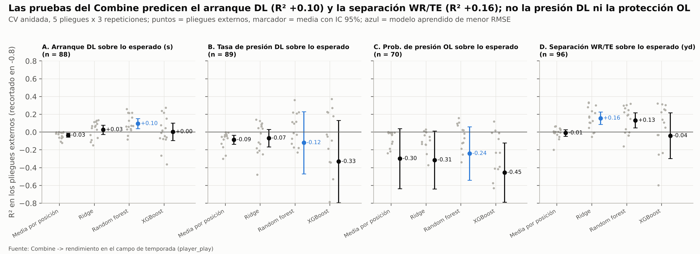

### Clasificación: titular (inició el 50%+ de los partidos disponibles)

Las métricas con umbral usan un corte de 0.5 sobre modelos con pesos por clase, lo que favorece la
exhaustividad (recall): perder a un futuro titular se considera más costoso que una falsa alarma.

| Población | Variables | Modelo | Exactitud | Precisión | Exhaustividad | F1 | ROC-AUC | PR-AUC |
| --- | --- | --- | --- | --- | --- | --- | --- | --- |
| Todos los prospectos (510; 103 titulares) | Combine | Logística | 0.759 | 0.441 | 0.723 | 0.545 | 0.835 ± 0.032 | 0.617 |
| Todos los prospectos | Combine | Random forest | 0.774 | 0.464 | 0.697 | 0.553 | 0.830 ± 0.031 | 0.629 |
| Todos los prospectos | Combine | XGBoost | 0.796 | 0.507 | 0.674 | 0.572 | 0.840 ± 0.036 | 0.652 |
| Todos los prospectos | Combine + draft | Logística | 0.839 | 0.585 | 0.738 | 0.649 | 0.911 ± 0.022 | 0.745 |
| Todos los prospectos | Combine + draft | Random forest | 0.800 | 0.506 | 0.877 | 0.640 | 0.912 ± 0.022 | 0.755 |
| Todos los prospectos | Combine + draft | XGBoost (campeón) | 0.824 | 0.549 | 0.800 | 0.646 | 0.915 ± 0.025 | 0.758 |
| Con tracking (299; 93 titulares) | Combine + draft | Logística | 0.783 | 0.636 | 0.724 | 0.672 | 0.884 ± 0.029 | 0.785 |
| Con tracking | Combine + draft | Random forest | 0.767 | 0.596 | 0.824 | 0.688 | 0.881 ± 0.039 | 0.777 |
| Con tracking | Combine + draft | XGBoost | 0.776 | 0.618 | 0.757 | 0.676 | 0.884 ± 0.040 | 0.789 |
| Con tracking | + movimiento en partido | Logística | 0.783 | 0.634 | 0.727 | 0.673 | 0.882 ± 0.032 | 0.782 |
| Con tracking | + movimiento en partido | Random forest | 0.763 | 0.594 | 0.785 | 0.672 | 0.879 ± 0.038 | 0.777 |
| Con tracking | + movimiento en partido | XGBoost (retador) | 0.776 | 0.622 | 0.752 | 0.676 | 0.884 ± 0.038 | 0.786 |
| Todos los prospectos (v2.0) | + campo proyectado | Logística | 0.839 | 0.585 | 0.728 | 0.646 | 0.910 ± 0.025 | 0.745 |
| Todos los prospectos (v2.0) | + campo proyectado | Random forest | 0.801 | 0.509 | 0.878 | 0.642 | 0.910 ± 0.020 | 0.748 |
| Todos los prospectos (v2.0) | + campo proyectado | XGBoost | 0.833 | 0.567 | 0.803 | 0.658 | 0.916 ± 0.024 | 0.756 |
| Con métricas de campo (255; 79 titulares) | Combine + draft | Logística | 0.792 | 0.643 | 0.768 | 0.697 | 0.865 ± 0.053 | 0.789 |
| Con métricas de campo | Combine + draft | Random forest | 0.792 | 0.640 | 0.794 | 0.706 | 0.867 ± 0.056 | 0.783 |
| Con métricas de campo | Combine + draft | XGBoost | 0.788 | 0.643 | 0.747 | 0.689 | 0.851 ± 0.070 | 0.761 |
| Con métricas de campo | + rendimiento en el campo | Logística | 0.803 | 0.666 | 0.755 | 0.705 | 0.869 ± 0.050 | 0.801 |
| Con métricas de campo | + rendimiento en el campo | Random forest (retador) | 0.800 | 0.658 | 0.781 | 0.711 | 0.874 ± 0.057 | 0.801 |
| Con métricas de campo | + rendimiento en el campo | XGBoost | 0.795 | 0.650 | 0.768 | 0.701 | 0.861 ± 0.073 | 0.780 |

La precisión y el PR-AUC son más altos en el grupo con tracking porque su tasa base de titulares es 31%, contra
20% en total; solo se comparan filas dentro de una misma población.

La versión 2.0 mueve los números de titulares en un solo lugar. El proyector pre-draft cambia el AUC entre
−0.002 y +0.0004, así que el campeón registrado sigue siendo Combine + draft (XGBoost, 0.915). El rendimiento de
campo observado sube a todos los modelos entre +0.004 y +0.009 de AUC y mejora exactitud, precisión y F1 en los
tres, mientras la exhaustividad baja cerca de 0.01 en la logística y el random forest. Es una ganancia medible
pero pequeña, y la evidencia es mixta (sección 9).

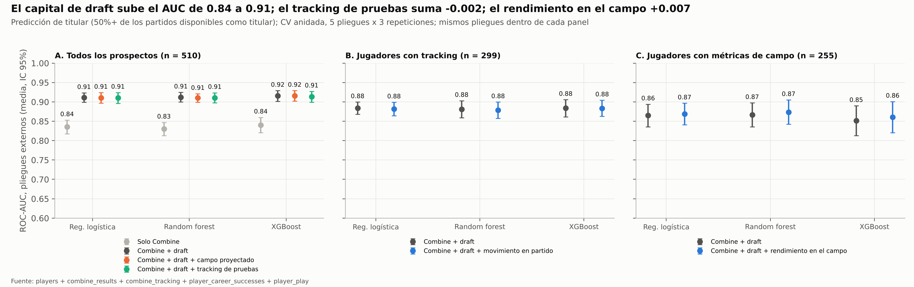

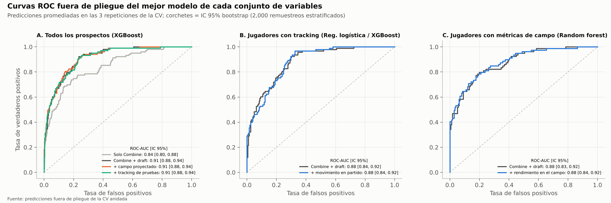

### Tracking de las pruebas: con frente a sin (v2.2)

Agregar el tracking de las pruebas no mejora ningún modelo. Cada fila compara el mejor modelo aprendido de
cada brazo en los mismos 15 pliegues externos.

| Objetivo | Mejor modelo, sin → con | Sin | Con | Cambio (IC 95%) | p, t corregida | Pliegues mejores |
| --- | --- | --- | --- | --- | --- | --- |
| Snap burst DL (SBI), R² | Random forest → random forest | 0.332 | 0.336 | +0.004 (−0.04, 0.04) | 0.83 | 8 de 15 |
| Snap burst WR (SBI), R² (v3.0) | Ridge → random forest | −0.081 | −0.088 | −0.007 (−0.70, 0.68) | 0.98 | 6 de 15 |
| Arranque DL sobre lo esperado, R² | Random forest → random forest | 0.096 | 0.091 | −0.004 (−0.10, 0.09) | 0.92 | 8 de 15 |
| Presión DL sobre lo esperado, R² | Random forest → random forest | −0.119 | −0.156 | −0.037 (−0.19, 0.12) | 0.62 | 9 de 15 |
| Protección OL sobre lo esperado, R² | Random forest → random forest | −0.241 | −0.291 | −0.051 (−0.16, 0.06) | 0.35 | 6 de 15 |
| Separación WR/TE sobre lo esperado, R² | Ridge → random forest | 0.157 | 0.123 | −0.034 (−0.24, 0.17) | 0.73 | 9 de 15 |
| Titular, todos los prospectos, ROC-AUC | XGBoost → XGBoost | 0.915 | 0.913 | −0.002 (−0.012, 0.008) | 0.68 (DeLong 0.30) | 5 de 15 |

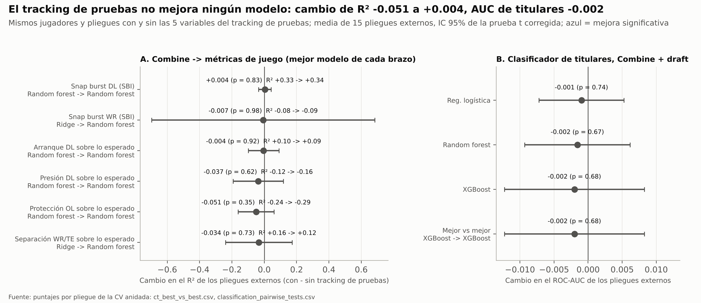

Los valores de R² son medias de los pliegues externos; los valores agrupados fuera de pliegue están en
`regression_summary.csv`. Las métricas con umbral casi no cambian en el modelo de titulares: F1 0.646 → 0.647
con XGBoost.

## 9. Comparación estadística de resultados

Tres conclusiones se sostienen en todas las pruebas:

- El capital de draft mejora la predicción de titulares (todas las pruebas p < 0.003).
- El movimiento en partido no la mejora (p ≥ 0.47).
- La familia de modelos importa poco.

Con el tracking de temporada completa, la regresión de la línea defensiva supera a su referencia en todas las
pruebas, incluida la prueba t corregida, la más estricta (Holm p = 0.001). La ganancia en receptores es
consistente pliegue a pliegue, pero no es significativa con esa prueba, así que su evidencia es moderada.

**Por qué estas pruebas.** Los 15 pliegues externos comparten jugadores de entrenamiento, así que una prueba t
pareada simple sobre los puntajes por pliegue exagera la confianza. El estudio usa:

- **Prueba t corregida para remuestreo** (Nadeau y Bengio, 2003). Infla la varianza por 1/J + n_prueba/n_entrenamiento, con J = 15 pliegues.
- **Rangos con signo de Wilcoxon** en los mismos pliegues, como control que no supone diferencias normales.
- **Corrección de Holm** dentro de cada familia de comparaciones por pares.
- **Prueba de Friedman** como control ómnibus de que los modelos tienen el mismo rango.
- **Prueba de DeLong** sobre las predicciones agrupadas fuera de pliegue, para comparar dos ROC-AUC correlacionados en los mismos jugadores.

$$
t = \frac{\bar{d}}{\sqrt{\left(\frac{1}{J} + \frac{n_{\text{prueba}}}{n_{\text{entrenamiento}}}\right)\hat{\sigma}_d^{2}}}, \qquad gl = J - 1
$$

### Regresión (RMSE, puntos SBI)

| Población | Comparación | ΔRMSE | t corregida (p, p Holm) | Wilcoxon p (Holm) |
| --- | --- | --- | --- | --- |
| Todas las posiciones | Random forest vs referencia | −0.49 | 2.64 (0.019, 0.12) | 0.0003 (0.002) |
| Todas las posiciones | Ridge vs referencia | −0.24 | 2.28 (0.039, 0.19) | 0.0006 (0.003) |
| Todas las posiciones | Random forest vs ridge | −0.25 | 1.43 (0.17, 0.66) | 0.008 (0.033) |
| Línea defensiva | Random forest vs referencia | −2.15 | 4.97 (0.0002, 0.001) | 0.0001 (0.0004) |
| Línea defensiva | Ridge vs referencia | −1.91 | 4.42 (0.0006, 0.003) | 0.0001 (0.0004) |
| Línea defensiva | XGBoost vs referencia | −1.99 | 2.91 (0.012, 0.046) | 0.0003 (0.001) |
| Línea defensiva | Modelos aprendidos entre sí | 0.07–0.23 | p ≥ 0.47 | p ≥ 0.21 |
| Receptores abiertos | Ridge vs referencia | −0.93 | 1.08 (0.30, 1.0) | 0.030 (0.15) |
| Receptores abiertos | Random forest vs referencia | −0.73 | 0.91 (0.38, 1.0) | 0.064 (0.19) |
| Receptores abiertos | XGBoost vs ridge | +1.11 | 1.20 (0.25, 1.0) | 0.030 (0.15) |

Friedman, todas las posiciones: χ² = 18.4, p < 0.001; random forest tiene el mejor rango (media 1.60) y la
referencia el peor (3.60). Friedman, línea defensiva: χ² = 22.6, p < 0.001; random forest tiene el mejor rango
(1.93) y la referencia el peor (3.87). Friedman, receptores: χ² = 12.7, p = 0.005; ridge tiene el mejor rango
(1.60) y XGBoost (3.07) queda por debajo de la referencia (3.00): los árboles con boosting sobreajustan a 63
receptores.

### Clasificación (ROC-AUC)

| Pregunta | Resultado | t corregida | DeLong |
| --- | --- | --- | --- |
| ¿Suma el capital de draft al Combine? (todos los prospectos) | +0.075 a +0.082 de AUC en los 3 modelos | p = 0.0005–0.0019 | z = 3.0–4.9, p ≤ 0.0023 |
| ¿Suma el movimiento en partido a Combine + draft? (con tracking) | −0.003 a −0.0002 de AUC | p = 0.52–0.99 | p = 0.47–0.81 |
| ¿Difieren las familias de modelos? (12 pruebas por pares) | Mayor diferencia 0.010 de AUC | p Holm ≥ 0.76 | — |

Friedman entre las tres familias solo es significativo con las variables del Combine solo (χ² = 10.1,
p = 0.006; XGBoost queda primero). No lo es en los otros tres escenarios (p = 0.15–0.59).

### Prueba de razón de verosimilitud para el Snap Burst Index

Un GLM logístico sobre los 299 jugadores con tracking hace la pregunta de negocio directamente:
titular ~ posición + log turno de draft + atletismo NGS + SBI. Agregar el SBI deja el ajuste igual:

- Razón de momios por +10 puntos de SBI: 0.87, IC 95% 0.61–1.24, p de Wald = 0.45.
- χ² de razón de verosimilitud = 0.58, p = 0.45. El AIC sube de 226.7 a 228.1.
- El pseudo-R² se queda en 0.43, casi todo por el turno de draft.

El puntaje atlético NGS tampoco suma nada (OR 1.02 por 10 puntos, p = 0.92).

Una mirada exploratoria, no preespecificada, a los jugadores del día 3 y no seleccionados pregunta si el SBI
importa donde el capital de draft dice menos. La versión 2.2 encontró ρ = 0.14 (IC 95% −0.04 a 0.30, 11
titulares entre 107) y la marcó como hipótesis, no como hallazgo. Con temporadas completas es ρ = −0.03
(−0.16 a 0.11, 12 titulares entre 164): el indicio era ruido.

### Pruebas de la versión 2.0

Tres conclusiones se sostienen: las pruebas del Combine superan a la posición sola en el arranque de la DL y la
separación de WR/TE; el proyector no suma nada; el rendimiento de campo observado suma poco, y solo las pruebas
menos conservadoras lo confirman.

**Regresiones de campo (RMSE).**

| Tarea | Mejor vs referencia | ΔRMSE | t corregida (p, p Holm) | Wilcoxon p (Holm) | Friedman χ² (p) |
| --- | --- | --- | --- | --- | --- |
| Arranque DL | Random forest | −0.0043 s | 2.86 (0.013, 0.075) | 0.0001 (0.0004) | 21.5 (0.0001); RF primero (1.27) |
| Separación WR/TE | Ridge | −0.017 yd | 2.26 (0.040, 0.24) | 0.0003 (0.002) | 6.8 (0.080) |
| Presión DL | Random forest | −0.0004 | 0.40 (0.69, 1.0) | 0.055 (0.25) | 7.6 (0.056) |
| Protección OL | Random forest | −0.0003 | 0.64 (0.53, 1.0) | 0.15 (0.38) | 6.6 (0.086) |

Las ganancias en el arranque de la DL y en la separación de WR/TE son consistentes pliegue a pliegue (Wilcoxon,
Holm p ≤ 0.002). No superan la prueba t corregida tras la corrección de Holm, así que se tratan como evidencia
moderada, igual que el resultado del snap burst de los receptores en v3.0.

**Clasificadores de titulares (ROC-AUC).**

| Pregunta | ΔAUC (3 modelos) | t corregida p | Wilcoxon p | DeLong p |
| --- | --- | --- | --- | --- |
| Campo proyectado vs Combine + draft (510) | −0.002 a +0.0004 | 0.64–0.87 | 0.29–0.84 | 0.054–0.77 (LR y RF algo peores) |
| Campo observado vs Combine + draft (255) | +0.004 a +0.009 | 0.21–0.79 | 0.44 (LR), 0.035 (RF), 0.021 (XGB) | 0.46 (LR), 0.37 (RF), 0.037 (XGB) |

**Prueba de razón de verosimilitud para el rendimiento de campo.** Un GLM logístico sobre los 255 jugadores
pregunta: titular ~ posición + log turno de draft + índice de campo, con el índice en z dentro de la familia.
Agregar el índice mejora el ajuste: razón de momios 1.47 por DE, IC 95% 1.02–2.12, χ² = 4.22, p = 0.040, AIC
198.8 → 196.5. El rendimiento de campo trae señal sobre la titularidad que la posición en el draft no trae. El
SBI, probado de la misma forma, no la trae (p = 0.45 en v3.0).

**Mediación.** El IC 95% bootstrap del camino indirecto (prueba → arranque → presión) excluye el cero para el
parcial de 10 yd (0.04–0.30 DE), el 40 (0.04–0.30), el salto largo (0.03–0.24), el vertical (0.05–0.30) y el
peso corporal (−0.28 a −0.05). Una vez que el arranque está en el modelo, ningún camino directo de la prueba a la
presión se distingue de cero: estimaciones puntuales de 0.00–0.16 DE y todos los IC 95% incluyen el cero.

### Versión 2.2: tracking de las pruebas

Ninguna comparación con tracking de pruebas pasa ninguna prueba. La prueba t corregida pareada da p ≥ 0.35 para
cada objetivo de juego (v3.0: snap burst DL 0.83, snap burst WR 0.98) y p = 0.68 para el modelo de titulares.
Wilcoxon en los mismos pliegues coincide (p ≥ 0.06), y DeLong sobre las predicciones fuera de pliegue de
titulares da p = 0.30 (AUC 0.913 vs 0.910). Una correlación parcial de rangos explica el único vínculo
univariado: la velocidad en pruebas de posición vs el arranque de la DL pasa de ρ +0.37 (p < 0.001) a +0.23 con
peso y rol fijos (p = 0.03), y a +0.13 al agregar el 40 oficial (p = 0.31).

Una primera corrida de entrega juntó las pruebas de posición de varios grupos antes de calcular el z. Mostró
una ganancia en el arranque de la DL de R² +0.07, mejor en 12 de 15 pliegues pero no significativa con la t
corregida (p = 0.19). Calcular el z de cada prueba dentro del grupo de posición que la corrió eliminó la
ganancia. Una ganancia que borra un cambio pequeño y correcto en el escalado de una variable es justo la que
la prueba corregida está para rechazar, y la corrida corregida es la entrega.

## 10. Conclusiones accionables

El Combine dice algo real sobre cómo se moverá un prospecto al snap, sobre todo con cuatro pruebas, con más
claridad en la línea defensiva y, ahora que se registran temporadas completas, en los receptores. Dice poco
sobre quién será titular una vez que se sabe en qué turno lo eligieron.

### Para scouts

1. **Den peso al 40, al parcial de 10 yd y al salto largo; descuenten el compuesto.** Dentro de una posición, cada uno se correlaciona 0.25–0.43 con burst, aceleración, velocidad máxima, frenado y cortes en partido (v3.0, 299 jugadores); el vertical les sigue con 0.15–0.24. El puntaje atlético NGS se correlaciona −0.05 a 0.06 con las mismas métricas, y el press de banca va de nulo a negativo. Al comparar dos prospectos de la misma posición, la información está en los números individuales de sprint y salto, no en el compuesto.
2. **Pidan un sprint y un salto, no todos.** El 40 y el parcial de 10 yd casi se duplican (ρ = 0.77), igual que el vertical y el salto largo (0.67). El 40, el parcial de 10 yd, el salto largo y el vertical son significativos contra las seis métricas de partido.
3. **En la línea defensiva, lean el parcial de 10 yd junto con el peso.** El modelo de v3.0 se apoya primero en el peso, luego en el momento en 10 yd (peso ÷ parcial) y en el 40. Cerca de la mitad del vínculo bruto de las pruebas con el arranque es el rol edge vs interior, así que comparen edge con edge.
4. **Consigan que se corran las pruebas de agilidad.** Solo 44% de los prospectos corrió el shuttle o el 3 conos, lo que deja su traducción como la más incierta (100–114 jugadores con tracking). Los equipos que las recolectan en los pro days llenan un hueco real.

### Para oficinas generales y equipos de analítica

5. **Revisen la fiabilidad antes de confiar en una métrica de tracking.** La fiabilidad depende de cuántas jugadas se ven. Con 8 jugadas por jugador (v2.2) el burst de los receptores parecía ruido (ICC −0.34); con 39 es un rasgo estable (0.62) y lo sigue siendo sin el contexto de la ruta. El burst de la línea defensiva también es estable (0.63), pero casi todo es el rol: neto de la alineación baja a 0.14. Los backs defensivos siguen débiles (0.26); para ellos usen el arranque a 1 segundo (0.55) o la distancia a 1 s (0.49).
6. **Eviten la trampa de la exposición.** Una métrica construida con las mejores jugadas de un jugador castiga a quien se ve en pocas jugadas: 0.50 yd de menos con 3 jugadas en la muestra de v3.0. Como a los titulares se les ve más, fabrica un vínculo con el tiempo de juego (ρ 0.23 → 0.08 al corregirla en v1; 0.12 vs 0.07 con temporadas completas). Usen medias con contracción por Bayes empírico, o ajusten por el número de jugadas.
7. **Usen el movimiento en partido para describir jugadores, no para pronosticar carreras.** El capital de draft lleva el AUC de titulares de 0.84 a 0.91. El movimiento en partido suma de −0.003 a 0 encima, y la razón de momios del SBI es 0.87 por 10 puntos (p = 0.45). El modelo pre-draft registrado es `cgmt-starter-classifier@champion`; el de movimiento se queda como retador.

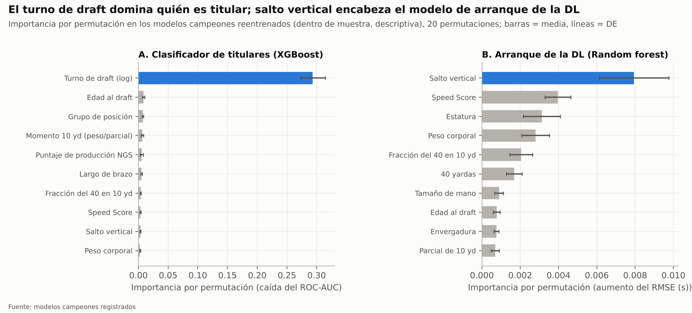

### Para entrenadores de línea defensiva: la brecha de traducción

La brecha de traducción compara el SBI en partido de cada liniero con lo que predijo su perfil del Combine. Una
brecha positiva marca a un jugador que juega más rápido al snap de lo que midió. Una negativa marca a un jugador
cuyo perfil atlético dice que puede arrancar más rápido de lo que lo hace, lo que apunta a la técnica: postura,
anticipación del snap, primer paso.

| Jugador | Posición, clase | Jugadas | SBI en partido | Predicho | Brecha |
| --- | --- | --- | --- | --- | --- |
| Will Anderson | DE, 2023 (ronda 1) | 290 | 74 | 56 | +18 |
| Chop Robinson | OLB, 2024 (ronda 1) | 64 | 71 | 56 | +15 |
| Cedric Johnson | DE, 2024 (ronda 6) | 14 | 71 | 57 | +14 |
| Brenton Cox | DE, 2023 (no seleccionado) | 24 | 64 | 51 | +12 |
| Austin Booker | DE, 2024 (ronda 5) | 52 | 64 | 54 | +9 |
| Tyrus Wheat | DE, 2023 (no seleccionado) | 28 | 41 | 55 | −14 |
| Nick Hampton | OLB, 2023 (ronda 5) | 25 | 44 | 59 | −15 |
| Adetomiwa Adebawore | DT, 2023 (ronda 4) | 75 | 37 | 54 | −17 |

La tabla conserva a los jugadores con 10+ jugadas (54 de 72 linieros, fiabilidad ≥ 0.57); las brechas se
calculan antes de redondear. Los jugadores con pocas jugadas y brechas grandes, como Nazir Stackhouse (+13 con
3 jugadas), están en `reportes/metricas/translation_gap.csv` y son pistas para revisar en video, no
conclusiones. Dos primeras rondas encabezan la lista, pero los siguen un sexta ronda y un edge no seleccionado:
ahí es donde una métrica de movimiento se gana su lugar, en jugadores que el draft no valoró alto. En los
receptores (v3.0), Derius Davis (ronda 4, +36 con 29 jugadas) y Rakim Jarrett (no seleccionado, +15) son los que
más superan a sus pruebas, y Rashee Rice (ronda 2, −15 con 133 jugadas) queda por debajo, un recordatorio de que
la distancia a 2 segundos de un receptor también refleja cómo se le usa.

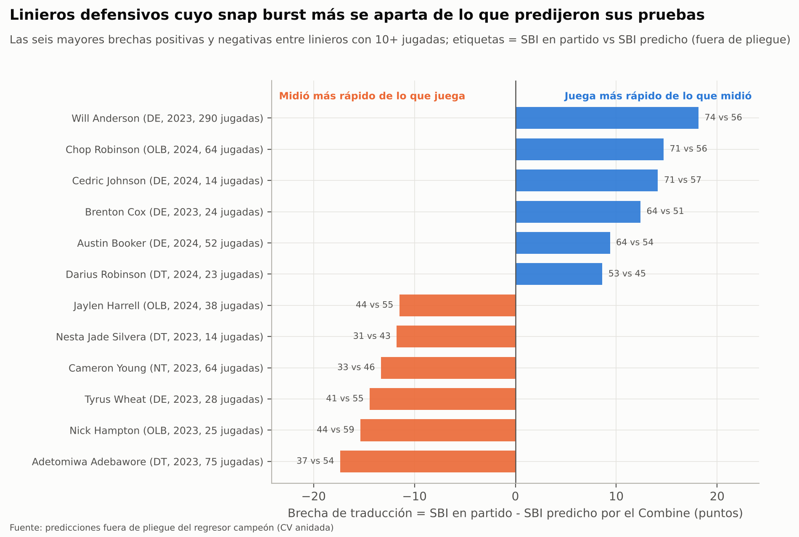

### Versión 2.0: lo que agrega el rendimiento de temporada completa

Los datos de temporada completa confirman la historia de la línea defensiva, la extienden del movimiento a la
producción y muestran dónde las pruebas dejan de ayudar: protección de pase y separación.

**Para scouts**

1. **Con los que van al pasador, confíen en las pruebas de sprint y salto: pronostican el arranque.** Dentro de la DL, el vertical, el 40, el parcial de 10 yd y el salto largo se correlacionan 0.36–0.43 con el arranque de temporada sobre lo esperado, y el vínculo se sostiene dentro del rol edge o interior. Cada 0.1 s en el parcial de 10 yd vale cerca de 0.03 s de arranque en partido, más o menos la mitad de la distancia entre un liniero típico y uno del decil superior. El vertical es la variable más importante del modelo campeón.
2. **El arranque es cómo las pruebas se vuelven presión.** Cerca de la mitad del vínculo de cada prueba con la tasa de presión pasa por el arranque (44–77%). Cuando las pruebas de un prospecto superan su arranque en video, la brecha señala el paso entre atletismo y producción que el entrenamiento puede atacar.
3. **En los receptores, el tamaño, no las pruebas, pronostica la separación.** Dentro de WR y dentro de TE, los jugadores más ligeros se separan más (ρ = −0.46); ninguna prueba pasa el control de falsos descubrimientos. El modelo solo con Combine explica cerca del 19% de la separación sobre lo esperado (R² agrupado); la estatura encabeza sus variables, seguida de qué saltos no hizo el receptor y del shuttle.
4. **No evalúen la protección de pase con el Combine.** Ninguna prueba se relaciona con la presión permitida por la OL (|ρ| ≤ 0.18), y ningún modelo supera a la posición sola. Los linieros elegidos antes protegen mejor (ρ = 0.33), así que la información está en el video que fijó su lugar en el draft.

**Para oficinas generales**

5. **El rendimiento de campo trae señal sobre la titularidad que la posición en el draft no ve.** Cada DE del índice de campo de la familia sube las probabilidades de ser titular 47% después de controlar por turno y posición (p = 0.04), y suma cerca de 0.007 de AUC al modelo de titulares. El SBI no mostró esa señal.
6. **Lean las temporadas de novato por posición.** El arranque (ρ = 0.61 con las temporadas siguientes), la presión (0.50) y la separación (0.37) de un novato se trasladan. Los números de protección de pase de un liniero novato no (0.16), así que no sobrerreaccionen a ellos.
7. **No hay una ganancia barata pre-draft en proyectar el rendimiento de campo.** Un modelo apilado que proyecta las métricas de campo de cada prospecto a partir de sus pruebas suma de −0.002 a +0.0004 de AUC: la información del Combine ya está en el modelo de titulares. El campeón sigue siendo Combine + draft.

**Para entrenadores de línea defensiva: brecha de traducción de temporada completa**

Esto complementa la tabla del SBI de arriba para los linieros con 50+ snaps de presión. Brecha = arranque
observado sobre lo esperado menos lo que predice su perfil del Combine (fuera de pliegue), en segundos;
positivo = arranca antes de lo que sugieren sus pruebas.

| Jugador | Posición, clase | Snaps de presión | Arranque sobre lo esp. | Predicho | Brecha |
| --- | --- | --- | --- | --- | --- |
| Brandon Dorlus | DT, 2024 (ronda 4) | 277 | +0.127 s | −0.011 s | +0.14 s |
| Will Anderson | DE, 2023 (ronda 1) | 1,118 | +0.119 s | −0.002 s | +0.12 s |
| Warren Brinson | DT, 2025 (ronda 6) | 133 | +0.091 s | −0.027 s | +0.12 s |
| Chop Robinson | OLB, 2024 (ronda 1) | 521 | +0.115 s | +0.018 s | +0.10 s |
| Austin Booker | DE, 2024 (ronda 5) | 394 | −0.098 s | +0.012 s | −0.11 s |
| Myles Cole | DE, 2024 (ronda 7) | 52 | −0.137 s | −0.018 s | −0.12 s |
| Tyrus Wheat | DE, 2023 (no seleccionado) | 110 | −0.124 s | +0.014 s | −0.14 s |

Will Anderson y Chop Robinson aparecen cerca de la cima de ambas tablas y Tyrus Wheat cerca del fondo de ambas,
así que las dos medidas de brecha coinciden en los extremos. Austin Booker es la excepción: en 52 jugadas
registradas se mueve más rápido de lo que midió (+9 de SBI), pero en 394 snaps de presión de temporada regular
arranca 0.11 s más lento de lo que predicen sus pruebas. Dos linieros interiores de rondas tardías, Dorlus y
Brinson, superan a sus pruebas por el mayor margen. La lista completa está en
`reportes/metricas/onfield_translation_gap.csv`.

**Tracking de las pruebas (v2.2).** Usen el tracking como auditoría del cronómetro, no como una calificación
nueva. El parcial 5–10 yd y la velocidad máxima registrados reproducen los tiempos oficiales, así que una brecha
grande entre ellos señala un problema de cronometraje que vale la pena revisar. La velocidad en las pruebas de
posición no necesita peso propio en la evaluación de un liniero defensivo: lo que dice del arranque, ya lo dice
el 40.

## 11. Limitaciones, control de fugas y siguientes pasos

Desde v3.0 los hallazgos de tracking descansan en 299 jugadores observados en una mediana de 39 jugadas cada
uno, entre la temporada 2023, las semanas 0–17 de 2024 y la semana 18 y playoffs de 2024–2025 (221 jugadores y
8 jugadas antes). Los hallazgos de campo de la versión 2.0 descansan en 255 jugadores con una mediana de 165–558
jugadas de temporada regular cada uno, y por eso su fiabilidad sigue siendo mayor.

**Controles de fuga de información.**

- Las medianas de imputación y el escalado se aprenden dentro de cada pliegue externo de entrenamiento.
- Los hiperparámetros los elige una CV interna que nunca ve el pliegue externo de prueba.
- Las variables de movimiento en partido son promedios por jugada, nunca conteos de jugadas. Los conteos siguen al tiempo de juego y filtrarían el objetivo; el episodio del percentil 80 de la sección 3 muestra lo fácil que pasa.
- La posición NFL solo etiqueta roles en el análisis de la línea defensiva y equilibra los pliegues; nunca es variable del modelo, porque se decide después del draft.
- El clasificador con movimiento es un diagnóstico. Sus variables se miden después del draft, así que queda registrado como retador y no debe usarse para decisiones de draft.

**Limitaciones.**

1. La mecánica de las pruebas solo se mide en parte. Hasta v2.2 el movimiento en las pruebas solo se conocía por tiempos y distancias. La versión 2.2 agrega el tracking a 10 Hz de las pruebas. Solo los parciales por distancia, las velocidades máximas y la velocidad en los giros se repiten dentro de un jugador, y ninguno suma poder predictivo a los resultados oficiales. El frenado y los cortes, la mecánica dentro de los giros del 3 conos y el shuttle, no se repiten entre intentos (r 0.14–0.43), así que todavía no se pueden comparar con la mecánica en partido.
2. Muestra de partidos incompleta. Ya se registran la temporada 2023 y las semanas 0–17 de 2024, pero faltan las semanas 1–17 de 2025, y el archivo de 2023 se detiene exactamente en 1,048,575 filas, el límite de una hoja de cálculo, así que falta al azar una parte de 2023. Aparecen 343 de 510 prospectos, así que los que casi no jugaron están subrepresentados.
3. Sin rivales ni balón. Con 1–4 jugadores registrados por jugada no se pueden medir la separación, el porcentaje de victorias al pasador ni los resultados de bloqueo, así que el movimiento se juzga con la cinemática del propio jugador.
4. Contexto de jugada parcial. Sin la jugada pedida, la distancia a 2 segundos de un receptor mezcla rutas, bloqueos y movimiento previo. La ruta y la alineación tomadas de `player_play` quitan parte de eso: el burst de los receptores sigue siendo un rasgo neto de la ruta (ICC 0.62), mientras que el de la DL es sobre todo rol (0.14 neto de la alineación).
5. Muestras chicas por posición. 72 linieros defensivos y 63 receptores alimentan los modelos del snap burst; la correlación ajustada por rol en la DL tiene un intervalo de 95% de unos ±0.25 (0.09–0.60).
6. Las pruebas de agilidad son escasas: 35% de los prospectos corrió el 3 conos y 39% el shuttle, así que sus estimaciones de traducción son las más inciertas.
7. El objetivo de titular es grueso. Un umbral de 50% de titularidad ignora el valor de rotación, que pesa más en los linieros defensivos.

**Lo que resuelve la versión 2.0.** La limitación 3 se cierra para tres familias: `player_play` aporta presión
generada, presión permitida y separación al lanzamiento en temporadas regulares completas. La limitación 4 se
prueba directamente: cada jugada registrada trae su ruta, asignación y alineación. Con la muestra de la semana
18, el snap burst de receptores y backs defensivos no mostraba señal de jugador al quitar ese contexto; con las
temporadas completas de v3.0, el de los receptores sí la muestra (ICC 0.62) y el de los backs defensivos sigue
débil (0.25). La limitación 2 pesa menos, porque las métricas de campo cubren todos los partidos de temporada
regular de 2023–2025.

**Advertencias nuevas en la versión 2.0.**

1. Los valores esperados salen de las jugadas de los propios prospectos (497 jugadores), no de toda la liga. "Sobre lo esperado" significa "frente a las clases de draft 2023–2025 en el mismo contexto".
2. Los backs defensivos siguen sin métrica de resultado: el archivo trae su alineación y asignación, no el resultado de la cobertura.
3. El modelo de titulares con datos de campo es circular por diseño. El rendimiento y los inicios se miden en las mismas temporadas, y los titulares suman más snaps. Las tasas por jugada, la contracción y los mínimos de jugadas limitan el efecto de la exposición, pero el modelo se queda como retador registrado, nunca como herramienta de draft.
4. La tasa de presión de la DL es un evento raro (cerca del 10% de los snaps de presión) con ICC 0.25, lo que limita cuánto puede explicar cualquier modelo pre-draft.
5. La protección de la OL depende del esquema, el mariscal y el diseño de la jugada. El valor esperado por alineación × duración del dropback quita parte de eso, no todo.
6. El archivo `player_play` entregado tiene 2,141 filas menos que las que indica la especificación (−0.68%). No se sabe qué jugadas faltan, así que no se puede descartar un pequeño sesgo en las métricas de campo.

**Siguientes pasos.**

- Agregar resultados de cobertura para los backs defensivos (separación permitida, pases por snap en cobertura), la única familia que `player_play` deja sin medir.
- Calcular "lo esperado" con jugadas de toda la liga en lugar de las de los propios prospectos, para comparar a un novato con todos los jugadores de la NFL en el mismo contexto.
- Entregar el archivo de tracking de 2023 sin cortar y la temporada regular de 2025 (semanas 1–17). La versión 3.0 mostró el beneficio: las temporadas completas volvieron medible el burst de los receptores y significativo el modelo de la DL. El flujo encuentra los archivos nuevos por patrón y los valida sin cambiar código.
- Volver a correr cada primavera con la clase más reciente como trabajo monitoreado; la configuración rápida y los hashes del manifiesto ya están listos para la CI.

## 12. Reproducibilidad

Todo el estudio se vuelve a correr desde los diez CSV con un comando y da los mismos números. Python 3.13,
dependencias fijadas en `requirements.txt`. La guía paso a paso (Colab y local) está en el [README](README.md).

```
python -m pip install -r requirements.txt
make reubicar     # una vez tras clonar: apunta el almacén MLflow a esta carpeta
make validar      # solo el contrato de datos: originales vs especificación, unos 10 s
make verificar    # hashes de los datos originales vs el manifiesto
make pruebas      # 35 pruebas unitarias, unos 5 s
make rapida       # todo el flujo con CV y rejillas mínimas, unos 10 min (carpetas propias)
make todo         # corrida de entrega, unos 90 min en 2 núcleos
make ui           # interfaz de MLflow: corridas, métricas, modelos registrados
```

1. `fuentes/datos_prep.py` (etapa `datos`): valida los diez CSV contra el contrato de datos, escribe `datos/datos_ini/manifiesto.json`, limpia los prospectos, construye las métricas de tracking y los perfiles de jugador, las jugadas de campo sobre lo esperado, los perfiles de campo y las variables del tracking de pruebas, y guarda todo en `datos/datos_limp/`.
2. `fuentes/train.py`, etapa `traduccion`: correlaciones prueba-partido y prueba-campo, fiabilidad, estabilidad de novatos, mediación en la DL, validez del SBI y los dos GLM de titulares.
3. Etapa `modelos`: regresión con CV anidada (3 poblaciones del SBI y 4 objetivos de campo, cada una con y sin tracking de pruebas) y clasificación (3 poblaciones, 8 conjuntos de variables), pruebas estadísticas, reajustes finales y el registro de 17 modelos.
4. Etapa `estadistica`: vuelve a calcular las pruebas ómnibus desde los puntajes por pliegue guardados, sin reentrenar.
5. Etapa `figuras`: las 21 figuras de `reportes/figuras/`.

Cada tabla detrás de este reporte está en `reportes/metricas/` como CSV o JSON, así cualquier figura se puede
volver a dibujar sin reentrenar. Un modelo registrado se carga con
`mlflow.sklearn.load_model("models:/cgmt-starter-classifier@champion")` contra `sqlite:///mlflow/mlflow.db`.

---

# Parte II. Historial de versiones

Todos los cambios relevantes del proyecto se documentan aquí. El formato sigue
[Keep a Changelog](https://keepachangelog.com/es-ES/1.1.0/) y el proyecto usa
[versionado semántico](https://semver.org/lang/es/):

- **MAYOR**: un cambio que altera una métrica publicada o la definición de un objetivo (los resultados no son comparables entre versiones).
- **MENOR**: un análisis, modelo, conjunto de variables o etapa nuevos; los resultados existentes siguen siendo comparables.
- **PARCHE**: correcciones y refactorizaciones que no cambian ningún número de `reportes/metricas/`.

Cada corrida de MLflow lleva las etiquetas `pipeline_version` (este archivo), `data_version` (hash de los
archivos originales, `datos/datos_ini/manifiesto.json`) y `git_commit`, así cada número del reporte se rastrea
hasta el código y los datos exactos que lo produjeron. Las versiones 0.1.0–0.3.0 fueron pasos de desarrollo
previos a la creación del repositorio (primer commit = 0.4.0); se registran para no perder el razonamiento
detrás de cada decisión.

Las entradas anteriores a 3.1.0 conservan los nombres de rutas, módulos y comandos que tenían en su momento
(`src/cgmt/`, `configs/`, `reports/metrics/`, `--stage`, `make validate`). La tabla de equivalencias con la
estructura actual está en la entrada 3.1.0.

## [3.1.0] - 2026-10-17

MENOR: el repositorio se reorganiza con la estructura para GitHub del documento `Estructura_Gitub_NFL.docx`,
toda la documentación pasa al español y se agrega un notebook de Google Colab. No cambia ninguna métrica ni
definición de objetivo: los datos limpios son idénticos byte por byte a los de v3.0.0, `data_version` sigue
siendo `a75ba51ae4b9` y los modelos se volvieron a entrenar desde un almacén MLflow limpio con el código
reorganizado (ver notas de la entrega).

### Agregado
- **Estructura del repositorio** según el documento adjunto, más complementos marcados en el README:
  - `datos/datos_ini/`: los diez CSV originales y el manifiesto (`manifiesto.json`).
  - `datos/datos_limp/`: los datos limpios listos para modelar (parquet) y `intermedios/` (cuadros de tracking limpios y contexto de jugada).
  - `fuentes/entrena.ipynb`: notebook de Colab para entrenar y evaluar de punta a punta.
  - `fuentes/datos_prep.py`: todas las funciones de limpieza y preparación.
  - `fuentes/train.py`: entrenamiento, evaluación, pruebas estadísticas, figuras y registro en MLflow.
  - `README.md` (guía de reproducción y decisiones) y `CHANGELOG.md` (reporte final más este historial).
  - Complementos: `configuracion/`, `pruebas/`, `reportes/` (figuras y métricas), `documentos/` (especificación de datos y tarjeta del modelo), `mlflow/` (almacén de experimentos y registro), `.github/workflows/`, `requirements.txt`, `pyproject.toml` y `Makefile`.
- **Notebook `fuentes/entrena.ipynb`**: clona el repositorio en Colab, instala las dependencias, valida el contrato de datos, prepara los datos, entrena en modo rápido (unos 10 min) o completo (unos 90 min), muestra las tablas y figuras de evaluación y carga los modelos registrados desde MLflow.
- **Datos originales comprimidos** (`.csv.gz`, `gzip -n -9`): `player_play_3.csv` pesa 147 MB sin comprimir y GitHub rechaza archivos de más de 100 MB. Los diez archivos pasan de 427 MB a 100 MB. pandas los lee sin descomprimir a disco, y el manifiesto guarda el SHA-256 y las líneas del contenido descomprimido, así `data_version` no cambia (`a75ba51ae4b9`). El lector acepta `.csv` y `.csv.gz` como el mismo archivo lógico, de modo que una entrega nueva sin comprimir funciona igual.
- `--etapa verificar` (`make verificar`): vuelve a calcular los hashes de `datos/datos_ini` contra el manifiesto; la CI falla ante cualquier diferencia.
- Una prueba nueva (`test_csv_comprimido_equivale_al_original`): un CSV comprimido da la misma tabla, el mismo hash y el mismo número de filas que el original. 35 pruebas en total.

### Cambiado
- Documentación en español: README, reporte final, tarjeta del modelo (`documentos/tarjeta_modelo.md`), comentarios de la configuración y del contrato de datos, docstrings, mensajes de registro y los nombres y docstrings de las pruebas.
- Las 21 figuras se dibujan con títulos, ejes, leyendas y notas de fuente en español. Un ajuste automático reduce el tamaño de letra de un título o nota que no cabe en el ancho de la figura.
- Línea de comandos en español: `--etapa todo|contrato|datos|traduccion|modelos|estadistica|figuras|reubicar` y objetivos de `make` en español (`instalar`, `pruebas`, `rapida`, `validar`, `verificar`, `datos`, `traduccion`, `modelos`, `estadistica`, `figuras`, `todo`, `reubicar`, `ui`, `limpiar`).
- El almacén MLflow pasa a `mlflow/mlflow.db` y `mlflow/mlartifacts/`. Los modelos se registran con `code_paths = [datos_prep.py, train.py]`, así se cargan en cualquier máquina sin instalar el paquete.
- Los identificadores (funciones, columnas, métricas, nombres de experimentos y de modelos registrados) se conservan en inglés, porque los comparten el código, los archivos de métricas y el registro de MLflow entre versiones.

**Equivalencias con la estructura anterior.**

| Antes (≤ 3.0.0) | Ahora (3.1.0) |
| --- | --- |
| `data/raw/*.csv` | `datos/datos_ini/*.csv.gz` |
| `data/manifest.json` | `datos/datos_ini/manifiesto.json` |
| `data/processed/`, `data/interim/` | `datos/datos_limp/`, `datos/datos_limp/intermedios/` |
| `src/cgmt/config.py`, `data.py`, `contract.py`, `cleaning.py`, `movement.py`, `performance.py`, `combine_tracking.py`, `features.py` | `fuentes/datos_prep.py` |
| `src/cgmt/models.py`, `stats.py`, `mlops.py`, `viz.py`, `pipeline.py` | `fuentes/train.py` |
| `configs/config.yaml`, `smoke.yaml`, `data_contract.yaml` | `configuracion/config.yaml`, `rapida.yaml`, `contrato_datos.yaml` |
| `tests/` | `pruebas/` |
| `reports/figures/`, `reports/metrics/` | `reportes/figuras/`, `reportes/metricas/` |
| `docs/Data_structure_CSV_files.docx`, `MODEL_CARD.md` | `documentos/Data_structure_CSV_files.docx`, `documentos/tarjeta_modelo.md` |
| `mlflow.db`, `mlartifacts/` | `mlflow/mlflow.db`, `mlflow/mlartifacts/` |
| `python -m cgmt.pipeline --stage all` | `python fuentes/train.py --etapa todo` |
| `make test`, `smoke`, `validate`, `all`, `relocate` | `make pruebas`, `rapida`, `validar`, `todo`, `reubicar` |

### Notas de la entrega
- Entrenado desde un almacén MLflow limpio: {{N_RUNS}} corridas etiquetadas `git_commit = {{COMMIT}}`,
  `pipeline_version = 3.1.0` y `data_version = a75ba51ae4b9`, con 17 modelos registrados (los mismos nombres y
  alias que en v3.0.0).
- Verificado: la etapa de datos reproduce byte por byte cada archivo de `datos/datos_limp/` de v3.0.0; el
  contrato da 435 revisiones, 0 errores y 32 advertencias, igual que antes; {{VERIFICACION}}

## [3.0.0] - 2026-10-17

MAYOR: el tracking de partido de temporada completa de 2023 y 2024 cambia la muestra del Snap Burst Index. La
definición del SBI no cambia, pero se mueve cada número basado en él, así que los resultados no son
comparables con v2.x. Todo lo que no usa tracking de partido reproduce v2.2.0 exactamente: las métricas y
regresiones de campo, los modelos de titulares con todos los prospectos y con datos de campo, y los análisis de
tracking de pruebas. `data_version` es `a75ba51ae4b9` (diez archivos originales).

### Agregado
- **`game_tracking_2023_5.csv`** (333 partidos, 154 jugadores) y **`game_tracking_2024_1_5.csv`** (305 partidos,
  semanas 0–17 de 2024, 314 jugadores). Con las partes de semana 18 y playoffs de 2024/2025, el tracking suma
  24,828 jugador-jugadas de temporada regular y playoffs y 299 jugadores con 3+ jugadas. Antes eran 2,677
  jugadas y 221 jugadores, y la mediana por jugador sube de 8 a 39 jugadas.
- **R8c, revisión de archivo cortado.** `game_tracking_2023_5.csv` tiene exactamente 1,048,575 filas de datos,
  el límite de filas de una hoja de cálculo, así que casi seguro se cortó al guardarse. Sus filas no siguen
  ningún orden, así que el corte quita un conjunto aleatorio de jugadas (2023 todavía cubre 154 de los 160
  prospectos de esa clase). El contrato advierte de cualquier archivo en ese límite, y el flujo descarta la
  última jugador-jugada del archivo, que puede estar incompleta. R8b quita los 98 partidos de pretemporada
  (390,373 cuadros). Contrato: 435 revisiones, 0 errores, 32 advertencias.
- **Los receptores abiertos se vuelven población del SBI** (`regression.populations`,
  `cgmt-snap-burst-regressor-wr`), con un retador con tracking de pruebas. Las poblaciones del SBI son un mapa
  configurado (`SBI_POPULATIONS`).

### Resultados que cambian (v2.2.0 → v3.0.0)
- Fiabilidad del snap burst (ICC): DL 0.62 → 0.63, **WR −0.34 → 0.62**, OL 0.10 → 0.40, DB 0.00 → 0.26, TE 0.24
  → 0.08 (21 jugadores). Sin el contexto de jugada, los WR se quedan en 0.62 y la DL baja a 0.14. Casi toda la
  estabilidad de la DL es el rol (edge vs interior); el burst de un receptor es suyo.
- Pruebas vs movimiento en partido: 35 de 63 celdas dentro de la posición pasan FDR (antes 25); 40 vs velocidad
  máxima ρ 0.43.
- **Mejora el modelo del SBI de la línea defensiva:** random forest RMSE 7.85 vs 9.99 de la posición sola
  (−21%; v2.2: 8.54 vs 10.05). El R² agrupado es 0.37 [0.17, 0.50] (antes 0.29 [−0.02, 0.45]), y la ganancia ahora
  pasa la prueba t corregida para remuestreo (p = 0.0002, Holm 0.001; v2.2 Holm p = 0.45).
- Receptores abiertos (nuevo): ridge RMSE 8.45 vs 9.38 (−10%), R² agrupado 0.22 [−0.01, 0.31]. La ganancia es
  consistente pliegue a pliegue (Wilcoxon p = 0.03) pero no significativa con la t corregida (p = 0.30).
- Todas las posiciones: random forest RMSE 9.57 vs 10.06 (−5%), R² agrupado 0.07 [0.00, 0.12] (antes −0.02).
- El SBI se valida contra el arranque de temporada de la DL con ρ 0.45 (antes 0.39, 69 DL vs 52) y contra la
  presión con 0.28 (antes 0.49).
- Titulares: el movimiento en partido sigue sin sumar nada a Combine + draft (299 jugadores, cambio de AUC −0.003
  a 0.000, DeLong p ≥ 0.47). La razón de momios del GLM por 10 puntos de SBI es 0.87 [0.61, 1.24], p = 0.45. El
  indicio exploratorio del día 3 (ρ 0.14 en v2.2) desaparece (−0.03).
- La trampa del percentil 80 persiste: lee 0.50 yd de menos con 3 jugadas y se correlaciona 0.12 con la tasa de
  titularidad, contra 0.07 de la media.
- El tracking de pruebas no suma nada a los modelos del SBI (DL +0.004, WR −0.007 de R²; p ≥ 0.83).

### Corregido
- Los títulos de figuras que fijaban como texto las conclusiones de v2.2 (figuras 6, 10, 15) y las notas de
  fuente con conteos escritos a mano (figuras 3, 4, 6, 7) ahora se calculan con los datos. La figura 14 solo
  lista linieros con 10+ jugadas registradas.

### Notas de la entrega
- Entrenado desde un almacén MLflow limpio: 93 corridas etiquetadas `git_commit = aad6177`,
  `pipeline_version = 3.0.0` y `data_version = a75ba51ae4b9`, con 17 modelos registrados (dos nuevos:
  `cgmt-snap-burst-regressor-wr@champion` y `-wr-ct@challenger`). Las correcciones de figuras se aplicaron
  después con `--stage figures`.
- Una primera corrida de v3 se interrumpió por un reinicio del espacio de trabajo; se descartó y la entrega se
  volvió a correr desde un almacén limpio.

## [2.2.0] - 2026-10-16

MENOR: el tracking de las pruebas del Combine de la especificación llega como `combine_tracking_6.csv` y entra
al flujo. `data_version` cambia a `d63395440694` (ocho archivos originales). No cambia ninguna definición de
métrica u objetivo. Cada número de v2.0.0 en `reports/metrics/` se reproduce exactamente: las mismas filas de
las tablas de resumen, pliegues, pruebas, DeLong e importancia, y los mismos campeones registrados. El tracking
de pruebas solo agrega filas y archivos nuevos.

**Resultado: el tracking de pruebas no mejora ningún modelo.** Reproduce el cronómetro, y su vínculo más fuerte
con el juego (la velocidad máxima en las pruebas de posición con el arranque de la DL) lo explican el peso, el
rol y el 40 oficial.

### Agregado
- **`combine_tracking_6.csv`** (archivo 3 de la especificación): 463,189 cuadros, 6,310 intentos y los 510
  prospectos, como indica la especificación. El contrato corre ahora 370 revisiones con 0 errores y 26
  advertencias. Desaparece la advertencia de archivo faltante y hay cuatro advertencias de rango nuevas: el
  carril del 40 queda fuera del marco de 0–53.3 yd del campo, y los balones lanzados superan los rangos de
  velocidad, aceleración y distancia de un jugador. R16 descarta las filas del balón.
- **Calibración de las variables de pruebas sobre intentos reales** (`attempt_reliability`,
  `ct_reliability.csv`, figura 19). El inicio de un intento registrado no se repite entre los dos 40 de un
  jugador (0–5 yd r = 0.16; parcial de 10 yd cronometrado desde el primer cuadro 0.23), así que se descartaron
  las métricas cronometradas desde la salida. Una métrica solo se vuelve variable si se repite con r ≥ 0.5
  (`combine_tracking_rules.min_reliability`), con una variable por constructo. Quedan cinco: parcial 5–10 yd del
  40 (0.87), velocidad máxima del 40 (0.99), velocidad conservada en los giros del shuttle (0.54), y velocidad
  máxima (0.79) y aceleración (0.55) en las pruebas de posición. Las dos de pruebas de posición se estandarizan
  en z dentro de cada prueba según la corrió cada grupo de posición.
- Validez y traducción (`ct_official_validity.csv`, `ct_translation_matrix.csv`,
  `ct_onfield_translation_matrix.csv`, `ct_partial_dl_getoff.csv`, figura 21):
  - El 40 registrado reproduce el cronómetro: velocidad máxima vs 40 oficial ρ −0.97 (−0.90 dentro de la posición).
  - La velocidad máxima en pruebas de posición es la única variable de tracking de pruebas ligada al arranque de
    temporada de la DL después de la corrección FDR (ρ +0.37, q = 0.009, 88 DL). Dentro de la DL sigue de cerca
    al 40 (ρ −0.76). Con peso, rol y 40 oficial fijos, la ρ parcial baja a +0.13 (p = 0.31).
- **¿Mejora los modelos el tracking de pruebas?** (`ct_best_vs_best.csv`, figura 20; el mejor modelo de cada
  brazo, mismos jugadores y pliegues; prueba t corregida para remuestreo):
  - Arranque DL sobre lo esperado: R² 0.096 → 0.091 (−0.004, IC 95% −0.10 a +0.09, p = 0.92, mejor en 8 de 15 pliegues).
  - Snap burst DL −0.093, presión DL −0.037, protección OL −0.051, separación WR/TE −0.034 (todas p ≥ 0.35).
  - Clasificador de titulares: AUC 0.915 → 0.913 (XGBoost; p = 0.68; DeLong p = 0.30). El campeón sigue siendo Combine + draft.
- Registro: `<regresor>-ct@challenger` para los cinco objetivos de juego y
  `cgmt-starter-classifier-combine-tracking@challenger`. Ningún campeón cambia.
- `ct_best_vs_best()` corre después de los modelos y en `--stage stats`. `stats.partial_spearman`. Figuras 19–21.
  Dos pruebas nuevas (34 en total).

### Notas de la entrega
- Entrenado desde un almacén MLflow limpio: 83 corridas etiquetadas `git_commit = 22b147e`,
  `pipeline_version = 2.2.0` y `data_version = d63395440694`, con 15 modelos registrados. Después se agregaron la
  columna de validez dentro de la posición, las correlaciones parciales del arranque de la DL y correcciones de
  títulos de figuras, aplicadas con `--stage translation`, `--stage stats` y `--stage figures`, sin reentrenar.
- Una primera corrida de entrega estandarizó las pruebas de posición juntando grupos de posición. Cinco nombres
  de prueba, como el gauntlet, los corren varios grupos (19% de los intentos de pruebas de posición). Esa corrida
  mostró una ganancia en el arranque de la DL de R² +0.07 (12 de 15 pliegues), ya no significativa con la t
  corregida (p = 0.19). Corregir la agrupación eliminó la ganancia. Esa sensibilidad a un cambio pequeño en una
  variable es justo de lo que protege la prueba conservadora; la corrida corregida es la entrega.

## [2.1.0] - 2026-10-16

MENOR: la especificación de datos del proveedor (`docs/Data_structure_CSV_files.docx`) se vuelve un contrato
de datos legible por máquina que cada ejecución revisa, y el flujo se ajusta a la especificación. **No cambia
ningún número de `reports/metrics/`:** `data_version` sigue siendo `dfc567c4ffe3`, y las etapas de datos y
traducción se volvieron a correr y comparar contra las salidas de v2.0.0: los 67 archivos procesados,
intermedios y de métricas son idénticos. Los modelos no se reentrenaron porque sus entradas y su código no
cambian, así que las corridas y el registro de v2.0.0 siguen vigentes. `data_audit.json` gana claves, y
`pp_rows_regular_season` pasa de 240,412 a 239,673: R15 quita 739 filas de down 0, ninguna de una jugada de las
familias DL, OL o WR/TE.

### Agregado
- **Contrato de datos** `configs/data_contract.yaml`: los nueve archivos de la especificación. Por columna
  registra tipo, nulos permitidos, rango, valores permitidos y patrón, más claves, claves foráneas, filas
  esperadas y cobertura del tracking. También documenta cómo maneja el flujo cada desviación conocida.
- `cgmt.contract`: corre primero en la etapa de datos, también como `--stage contract` / `make validate`.
  Escribe `reports/metrics/data_contract_report.csv` (una fila por revisión, con severidad y manejo) y
  `data_contract_summary.json`. Los errores (archivo o columna obligatoria faltante, clave duplicada, clave
  foránea rota) detienen la ejecución. Las desviaciones son advertencias que manejan las reglas de negocio.
- Resultado con los archivos entregados: 332 revisiones, **0 errores, 23 advertencias**. Falta
  `combine_tracking.csv` (archivo 3 de la especificación). El tracking solo cubre la semana 18 y playoffs de
  2024–2025 (sin 2023; 279 de 510 prospectos). `player_play` tiene 2,141 filas menos que la especificación
  (−0.68%). Los partidos de pretemporada y las semanas de playoffs 19–23 quedan fuera de REG/POST y 1–18 de la
  especificación. Hay 961 filas de down 0 (intentos de dos puntos). Cuatro indicadores vienen como TRUE/FALSE
  donde la especificación documenta 1.0/nulo. Completan la lista unas pocas posiciones de tracking fuera del
  campo y nulos menores en columnas que no se usan.
- **`cgmt.combine_tracking`** (archivo 3 de la especificación, opcional): regla de negocio R16. Las métricas
  por intento usan las mismas definiciones que el tracking de partido: burst a 1 s / 2 s, velocidad máxima,
  tiempo al 90% de la velocidad máxima, aceleración y frenado máximos, corte más cerrado, parciales de 10/20 yd
  del tracking, y apoyos y velocidad conservada en los giros del 3 conos y el shuttle. Las variables de jugador
  (`ct_*`) toman el mejor intento, y las pruebas de habilidad se estandarizan en z dentro de cada nombre de
  prueba. Con el archivo presente el flujo agrega: validez del tracking contra lo oficial
  (`ct_official_validity.csv`); tracking de pruebas vs movimiento en partido y rendimiento en el campo
  (`ct_translation_matrix.csv` y `ct_onfield_translation_matrix.csv`, en archivos aparte para que no se muevan
  los q-valores FDR de v2.0.0); regresiones atlético vs atlético + tracking en los mismos pliegues
  (`regression_ct_comparison.csv`, registradas como `<nombre>-ct@challenger`); y el conjunto pre-draft
  `combine_draft_ct`. La regla del campeón se extiende a ese conjunto: reemplaza a Combine + draft solo con un
  AUC medio mayor y DeLong p < 0.05. Probado de punta a punta con un archivo simulado. Inactivo con los datos
  entregados.
- 7 pruebas (`tests/test_contract.py`, 32 en total): severidades del contrato, codificaciones booleanas,
  resolución de archivos para nombres de la especificación y partes divididas, R15 y códigos de alineación de la
  especificación, y el parcial del 40 contra la cinemática, los apoyos del shuttle y la agregación del mejor
  intento.

### Cambiado
- `raw_files` acepta nombres o patrones glob, así se encuentran tanto los nombres de la especificación
  (`game_tracking_2024.csv`, `player_play.csv`, `combine_tracking.csv`) como las partes entregadas
  (`game_tracking_2024_2.csv`, `player_play_3.csv`). Una parte `<raíz>_<n>.csv` se ignora si existe el
  `<raíz>.csv` completo. El orden de archivos en el manifiesto no cambia, así que `data_version` no cambia.
- Lector: una columna extra se registra y se ignora en lugar de detener la ejecución (el reporte del contrato la
  lista); una columna faltante sigue siendo error. El tracking se procesa un archivo a la vez: la regla R8b
  conserva `tracking_rules.season_types` (REG, POST; los archivos de temporada de la especificación también
  traen pretemporada). Una jugada repartida entre partes de archivo se procesa una vez, después de leer todas
  las partes. Los cuadros se agregan a `tracking_frames.parquet` y las figuras solo leen los cuadros de línea
  defensiva que dibujan. Juntos, estos cambios mantienen temporadas del tamaño de la especificación dentro de la
  memoria.
- `performance.py`: el lector booleano acepta TRUE/FALSE, True/False, 1/0 y 1.0/0.0. Las celdas de alineación
  salen de `performance_rules.alignment_codes`, que agrega los códigos DE → EDGE y DT/NT → INTERIOR_LINE de la
  especificación (0 jugadas afectadas; OLB se queda en OTHER). La regla nueva R15 (`valid_downs`) conserva los
  downs 1–4. La presión permitida de la OL sobre lo esperado solo se calcula donde `pressure_allowed` está
  registrada (antes se leía como "sin presión"; 0 filas afectadas).
- `within_group_spearman`: Benjamini-Hochberg corre solo sobre p-valores finitos (una columna constante da NaN
  en lugar de un error). Los resultados son idénticos cuando todos los p-valores son finitos.

### Considerado y no adoptado
- Quitar las presiones sin bloqueo de la métrica de presión de la DL (especificación: `unblocked_pressure`): la
  fiabilidad de la presión sobre lo esperado bajó de ICC 0.25 a 0.22, así que la métrica se queda como estaba.
- Agregar `cushion` y la cobertura del equipo a lo esperado de la separación WR/TE: el ICC de los WR bajó de 0.75
  a 0.65. El cushion es la respuesta del defensor al receptor (una variable posterior al tratamiento), así que
  condicionar en él quita parte de la habilidad que se quiere medir.

## [2.0.0] - 2026-10-16

MAYOR: un séptimo archivo original y objetivos de campo nuevos. `data_version` cambia, y las tablas de
regresión y clasificación ganan filas. Cada número de v1 se reproduce sin cambios (mismo SBI, mismos pliegues,
misma semilla). Las filas de v1 son un subconjunto de las salidas de v2.

### Agregado
- **`player_play_3.csv`** (314,197 jugador-jugadas, 497 prospectos, 2023–2025 con pretemporada y playoffs):
  validado contra el encabezado completo de 64 columnas, leído en 25 columnas usadas, con hash en el manifiesto
  e integridad referencial revisada contra `combine_results` y `games`.
- Reglas de negocio R10–R14 (`performance_rules` en la configuración): solo temporada regular; se quitan las
  jugadas anuladas por castigo; el arranque NGS fuera de [0.30, 2.00) s se deja vacío (21 jugadas); mínimo de
  jugadas por familia (DL 20 snaps de presión, OL 50 snaps de protección de pase, WR/TE 30 rutas); los DB no
  reciben métrica de campo (el archivo no trae resultados de cobertura).
- `performance.py`: métricas de campo medidas sobre lo esperado para el contexto de la jugada: arranque y tasa
  de presión de la DL (vs alineación), probabilidad máxima de presión y presiones permitidas de la OL (vs
  alineación × quintil de dropback), separación de WR/TE al lanzamiento (vs ruta × alineación). Contracción por
  Bayes empírico, pesos de fiabilidad, z dentro de la familia y un índice por familia.
- Análisis de traducción: fiabilidad de campo (ICC), estabilidad de novato a temporadas siguientes, matriz
  prueba vs campo con el capital de draft como referencia, revisión del rol en la DL, mediación prueba →
  arranque → presión, validez convergente del SBI de tracking contra el arranque de temporada, fiabilidad del
  tracking ajustada por contexto (cierra la limitación 4 de v1), GLM de titulares con el índice de campo.
- Regresión: cuatro tareas Combine → campo (`regression.onfield_tasks`), cada una con los mismos cuatro
  modelos, CV anidada, pruebas y un campeón registrado (`cgmt-onfield-<tarea>@champion`).
- Clasificación: `combine_draft_proj` (seguro antes del draft: un `OnFieldProjector` apilado aprende Combine →
  campo dentro de cada pliegue de entrenamiento, fuera de pliegue para las filas de entrenamiento, y nunca lee
  etiquetas al predecir) y `combine_draft_perf` (rendimiento de campo observado, diagnóstico), registrado como
  `cgmt-starter-classifier-onfield@challenger`. El campeón cambia al conjunto del proyector solo si supera a
  Combine + draft en AUC medio con DeLong p < 0.05.
- Figuras 15–18; las figuras 11–13 se generalizan a cualquier conjunto de experimentos.
- 7 pruebas (`tests/test_onfield.py`): R10–R13, centrado sobre lo esperado, el proyector nunca lee etiquetas al
  predecir, proyecciones de entrenamiento fuera de pliegue, exclusión del imputador, ajuste del pipeline.

### Notas de la entrega
- Entrenado desde un almacén MLflow limpio: 54 corridas etiquetadas `git_commit = 5f30906`,
  `pipeline_version = 2.0.0`, `data_version = dfc567c4ffe3`; 9 modelos registrados (4 regresores de campo
  nuevos, 1 retador nuevo).
- Después del entrenamiento: `mediation_bootstrap` también reporta un IC bootstrap del camino directo (mismos
  remuestreos, así que los IC indirectos no cambian) y se volvió a correr la etapa de traducción; se corrigieron
  títulos y leyendas de figuras (leyenda de fig12, redacción de fig13, título de fig18 ahora calculado con los
  datos) y se volvieron a dibujar.
- Verificado: las corridas repetidas del random forest del arranque DL, la logística del proyector y la
  logística de campo reproducen exactamente sus puntajes de pliegue externo guardados; cada número de v1 se
  reproduce sin cambios.
- Resultados: las pruebas pronostican el arranque de la DL (ρ 0.36–0.43) y el arranque media cerca de la mitad
  del vínculo prueba → presión; los modelos del Combine llegan a R² agrupado 0.13 (arranque DL) y 0.19
  (separación WR/TE), y a nada en presión DL ni protección OL; el proyector no mejora al campeón de titulares
  (DeLong p ≥ 0.05) así que no se promueve; el rendimiento de campo observado suma +0.004 a +0.009 de AUC.

### Cambiado
- La configuración rápida escribe en `data/smoke/` y `reports/smoke/`, así nunca puede sobrescribir las salidas de entrega.
- `Config.path` crea la carpeta padre de las rutas de archivo (manifiesto).
- La etapa de regresión se refactoriza en una rutina `_regress` compartida por el SBI y las tareas de campo;
  `regression_summary.csv` gana una columna `target`; la brecha de traducción del SBI conserva `predicted_sbi`.

## [1.0.1] - 2026-10-15

### Agregado
- `make relocate` (`--stage relocate`): reescribe las rutas absolutas de artefactos que MLflow guarda en
  `mlflow.db`, así el registro funciona después de extraer el archivo en cualquier carpeta. Idempotente. No
  cambia ningún número de `reports/metrics/`.

## [1.0.0] - 2026-10-15

Nota: las corridas MLflow de la entrega llevan `git_commit = e8e0b91` (etiqueta v0.9.0), el código que entrenó
cada modelo. Los cambios de 1.0.0 posteriores a esa corrida (abajo) solo tocan el GLM, las etiquetas de rangos
de Friedman y las figuras, que se regeneraron con `--stage translation`, `--stage stats` y `--stage figures`.

### Agregado
- Reporte técnico, README, tarjeta del modelo, flujo de CI (pytest + flujo rápido).
- Corrida de entrega desde un almacén MLflow limpio (`mlflow.db`), modelos registrados con alias:
  `cgmt-starter-classifier@champion`, `cgmt-starter-classifier-movement@challenger`,
  `cgmt-snap-burst-regressor@champion`, `cgmt-snap-burst-regressor-dl@champion`.
- `--stage stats`: vuelve a calcular las pruebas ómnibus de Friedman desde los puntajes de pliegue externo
  guardados, así una corrección estadística se aplica a una corrida de entrega sin reentrenar.
- `MODEL_CARD.md`.

### Corregido
- Los rangos medios de Friedman se calculaban como "más alto es mejor" para cada métrica, lo que invertía los
  rangos del RMSE (χ² y p-valores no se afectaban). Ahora los rangos usan 1 = mejor según la métrica.
- El GLM de titulares no convergía: ningún jugador no seleccionado con tracking llegó a titular (separación
  casi completa en `is_undrafted`). El indicador sale del GLM (el log del turno ya coloca a los no seleccionados
  en el turno 260); el resultado del SBI no cambia (OR 0.91 por 10 puntos, p = 0.62).

### Cambiado
- Figuras: arreglos de diseño (las etiquetas ya no se enciman, los títulos caben en el marco); el ejemplo de
  trazas de velocidad se limita a edge rushers (DE/OLB) para comparar lo comparable; nombres legibles de
  variables en la gráfica de importancia; leyendas ROC más cortas.

### Verificado
- Dos experimentos de la entrega, vueltos a correr con la configuración del commit, reproducen exactamente los
  puntajes de pliegue externo guardados (RMSE de XGBoost en la DL, AUC de la regresión logística con todos los
  prospectos).

## [0.9.0] - 2026-10-15

### Agregado
- `metric_reliability()`: ICC (método de momentos) y ANOVA de una vía por métrica × posición. Hallazgo: el snap
  burst de 2 segundos es un rasgo del jugador solo en la línea defensiva (ICC 0.62).
- Análisis de la línea defensiva: correlaciones prueba-partido brutas vs ajustadas por rol edge/interior.
- La regresión corre para dos poblaciones (`all_positions`, `defensive_line`).
- `sbi_reliability` por jugador (peso de Bayes empírico) y un resumen de fiabilidad por posición.
- Configuración rápida (`configs/smoke.yaml`) para la CI: mismo código, CV y rejillas mínimas.
- 14 figuras (`reports/figures/`), suite de pytest (18 pruebas).

### Cambiado
- El objetivo de regresión pasa del burst contraído en yardas (`burst_2s_eb`) al SBI normalizado por posición.
  Con el objetivo en yardas la referencia por media de posición daba R² = 0.94, porque la contracción empuja los
  valores a las medias de grupo y oculta la pregunta dentro de la posición.
- Rejilla de random forest recortada (200 árboles, `max_features` 0.33/0.66) para caber en 2 núcleos.
- Rejilla de alpha de ridge ampliada a [1, 1000] (alpha 0.1 sobreajustaba con n = 221).
- Serialización de modelos MLflow con cloudpickle (skops no puede serializar el transformador del proyecto).

## [0.5.0] - 2026-10-15

### Agregado
- Validación cruzada anidada (externa RepeatedStratifiedKFold 5×3, interna GridSearchCV de 3 pliegues).
- Regresión: referencia por media de posición vs Ridge vs Random Forest vs XGBoost.
- Clasificación: regresión logística (L1/L2) vs Random Forest vs XGBoost sobre conjuntos de variables anidados
  (Combine, Combine + draft, Combine + draft + movimiento en partido).
- Estadística: prueba t corregida para remuestreo (Nadeau-Bengio), Wilcoxon + Holm, Friedman, DeLong, IC
  bootstrap; prueba de razón de verosimilitud del GLM logístico para el SBI.
- Seguimiento MLflow (almacén SQLite) y registro de modelos.

## [0.4.0] - 2026-10-15 - primer commit

### Cambiado
- **SBI redefinido (cambio incompatible):** el nivel del jugador = media sobre las jugadas con contracción por
  Bayes empírico, en lugar de la "capacidad" de percentil 80. El submuestreo mostró que el percentil 80 lee 0.43
  yd de menos con 3 jugadas y 0.21 yd de menos con 5; como los titulares registran más jugadas, el sesgo creaba
  una correlación espuria SBI–tasa de titularidad (0.23 → 0.08 tras la corrección). El percentil 80 se conserva
  como `<métrica>_q80` solo para el análisis de sensibilidad.

## [0.3.0] - 2026-10-15 (antes del repositorio)

### Agregado
- Métricas de movimiento ancladas al snap: burst a 1 s / 2 s, arranque, aceleración máxima, velocidad máxima,
  frenado máximo, corte más cerrado. Capacidad del jugador = percentil 80 entre jugadas (reemplazado en 0.4.0).
- Snap Burst Index en escala 50 ± 10 dentro del grupo de posición.
- Matriz de traducción prueba vs partido dentro de la posición con IC bootstrap y BH-FDR.

## [0.2.0] - 2026-10-15 (antes del repositorio)

### Agregado
- Limpieza de prospectos y reglas de negocio R1–R7 (rangos, indicadores de faltantes, turno 260 para no
  seleccionados, temporadas disponibles, tasa de titularidad y titular ≥ 0.5, edad al draft, conferencia
  fuerte).
- Reglas de tracking R8–R9 (anclaje al snap, mínimo de 2.0 s, topes físicos, 3+ jugadas por jugador).

## [0.1.0] - 2026-10-15 (antes del repositorio)

### Agregado
- Lectores validados por esquema para los seis CSV y revisiones de integridad referencial.
- `data/manifest.json` con SHA-256 por archivo original y una versión combinada `data_version`.
